<p align="center">
  
</p>


<h1 align="center">Long编辑</h1>

<p align="center">
  <strong>让文件成为知识，让工作自然继续。</strong><br>
  本地优先的 Windows 知识工作台<br>
  从一份笔记，到一整个项目：把阅读、写作、资料整理与关系探索放在同一个工作空间。
</p>

<p align="center">
  
  
  
  <a href="https://www.gnu.org/licenses/agpl-3.0.html"></a>
</p>

<p align="center">
  <a href="#下载">下载</a> ·
  <a href="#快速开始">快速开始</a> ·
  <a href="#日常工作流">日常工作流</a> ·
  <a href="#真实界面">真实界面</a> ·
  <a href="#核心能力">核心能力</a> ·
  <a href="#格式能力">格式能力</a> ·
  <a href="#主题与交互">个性化</a> ·
  <a href="#开发与验证">开发与验证</a>
</p>

<p align="center">
  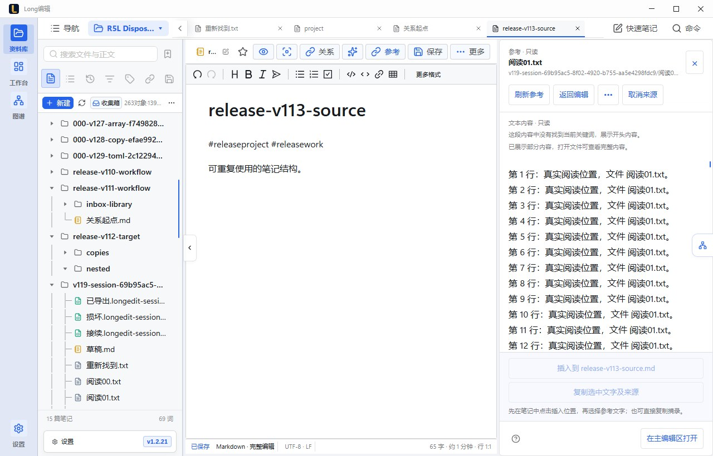
</p>

<p align="center"><sub>真实安装版工作区：紧凑导航、稳定的多文档标签与主编辑区，把更多空间留给内容。</sub></p>

## 开发进展

v1.2.21 已发布；v1.2.22 正在完成 TOML 字段新增与删除，尚未发布。见[开发记录](docs/V1_2_22_Unsigned_Community_Release_Audit_2026-10-24.md)。

## 不只是打开文件，更是接续你的工作

> **v1.2.21 已正式发布**：YAML 字段右键新增／删除，自动使用当前映射，差异预览后应用到草稿，保留注释、其他字段及未保存内容。[下载安装](https://github.com/Longyuyeee/Long_MarkDownReader/releases/tag/v1.2.21) · [发布说明](docs/RELEASE_NOTES_v1.2.21.md)。


文件可能分散在笔记、报告、配置、表格和图片里，思路却不应该被文件类型切碎。Long编辑以本地目录为资料库，在同一套导航里连接不同的阅读与编辑工作区：先找到资料，再理解内容，最后把自己的记录留在合适的位置。

<table>
  <tr>
    <td width="33%" valign="top"><h3>📚 一个资料库，多种内容</h3><p>文本、数据、Office、PDF、图形与媒体按类型进入对应工作区，不用把所有文件先转成笔记。</p></td>
    <td width="33%" valign="top"><h3>🔎 找到资料，边看边写</h3><p>搜索结果默认打开在主编辑区；需要对照时主动打开参考区，选文与来源可插入 Markdown。</p></td>
    <td width="33%" valign="top"><h3>🧭 看见知识之间的连接</h3><p>通过链接、反向链接、图谱、思维导图与 Canvas，把文件从列表变成可以探索的关系网络。</p></td>
  </tr>
  <tr>
    <td valign="top"><h3>📝 灵感落在合适的位置</h3><p>快速笔记直接选择资料库、保存位置与模板，不要求先收集、再额外归档。</p></td>
    <td valign="top"><h3>🗂️ 保存工作现场</h3><p>给一组打开的文档和视图命名，切换项目后再继续；智能集合让常用筛选随资料变化。</p></td>
    <td valign="top"><h3>🎨 把工作区调成喜欢的样子</h3><p>主题、控件质感、动效、字体与排版独立调整，文件列表也可以有自己的颜色和图标。</p></td>
  </tr>
</table>

### 适合怎样的工作？

| 你的任务 | 可以这样使用 |
| --- | --- |
| 学习、阅读与摘录 | 搜索课程资料，在侧边参考报告或 PDF 提取文字，把选文和出处整理到 Markdown 笔记 |
| 项目资料与会议记录 | 为项目建立资料库，用模板记录会议，保存工作现场，并用智能集合追踪相关文件 |
| 技术文档与配置整理 | 在同一资料库中阅读 Markdown，检查 JSON 结构，编辑 YAML/XML/TOML 和轻量代码源码 |
| 表格与报告审阅 | 打开 CSV、Table、XLSX、PDF 与 Office 工作区，按实际能力编辑或生成可靠副本 |
| 灵感、方案与知识组织 | 用 OPML、Canvas、Mermaid、Draw.io 表达思路，再通过知识图谱探索已有资料之间的联系 |

Long编辑不是完整的 Office 套件、IDE 或专业媒体编辑器；具体可编辑范围见下方[格式能力](#格式能力)。

## 下载

<p>
  <a href="https://github.com/Longyuyeee/Long_MarkDownReader/releases/tag/v1.2.21"></a>
  <a href="https://github.com/Longyuyeee/Long_MarkDownReader/releases/latest"></a>
</p>

当前公开稳定版为 **v1.2.21**，支持 Windows 10/11 x64。

| 安装方式 | 下载 | 适用场景 |
| --- | --- | --- |
| NSIS 安装程序 | [LongEdit_1.2.21_x64-setup.exe](https://github.com/Longyuyeee/Long_MarkDownReader/releases/download/v1.2.21/LongEdit_1.2.21_x64-setup.exe) | 推荐，大多数用户 |
| MSI 安装程序 | [LongEdit_1.2.21_x64_zh-CN.msi](https://github.com/Longyuyeee/Long_MarkDownReader/releases/download/v1.2.21/LongEdit_1.2.21_x64_zh-CN.msi) | 管理部署或 MSI 工作流 |
| 校验与说明 | [Release v1.2.21](https://github.com/Longyuyeee/Long_MarkDownReader/releases/tag/v1.2.21) | Release Notes 与 SHA-256 |

> 社区版暂未使用 Authenticode 商业证书，Windows 可能显示“未知发布者”或 SmartScreen 提示。请只从本仓库的 GitHub Release 下载，并使用同页 [`SHA256SUMS.txt`](https://github.com/Longyuyeee/Long_MarkDownReader/releases/download/v1.2.21/SHA256SUMS.txt) 核对文件；不需要关闭系统安全防护。

<details>
<summary>展开安装包 SHA-256 与本机核对方法</summary>

在 PowerShell 中进入下载目录，核对实际文件的哈希值：

```powershell
Get-FileHash -Algorithm SHA256 .\LongEdit_1.2.21_x64-setup.exe
```

```text
b8733946382f916408938de5d3357684c84fe7402e18badae3ffba8db25246df  LongEdit_1.2.21_x64_zh-CN.msi
99701caf6627e265fb244a0e20b93ab5cdc668b89384cb0b2e8e9832be05c863  LongEdit_1.2.21_x64-setup.exe
```

</details>

应用可每 24 小时检查更新，也可在设置中手动检查；自动更新始终需要确认，并校验安装包大小与 SHA-256。v1.0.4 及更早版本需先手动安装当前版本。

## 快速开始

1. **安装并启动**：普通用户优先选择上面的 NSIS 安装程序。
2. **选择资料库**：添加一个本地目录，或选择已有资料库；顶部资料库名称可展开切换列表。
3. **打开你的第一份资料**：从文件树选择文件，或在“搜索文件与正文”中查找；结果默认在主编辑区打开。
4. **创建自己的记录**：点击“快速笔记”，选择资料库、保存位置与模板，再记录内容。
5. **按需要打开参考**：搜索结果旁选择“在侧边参考”，对照阅读不会替换当前草稿。
6. **确认保存与接续**：可编辑草稿使用“保存”或 `Ctrl+S` 写入；在工作台保存命名工作现场，方便之后继续。

刚开始不必配置所有选项。先选资料库、打开文件、写一份笔记，等需要时再使用集合、图谱和个性化设置。

## 日常工作流

### ① 找资料 → 打开 → 对照 → 写自己的内容

搜索和参考是两种不同意图，界面明确区分：

| 你点击的操作 | 内容出现的位置 | 是否替换当前内容 |
| --- | --- | --- |
| 搜索结果的打开操作 | 主编辑区，进入对应格式工作区 | 切换到目标文档；未保存内容受保护 |
| “在侧边参考” | 独立的只读参考区 | 不替换当前草稿 |
| 将参考选文及来源插入 | 当前 Markdown 的插入位置 | 插入可撤销，仍需手动保存 |

打开自己的 Markdown 笔记并选定插入位置后，可将参考选文及来源直接插入。参考区在窄窗口自动改为上下布局，避免把正文挤得过窄。

参考展示磁盘上的部分文字；PDF 参考为提取文字，完整版面可在主编辑区打开。支持手动刷新和失效来源重新关联；阅读位置、搜索条件和参考资料身份按资料库记住，重启后重新读取内容，不保存参考选文，不自动跟踪全库重命名。

资料库搜索与 `Ctrl+P` 命令面板使用相同的关键词规则：`项目 预算 -旧版` 要求同时含前两个词，并排除“旧版”；`"交付范围"` 匹配连续短语。命令面板可选择当前资料库或全部已配置资料库，不扫描整台电脑。结果按文件分组，可继续搜索、加载更多文件，并按相关性或修改时间排序，不再把旧的前 200 个命中当作全部。跨库逐库显示状态，离线、不可读或达到处理预算不会假装成完整空结果；源资料变化后，保留已加载结果并在底部原位置提供重新搜索。跨库打开前请先保存当前草稿，软件不会代存或丢弃修改。

### ② 想到就记，保存时就选好位置

快速笔记可直接选择**资料库、保存位置和模板**。日常记录可以留在收集箱，也可以直接放入项目目录，不需要强制进行额外的归档操作。保存失败会保留内容，重试不会因为同一次保存操作而重复创建笔记。

收集箱从“新建笔记”开始使用，首次新建会自动准备文件夹。空目录与暂时无法访问会明确区分；路径失效时可重试或更换位置，继续使用其他区域。

### ③ 把常用筛选变成智能集合

智能集合是动态查找资料的视图，不是另一份文件副本。按目录、标签、时间、对象类型和关键词组合条件，源资料变化后重新查询，即可得到符合条件的内容。

例如：为项目相关资料建立集合，或把某个目录里带指定标签的笔记集中查看。文件依然留在原来的目录，不需要为了加入集合而搬家。

默认先看“我的集合”，也可以从最近修改、全部笔记或标签示例开始；需要新建或调整时再展开筛选条件。文内标签则用于按主题找笔记，点击标签即可查看相关笔记。

集合结果按文件归组，可继续加载；名称、路径、修改时间和相关度针对整个查询排序，而不是只排当前一页。刷新失败保留已看的结果和滚动位置，未提交条件切换侧栏后仍可继续。统计尚未查全会明确提示，不将部分数量当总数。

需要整理标签时，可选最多 64 篇笔记，先预览添加、改名或移除的影响，再明确确认。它会修改已保存的 Markdown 正文（包含代码块中的同名标签），不移动文件、不改其他集合条件、不自动代存草稿。未保存或外部变化的文件受保护；写入前保留原文历史，部分失败逐项显示已完成、未执行或需核对，不自动全量重试。

### ④ 保存现场，下次从这里继续

在工作台给当前工作现场命名，保留资料库内打开的文档标签、当前选中文档和支持的视图状态。切换任务后，再选择对应现场继续阅读与整理。

换电脑或调整资料目录时，从“管理现场”导出，再在另一处导入并选择目标资料库。软件先列出可用与缺失文件，可重新定位、先保存记录或继续可用部分；缺失项不会静默删除，相同来源不会重复添加。导出只记录库内相对路径、顺序、固定标签与阅读位置，默认不携带搜索和参考，勾选后才包含；文件名和搜索词仍可能涉及隐私，请谨慎分享。

**工作现场不保存正文或未保存草稿，也不是文件备份。** 换机需另行复制原文件，或使用[资料内容备份](docs/Content_Backup_User_Guide.md)迁移所选资料；恢复现场时，当前未保存的标签和活动文稿受保护，不会自动代存。新迁移文件最多 128 份资料、256 KiB，超过正文缓存数量的阅读位置按需恢复。

### ⑤ 先看历史差异，再决定如何恢复

Markdown 和资料库内 TXT 的历史提供差异预览，区分当前来源与历史版本的增删内容。可以恢复为独立副本，也可以在保护当前草稿后替换编辑区；完整差异块还可点击“恢复此处”，只找回需要的一段，保留其他修改。恢复可撤销，仍需手动保存；简化或截断的差异不提供局部恢复。

恢复前会核对当前文件与历史来源是否变化。发现来源过期时先拒绝执行，而不是用旧结果覆盖新内容。本版不把这一能力泛化为所有格式的历史恢复。

也可以查找历史正文和备注，按日期回看、跳转差异，通过条目右键保留重要版本。Markdown/TXT 保存遇到外部修改时，直接比较后继续编辑、另存副本，或先保护草稿再读取磁盘版本；普通 Markdown 保存会保留修改前后快照。重要版本保留在本机历史缓存中，不是独立备份，迁移或清理缓存前应另行备份。

### ⑥ 给不同类型的资料建立关系

在文档工具栏“专注”旁点击 **添加关系**，选择另一份文件和关系类型，按需补充说明，保存后即可在图谱中看到联系。PDF、表格、图片和其他附件也能使用，不需要先写 Markdown 链接；图谱顶部及选中文件后也有同一入口。

关系页直接查看当前文件的手动关系，通过每条关系的菜单修改类型和说明或移除；“我提到的 / 提到我的”继续查看正文引用，图谱用于查看整个资料网络。手动关系关联当前资料库内的整份文件，单独保存于 `.longedit/file-relations.json`，原文保持不变；整体搬迁资料库时请保留此目录，应用内改名或移动会同步关系位置。

### ⑦ 整理文件，删错也能找回

在文件栏右键选择“移动到”“复制到”或“创建副本”；按住 Ctrl/Shift 多选后可一次处理多项。目录选择使用弹窗，输入新目录会自动创建，重名时保留两份。移动后，打开的文档、收藏、关系和显示样式继续跟随。

多选文件后右键选择“批量重命名…”，可添加前后缀、查找替换或添加序号。先预览原名称、新名称和冲突，再执行；保留 `.table.json` 等复合扩展名，失败时只重试未完成项目。改名、移动和回收恢复在系统执行时仍拒绝覆盖其他程序刚创建的同名内容。

文件右键“更多操作 → 管理附件…”或文档操作菜单，可查看当前 Markdown 草稿的引用、位置和失效状态，按文档修复引用；原附件与库外原件保留，仍需保存笔记。[附件管理用法](docs/Attachment_Management_User_Guide.md)。

文件栏空白处右键“最近操作…”可查移动、改名和复制记录，文件右键位于“更多操作”中；重启后继续查看位置、按项还原。“撤销上次移动”保留当前会话的批次撤销，重启后进入持久记录选择还原项。后续编辑或同名冲突会保留现状；复制只查看，清除记录不删除文件。

普通删除进入资料库回收站，可从文件栏空白处右键或“更多操作”打开回收站恢复。剪切、复制和粘贴使用应用内当前资料库的文件剪贴板。回收内容保存在资料库的 `.longedit/trash`，整理记录保存在 `.longedit/file-operations`；整体搬迁资料库时请一并保留 `.longedit`。

外部文件拖入资料库时，同名正文和图片保留两份，不覆盖已有资料。Markdown 的普通本地图片复制到独立 `.assets` 目录，原文和原图不变；多文件导入逐项反馈，只重试未完成项。若文件已经导入、只是目录刷新失败，刷新列表即可，不需要重新导入整批文件。外部笔记有未保存修改时须先保存，再存入资料库。

图片迁移限 UTF-8 Markdown、单份 20 MiB、512 处所选文档目录内的普通相对图像路径。缺失、越界或无法可靠识别的资源明确失败；不承诺搬迁任意附件、文档超链接，或后续单独移动文档时自动重写资源引用。完整边界见[安全导入说明](docs/RELEASE_NOTES_v1.1.5.md#支持边界)。

### ⑧ 让经常写的内容成为模板

在“新建 → 笔记模板 → 管理模板”新增或修改模板，也可从当前 Markdown 的“文档操作 → 保存为模板…”保存当前草稿。支持标题、日期、时间变量；默认模板按资料库选择，快速笔记可复用。模板保存在本机，管理备份不包含模板正文。

需要换电脑或分享模板时，在模板管理的“更多操作”导出当前模板或全部已保存模板；导入时勾选、预览正文，同名项可保留两份或跳过。模板文件保留变量，不携带本机目录和资料库默认设置；原有模板及未保存编辑保持不变。

需要填写作者、项目等字段时，选“填写模板后新建…”，核对资料库、目录和预览后创建；模板可写 `{{param:作者}}`，未知变量保留，字段内容不会再次展开成变量。原有一键创建和快速笔记流程不增加必填步骤。

文章写好后，从 Markdown 的“导出”先预览当前草稿：**独立 HTML** 携带授权本地位图，换目录也能阅读；**Markdown 仅正文** 保留原图片引用依赖；**打印 / PDF** 在原生打印页选择浏览器“另存为 PDF”，保存后核对文件。不同虚拟打印机的文字层可能不同，页眉页脚可能包含来源路径，可在更多设置关闭。图片可通过“更多格式 → 本地图片…”、粘贴或拖入编辑区，按相对路径复制到文档旁的资源目录；不搬走共享图片，不自动下载在线图片，不代存原稿，也不覆盖已有交付文件。[操作说明与资源边界](docs/Writing_Delivery_User_Guide.md)。

标签右键可固定、关闭其他/右侧未固定标签或恢复关闭；可拖动排序，使用 Ctrl+Shift+T 恢复最近关闭的文档入口。Markdown 和文本保留阅读位置；已明确放弃的未保存内容不会随关闭入口恢复。文内标签可右键固定常用项，智能集合支持顺序调整和多个标签同时筛选。

### ⑨ 把 PDF 批注整理成可追溯笔记

在 PDF 侧栏“批注”按页码、颜色、类型和摘录/评论筛选，勾选需要的条目后“整理为笔记”。预览保留原页、摘录、可选评论及来源；可按页码或颜色组织。每组列表50条，每次最多200条，隐藏选择会显示数量，不会静默丢掉勾选。

插入时看清目标文件名和所属文件夹，只追加到最新草稿，不替你保存；也可选择库内新名称创建笔记，已有文件不会被覆盖。原 PDF 和批注不因整理笔记而被改写。

在 Long编辑 中点击笔记来源，先核对内容摘要再返回原页/批注；同名替换不会被当成原来源。文件移动后可明确验证新相对路径、只重新关联草稿，仍需手动保存。旧链接和已删批注会在侧栏顶部说明情况。[完整用法](docs/PDF_Reading_Notes_User_Guide.md)。

### ⑩ 从复制一片表格，到放心保存

在 CSV、TSV 或开放 Table 中，单击照常编辑；**Shift＋点击**选择可见多格，直接粘贴多行多列，或复制、清空选区。筛选后的隐藏行保持不变；贴错了，用 **Ctrl+Z** 一次撤销整批，再用 Ctrl+Y 重做，排序后仍定位到原来的行。

多行单元格显示换行标记，点旁边的 **↵** 打开文本区，确认后只是写入草稿，仍由你点击保存。保存、重开和导出时保留中文、空尾格、前导零与长编号；XLSX 导出的公式外观文本保持文本。CSV 本身没有列类型，其他软件可能自行解释，请核对导入方式。

单次剪贴板最多 2 MiB／20,000 格，历史最多 100 次／8 MiB；新增列与视图配置不属于数据撤销。范围或容量超限会整次拒绝，不留下贴了一半的结果。[完整操作与边界](docs/Lightweight_Table_User_Guide.md)。

### ⑪ 让已有 XLSX 接着填、筛、保存

选中工作簿区域后直接 Ctrl+C / Ctrl+V，带引号、换行和空尾格的文本保持字段边界，前导零与长编号保留文本类型。应用内复制区分普通文本与真实公式：复制公式按目标平移相对引用，剪切移动保持原引用；纯文本菜单另明确标为“粘贴文本（自动识别）”。输入框中的删除、复制和粘贴仍属于输入框，点击网格后再用方向键移动。

在“数据、Table 与规则”筛选和排序后，点击“复制筛选结果”，一次复制表头与匹配行，不混入其他行、不重排原网格。Ctrl+C仍复制选区。数字种子填充可可靠接续`0.1、0.2、0.3`，文本编号不当数字序列；粘贴和填充可整批撤销，最后仍需显式保存。

工作面前256列、每批10,000格及文本/类型记录各10MiB等边界保留，复杂内容仍按公开兼容矩阵处理，不宣称完整Excel等价。[实际入口、保存与兼容边界](docs/Workbook_Editing_User_Guide.md)。

## 真实界面

主图、模板、TXT 恢复、文件整理与图谱截图来自 **v1.2.21 真实安装版**。其余旧版截图保留版本标注，用于说明对应功能；测试库名称和原始截图文件名中的历史版本文字不代表当前软件版本。

### 模板与文本历史

<table>
  <tr><td width="50%">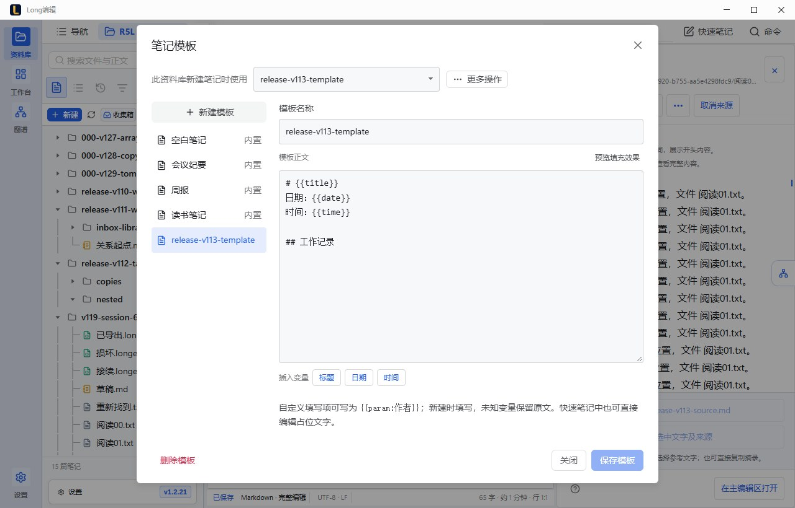</td><td width="50%">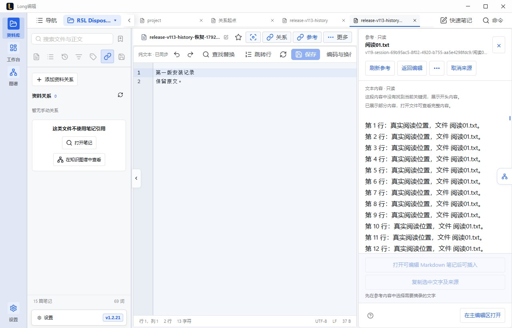</td></tr>
  <tr><td align="center"><sub>在弹窗中编辑模板与变量</sub></td><td align="center"><sub>TXT 恢复副本，保留原文件</sub></td></tr>
</table>

### 文件整理与回收

<table>
  <tr><td width="50%">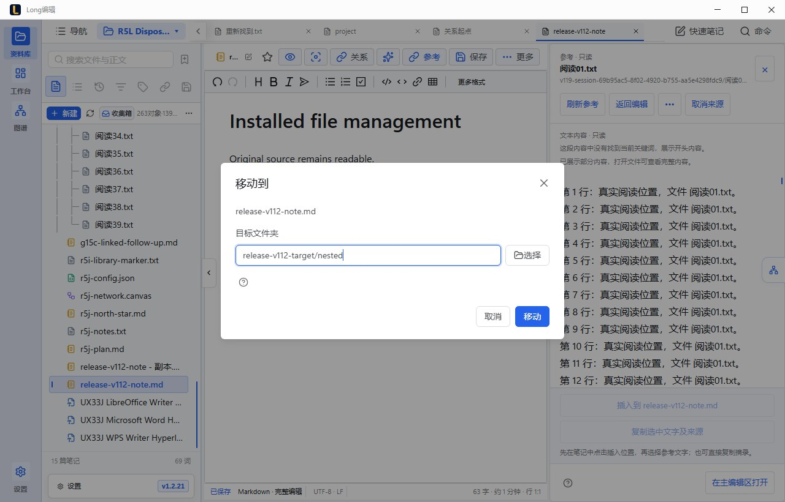</td><td width="50%">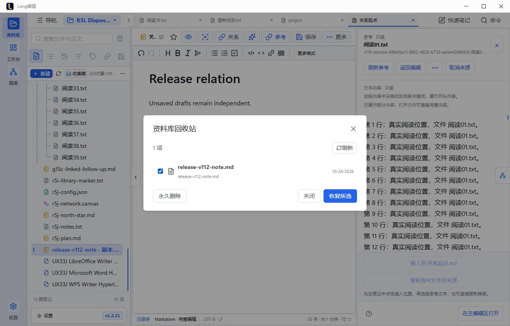</td></tr>
  <tr><td align="center"><sub>选择或输入目标目录</sub></td><td align="center"><sub>在回收站选择恢复</sub></td></tr>
</table>

### 专业编辑工作区

文件树保留完整扩展名并按类型使用不同图标；顶部标签支持多文档切换和横向滚轮导航。编辑器、状态栏与上下文工具共享一致的主题和保存状态。

<p align="center">
  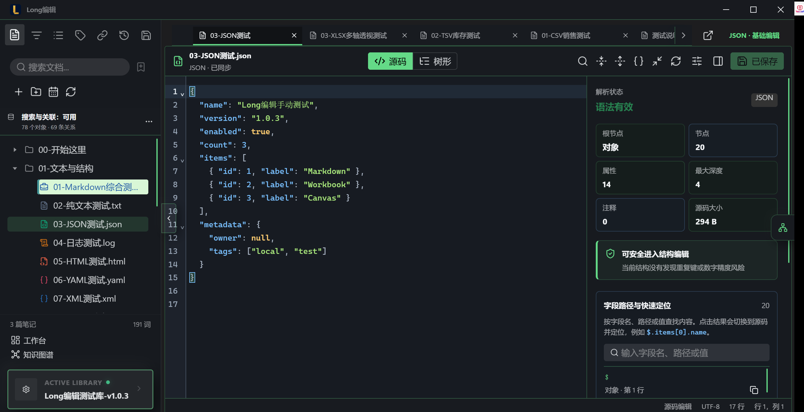
</p>

<p align="center"><sub>历史安装场景 · JSON 源码、解析状态与字段路径；新版采用开头所示的统一导航。</sub></p>

JSON、YAML、XML、TOML 与代码文件使用专业源码编辑体验。JSON 还提供虚拟化树形查看、结构诊断、字段路径定位和明确的安全编辑提示。TOML 与 YAML 简单值可右键“修改值…”，预览后应用到草稿；只替换当前字面量，保留其他排版与注释。打开 XML 的“元素与问题”，可在结构提纲中右键元素，选择“修改属性…”，弹窗选择已有属性并编辑可读值，预览后应用；支持特殊符号、空值和多行，保留原引号与其他属性。XML 同一提纲可右键“修改文字…”，支持连续普通文字、CDATA 和成对空元素，保留其他节点与排版；复杂内容继续使用源码。XML 提纲还可右键复制元素与上移/下移，预览后保留完整原文调整同级内容。XML 提纲还可右键删除元素，预览后移除完整子树，保留其他原文。XML 属性弹窗还可新增与移除普通属性，无属性元素也可使用，预览后应用到草稿。XML 提纲还可右键添加子元素与重命名元素，必要弹窗和差异预览后应用到草稿，保留原前缀与其他原文。结构化源码改回已保存原文后会正确恢复保存状态，保存期间后续输入仍受保护。YAML 数字提纲按原文显示长数字与原有记法。

### 表格与工作簿

<p align="center">
  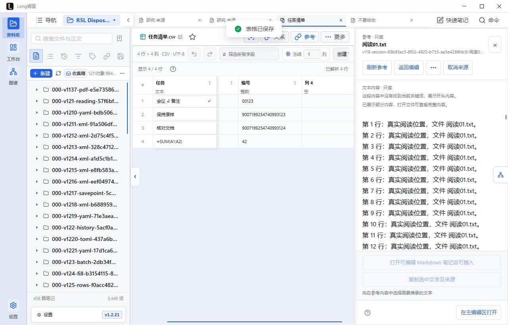
</p>

<p align="center"><sub>v1.2.21 真实安装版 · 多行按需编辑，CSV 重开与编号保留；原有 XLSX 工作区继续保留。</sub></p>

<p align="center">
  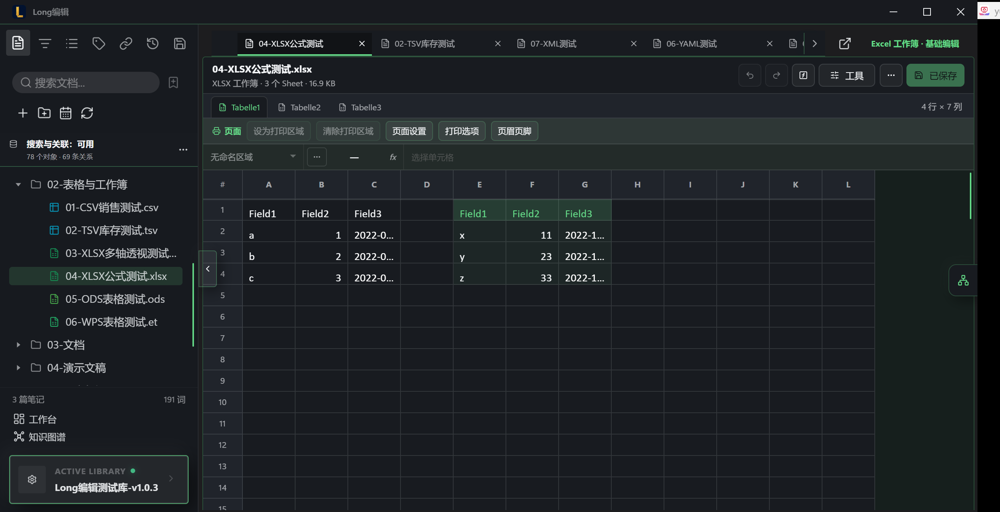
</p>

<p align="center"><sub>历史安装场景 · XLSX 多工作表、公式栏与页面工具。</sub></p>

CSV、TSV 与开放 Table 提供网格、冻结前 N 列、看板、导入导出和显式转换；CSV/TSV 创建 Table 副本前会说明来源、候选目标、不覆盖策略与转换损失，完成后自动打开实际目标，源文件保持不变。XLSX 工作区提供多工作表、公式、样式、图表、筛选、页面设置、经典错误值和已有日期时间单元格的有界编辑。

### 知识图谱与思维导图

<p align="center">
  
</p>

<p align="center"><sub>v1.2.21 安装场景 · 关系网络与知识图谱治理面板；数据来自独立测试资料库。</sub></p>

知识图谱把文件、标题、链接与 Canvas 节点组织成可交互网络。支持稳定后自动全图适配、搜索、筛选、多种布局与主题、框选和拖动、缩放、适应当前选择、有界且尊重减少动效设置的选择反馈、可点击/拖动/键盘操作的语义缩略导航、右键操作、中心节点、视图保存以及 SVG/PNG 导出；密集中景会主动降低普通箭头和状态环噪声，近景仍保留方向语义。

### 设置、主题与资料库

<table>
  <tr>
    <td width="50%">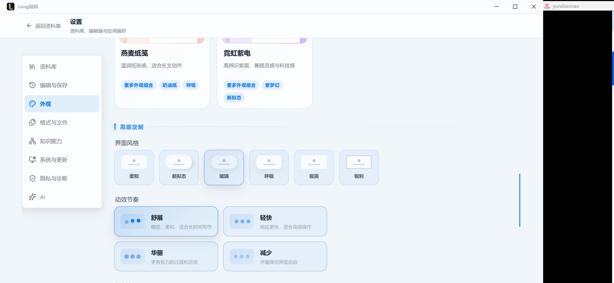</td>
    <td width="50%">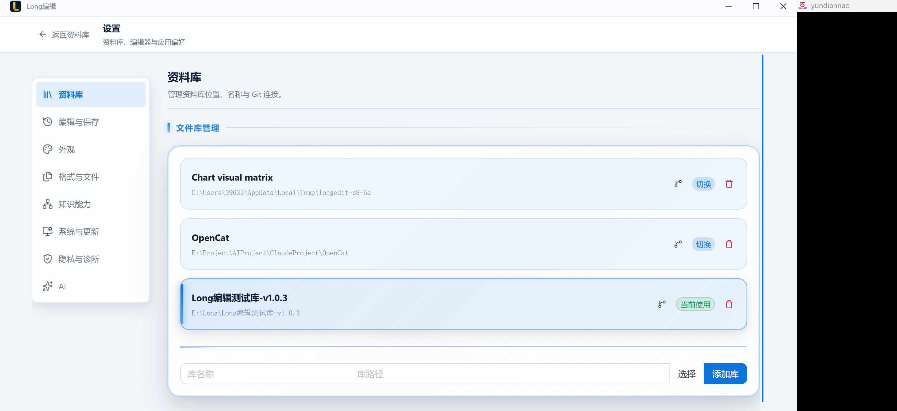</td>
  </tr>
  <tr>
    <td align="center"><sub>历史安装场景 · 主题、界面风格与动效节奏</sub></td>
    <td align="center"><sub>历史安装场景 · 多资料库管理与切换</sub></td>
  </tr>
</table>

设置按资料库、编辑与保存、外观、格式与文件、知识能力、系统与更新、隐私与诊断、AI 分类。主题不仅切换颜色，也统一编辑器、表格、画布、弹窗、选择器、光标和焦点状态。

## 核心能力

| 工作方向 | 已提供的体验 |
| --- | --- |
| 本地资料库 | 多资料库、文件树、全文搜索、标签、保存视图、历史、管理备份、资料内容备份与新目录恢复 |
| 专业编辑 | 多标签、撤销/重做、显式保存、外部修改冲突保护、语法诊断 |
| 知识组织 | 文内标签、智能集合、引用、反向链接、跨格式手动关系、知识图谱、思维导图、JSON Canvas、关系定位 |
| 表格数据 | CSV/TSV/Table 网格与看板，XLSX/ODS 工作区和有界高级对象支持 |
| 文档与演示 | PDF 阅读与页面工具，DOCX/PPTX 阅读、受控草稿和可靠副本 |
| 图形与媒体 | Mermaid、Draw.io、SVG、图片基础编辑器，以及支持逐帧、截图、位置记忆和同名字幕的流式视频播放器 |
| 外部打开 | 支持格式使用独立顶层窗口，不占用主资料库窗口或增加内部标签 |
| 个性化 | 核心主题、场景预设、外观组合、文件颜色与图标标记 |

所有可编辑格式都遵守同一条原则：修改先保留在草稿中，只有点击保存或按 `Ctrl+S` 才写回源文件。只读、可靠副本、显式转换和外部程序交接会在界面中明确说明。

### 阅读与写作：让内容处在中心

- Markdown 支持所见即所得、IR 与源码模式，常用格式工具、正文宽度、导出和历史靠近编辑区。
- 多文档标签与快速笔记、命令入口共享紧凑顶栏；点击切换不改变标签顺序。
- 当前文档名称可以点击改名，不必只从文件树寻找重命名操作。
- 专注模式减少周围导航干扰；需要参考时主动展开，不默认占用正文空间。
- 历史快照与正文保存分开：快照用于保留历史，不能代替对源文件的明确保存。

### 资料组织：从目录，到集合，再到关系

- 多个本地目录可以分别作为资料库，切换时保护未保存内容。
- 文件、目录、最近访问、大纲、标签、集合、关系与历史保留各自入口。
- 文件树通过缩进与层级引导表达父子关系；文件可使用独立图标、文字颜色和背景标记。
- 搜索、保存视图与智能集合用于找到内容；链接、反向链接与图谱用于理解联系。
- 点击“添加关系”即可关联库内任意类型文件；不改变该格式原有的阅读、编辑或只读范围。
- 路径暂不可用时可以重试；重新读取失败会保留当前未保存内容，不把空内容误当作读取成功。

### 结构与源码：为数据提供专用工具

- JSON/JSONC 支持源码与结构查看、字段路径定位、结构风险提示，以及有界的本地 JSON Schema 辅助。
- 大 JSON 渐进只读，使用分段导航和流式搜索，不强行构建全文树形或写回。
- YAML、XML、TOML 提供源码、结构导航与轻量诊断，不冒充完整 Schema 服务。
- 代码与配置文件提供语法高亮和轻量编辑工具，不执行程序、不提供编译或调试环境。
- `.env` 的敏感变量值默认遮罩，并排除全文索引与知识图谱；查看和编辑需逐文件明确确认。

### 表格、文档与演示：只开放已验证的编辑范围

- CSV/TSV/Table 支持网格、冻结列和看板；转换创建新副本并先披露损失，不直接覆盖来源。
- XLSX 提供工作表、公式、样式、图表、筛选及页面工具，复杂结构按能力限制写回。
- DOCX/PPTX 提供受控的基础对象、文字与样式编辑，并通过预览、冲突检查和输出复读保护保存。
- PDF 页面提取、合并、插入、重排和旋转生成副本；批注与 OCR 结果以独立附加文件保存。
- PDF 表单、文字水印、属性及永久脱敏仅开放已验证子集；永久脱敏使用图片型输出，会失去文字搜索与交互能力。

### 图形、导图与媒体：不同表达，统一入口

- 知识图谱侧重探索已有资料之间的关系；思维导图、Canvas、Mermaid 和 Draw.io 用于主动构建表达。
- OPML 可以在披露转换边界后生成独立 Canvas 投影，不与来源自动同步。
- SVG 提供源码与净化预览，限制危险协议和外部资源。
- 图片提供缩放、平移，以及支持格式的基础裁剪和调整；编辑结果另存为副本。
- 视频采用流式播放，支持逐帧、截图、位置记忆和同名字幕，不承担专业剪辑或转码。

### 可选 AI：按自己的服务配置

设置中可配置兼容 OpenAI API 格式的服务，包括本地 Ollama 回环地址；API Key 使用操作系统凭据库存储。AI 并非使用资料库的必要条件。

使用远程服务时，请把相关请求内容视为会发送到你配置的服务提供方，先确认隐私与费用；“本地优先”不代表远程 AI 请求也在本机完成。

## 格式能力

当前注册 **43 类格式、91 个扩展名**，映射到 11 套发布能力配置：30 类已验证、7 类有限能力、6 类依赖外部程序。

| 格式族 | 主要能力 | 明确边界 |
| --- | --- | --- |
| Markdown / TXT / LOG | 所见即所得或源码、搜索、撤销与显式保存 | LOG 大文件优先使用专业查看模式 |
| JSON / YAML / XML / TOML / 代码 | 按格式提供语法高亮、结构导航、轻量诊断和保存；JSON 提供字段路径与本地 Schema 辅助 | 大 JSON 渐进只读、分段导航和流式搜索；HTML 预览经过净化和 sandbox，不执行脚本；不是 IDE 或通用 Schema 服务 |
| CSV / TSV / Table | 网格、冻结列、看板、转换、导入导出 | 不承诺复杂 Excel 对象语义 |
| XLSX | 工作表、公式、样式、图表、筛选与有界类型编辑 | 仅正式注册 `.xlsx`；宏不执行，部分高级结构只读或保存可靠副本 |
| DOCX / PPTX | 阅读、受管草稿、经验证的基础对象与文字/样式编辑，以及可靠保存 | 不宣称完整等价 Microsoft Office；复杂对象与高级排版按边界处理 |
| PDF | 阅读、搜索、批注、OCR 附加文件、页面副本及有界表单/水印/脱敏 | 原文不覆盖；不是通用内容重排编辑器，永久脱敏图片副本会失去搜索与交互 |
| Mermaid / Draw.io / SVG | 查看、编辑、画布操作与安全保存 | 外部资源和危险协议会被阻断 |
| OPML / JSON Canvas | 思维导图、卡片与关系画布；OPML 可在完整披露后生成独立 Canvas 投影 | 修改需显式保存；投影副本不与源文件自动同步 |
| 图片 | PNG、JPEG、GIF、WebP、BMP、ICO、AVIF | 查看支持光标锚定滚轮缩放、拖拽平移和双击 100%/适应窗口；PNG/JPEG/WebP/BMP 可旋转、翻转、精确裁剪、缩放、调整亮度/对比度/饱和度、转换并另存副本；GIF/ICO/AVIF 与外部图片只读 |
| 视频 | MP4、WebM、OGV、M4V 及五种系统解码入口；资料库视频支持逐帧、PNG 截图、位置记忆和同名 VTT/SRT 字幕 | MOV/MKV/AVI/MPEG/MPG 取决于系统解码器；不提供嵌入字幕拆封、字幕编辑或转码 |
| ODS / ODP / 旧 Office / WPS | ODS 支持简单值和已有命名样式的可靠副本，ODP 支持简单正文页的可靠副本；旧 Office 转换，WPS 原生格式交给外部程序 | ODS 公式与自定义样式只读；ODP 复杂对象整页阻断，备注、版式、动画及外部打开只读；`.wps/.et/.dps` 不在软件内编辑 |

格式事实源位于 [`shared/file-formats.json`](shared/file-formats.json)，发布边界位于 [`shared/release-capability-matrix.json`](shared/release-capability-matrix.json)。

“43 类格式”是注册格式族数量，不是 43 种完全等价编辑器。“30 类已验证”也不意味着所有功能都可无损写回。软件按具体格式显示完整编辑、有限编辑、只读、可靠副本或外部依赖；格式能力页可查看实际支持范围。

## 设计原则

- **本地优先**：文档、索引和知识关系默认留在本机，不要求云端账号。
- **显式保存**：编辑不会在后台悄悄覆盖源文件，危险覆盖和格式降级需要确认。
- **能力诚实**：完整编辑、有限编辑、只读预览、可靠副本和外部依赖不会混为一谈。
- **恢复优先**：外部修改、路由错误和索引损坏提供比较、重载、隔离或重建路径。
- **用户控制**：默认应用、自动更新、外部程序接管和删除操作都由用户明确触发。
- **隐私可审计**：诊断和管理备份移除文档正文、完整路径、API Key、凭据与缓存正文。

### 保存、恢复与备份不是同一件事

| 机制 | 保存什么 | 不能替代什么 |
| --- | --- | --- |
| 正文保存 | 明确写入支持格式的文件内容 | 不能替代跨设备备份 |
| 历史快照 | 支持格式的历史内容，供比较与恢复 | 不能代替点击“保存” |
| 工作现场 | 资料库内文档身份、标签与支持的视图状态 | 不保存未保存的正文草稿 |
| 阅读与参考记忆 | 阅读位置、搜索条件和参考来源身份 | 不保存参考摘录正文，不保证自动跟踪所有改名 |
| 管理备份 | 脱敏设置与能力合同，恢复时重新映射本机资料库 | 不备份实际文档、API Key 或操作系统凭据 |
| 资料内容备份 | 所选已保存文档/数据、附件、PDF 批注及可选 Markdown/TXT 历史 | 不含未保存草稿，不是整份应用环境镜像，也不是加密包 |

在“设置 → 隐私与诊断 → 资料内容备份”选择整库或子目录，先核对数量、大小和未包含清单，再导出新 ZIP。恢复时完整校验后写入全新目录，保留相对资源、配套批注和选中历史；完成后由你自行添加资料库，不自动切换或覆盖当前草稿。

内容包最多 512 MiB（未压缩）、单文件 128 MiB、10000 个文件条目，大库可按子目录分包；历史默认不选。内容未脱敏、未加密，可能包含私人资料，请妥善保管。应用配置/缓存重叠范围会拒绝备份，网络共享和断线恢复不在本版验收范围内。详见[操作说明与边界](docs/Content_Backup_User_Guide.md)。

换电脑时可使用内容备份迁移所选资料，或另行复制/同步实际资料目录；只带走管理备份或工作现场，不代表文档也已经迁移。

## 主题与交互

个性化不止是切换明暗。配色、界面质感、正文排版和文件标记可以分开调整，既能一键选择，也能继续 DIY。

| 调整层次 | 可选择的方向 |
| --- | --- |
| 核心与场景预设 | 专业浅色、专业深色、高对比；长文阅读、护眼研读、编码专注、创意图谱 |
| 配色与界面质感 | 19 个注册主题与外观组合；柔和、霓虹、玻璃、轻盈、极简、锐利等质感 |
| 文档显示 | 跟随风格、简洁、纸张、排版，按阅读习惯选择 |
| 字体与排版 | 正文字体与代码高亮主题；正文 12–28 px、行距 1.3–2.4、字距、段后间距、左对齐或两端对齐 |
| 文件列表 | 紧凑、舒适或宽松密度，平面或卡片行，彩色或单色图标 |
| 单个文件标记 | 独立图标、背景标记和文字颜色，保留主题下的选中辨识 |
| 动效与辨识 | 沉稳、利落、表现力或减少动效；高对比预设强化文字、焦点和边界 |

正文字体可选择无衬线、衬线、等宽、微软雅黑、宋体、楷体、仿宋、思源/Noto、Consolas，或填写自定义已安装字体名称。字体需要本机实际安装，缺失时自动回退，软件不会替你下载所有字体。

显示设置提供实时预览，**只改变阅读显示，不改写文档正文**。PDF 和 Office 继续保留原文档排版。主题库会合并视觉配置重复的组合，注册组合数不等于界面中完全不同的主题卡片数量。

紧凑工具栏和标签支持横向滚轮导航；左侧导航根据可用宽度在“图标 + 文字”和纯图标之间自适应。动效用于提示状态，不要求用户依靠动画才能理解操作。

## 常用操作与快捷键

| 快捷键 | 操作 |
| --- | --- |
| `Ctrl+S` | 保存当前草稿 |
| `Ctrl+P` | 打开命令面板 |
| `Ctrl+Shift+T` | 重新打开最近关闭的文档标签 |
| `F11` | 切换专注模式 |
| `Ctrl+C` / `Ctrl+X` / `Ctrl+V` | 文件区域内复制 / 剪切 / 粘贴所选项目 |
| `F2` | 文件区域内重命名 |
| `Delete` / `Shift+Delete` | 文件区域内移到回收站 / 永久删除 |
| `Ctrl+Z` / `Ctrl+Shift+Z` | 支持的编辑器内撤销 / 重做，具体范围依工作区 |

打开外部文件、刷新目录、今日笔记、导出 HTML 和应用主题等操作可从命令面板选择。搜索、保存和格式工具也保留可见入口，不必先记住快捷键。

## 常见问题

<details>
<summary><strong>需要注册账号或把资料上传到云端吗？</strong></summary>

本地资料库不要求云端账号，文档、索引和知识关系默认在本机处理。检查更新和下载会访问 GitHub；配置并使用远程 AI 时，相关请求会访问你选择的服务。这些联网行为与本地文件工作区是不同边界。

</details>

<details>
<summary><strong>智能集合、资料库和工作现场有什么区别？</strong></summary>

资料库是实际文件所在的本地目录；智能集合是对这些资料的动态筛选；工作现场是打开哪些文档、当前看哪一份以及支持的视图状态。集合不会复制文件，现场也不保存未保存的正文。

</details>

<details>
<summary><strong>点击搜索结果，为什么没有自动打开在侧边？</strong></summary>

打开资料通常表示要阅读或编辑这份文件，所以默认进入主编辑区。需要边看边写时，明确选择“在侧边参考”；参考内容不会替换当前草稿。

</details>

<details>
<summary><strong>为什么有些格式只能只读或另存副本？</strong></summary>

复杂格式的可靠写回需要逐项验证。Long编辑优先保留源文件与已知结构，不把能预览误写成能完整编辑。PDF、图片和部分 Office 操作使用副本；旧 Office/WPS 原生格式可能依赖兼容外部程序，详见格式能力页。

</details>

<details>
<summary><strong>文件被其他软件修改了，或者目录暂时无法访问，怎么办？</strong></summary>

先保留当前草稿，再使用界面提供的重载、比较或重试入口。不要把重新读取当作自动保存；读取失败时，软件不会以空内容替换未保存草稿。遇到冲突可先保留副本，再决定采用哪份内容。

</details>

<details>
<summary><strong>怎样反馈问题，才能更容易复现？</strong></summary>

通过 [GitHub Issues](https://github.com/Longyuyeee/Long_MarkDownReader/issues) 描述你想完成的任务、实际点击步骤、预期结果与实际结果，并提供软件版本、Windows 版本及文件类型。截图和最小示例请先移除个人资料、路径、密钥与其他敏感内容。

</details>

## 开发与验证

1.2.21 已发布：YAML 字段新增／删除已交付。[发布说明](docs/RELEASE_NOTES_v1.2.21.md) · [基础功能路线](docs/Foundation_Deepening_Roadmap_1_2_21_to_1_2_22_2026-10-24.md)。

<p>
  
  
  
  
</p>

技术栈为 Vue 3、TypeScript、Tauri 2 与 Rust。Markdown 使用 Vditor，专业源码编辑使用 CodeMirror。开发环境需要 Node.js 22、Rust stable、Windows WebView2 和 Tauri 2 所需的 Windows 构建工具。

### 基础功能深化路线

现有基础能力持续围绕实际使用任务深化，入口放在右键、具名菜单和按需弹窗中。跨库复制、整理记录、附件管理、长文组织、查找替换、结构化历史、集合复用、引用修复、PDF 阅读笔记、Table / XLSX 录入检查、恢复接续、带阅读成果复制和可移植章节链接已交付。[十二版完成情况](docs/Foundation_Deepening_Roadmap_1_1_21_to_1_1_32_2026-10-19.md) · [1.1.33—1.1.37 本轮路线](docs/Foundation_Deepening_Roadmap_1_1_33_to_1_1_37_2026-10-21.md)。计划不代表已交付。

### 从源码启动

```powershell
git clone https://github.com/Longyuyeee/Long_MarkDownReader.git
cd Long_MarkDownReader
npm ci
npm run tauri dev
```

### 检查与构建

| 目的 | 命令 |
| --- | --- |
| 前端类型检查与生产构建 | `npm run build` |
| 当前开发合同与回归审计 | `npm run check:current-development-audit` |
| Rust 功能与独立性能回归 | `npm run test:rust` |
| 生产依赖安全审计 | `npm run audit:prod` |

发布前完整质量检查与无签名社区安装包构建：

```powershell
npm run ci:patch-release
npm run build:ux39-unsigned
```

### 仓库结构

```text
src/                 Vue 3 前端、编辑器与知识工作区
src-tauri/           Rust/Tauri 桌面端、文件与格式命令
shared/              格式、能力、主题与发布事实合同
scripts/             自动化检查、证据采集与发布工具
docs/                当前审计、发布说明、开发交接与历史归档
design/brand/        品牌图标母版
releases/            仍受合同引用的历史产物与旧安装包归档
```

安装包由 Tauri 生成 MSI 与 NSIS。社区发布包含两个安装器与 `SHA256SUMS.txt`；受控更新不依赖旧 Tauri 私钥，也不发布 `latest.json` 或 `.sig`。

### 可追溯的开发与验收

能力说明由格式注册表和发布合同约束。发布流程区分源码检查、打包、真实安装运行、保存复开和公开附件核验；普通浏览器截图不能替代真实 Tauri 安装版验收。

| 需要了解的内容 | 文档入口 |
| --- | --- |
| 当前开发状态与换电脑接续 | [开发交接](docs/Development_Handoff.md) |
| 原始需求、阶段与收口边界 | [开发对齐与收口计划](docs/Development_Alignment_and_Closure_Plan_2026-08-02.md) |
| 产品路线与全界面改版方向 | [产品与 UI 计划](docs/V1_1_0_Product_and_UI_Plan_2026-10-11.md) |
| 当前公开版本的实际发布证据 | [本版发布记录](docs/V1_1_37_Unsigned_Community_Release_Audit_2026-10-22.md) |
| DOCX 日常编辑与保存 | [原件、副本及草稿保护](docs/DOCX_Editing_User_Guide.md) |
| PPTX 编辑与副本交付 | [目标、备注、多项更改与保存接续](docs/PPTX_Editing_User_Guide.md) |
| XLSX 连续录入与检查 | [单元格右键检查及草稿修正](docs/Workbook_Entry_Validation_User_Guide.md) |
| Table 录入规则与纠错 | [规则、问题定位与可撤销修正](docs/Table_Entry_Validation_User_Guide.md) |
| PDF 批注与阅读笔记接续 | [更新笔记与保留补写](docs/Pdf_Reading_Continuity_User_Guide.md) |
| 引用来源与关系核对 | [查找来源与保留定位](docs/Reference_Repair_User_Guide.md) |
| 标签整理与集合条件复用 | [选择范围与跨项目复用](docs/Tags_Collections_Reuse_User_Guide.md) |
| 结构化源码历史与恢复 | [比较、局部恢复与撤销](docs/Structured_History_User_Guide.md) |
| 当前文档查找与替换 | [选择范围、批量预览与一次撤销](docs/Document_Find_Replace_User_Guide.md) |
| 长 Markdown 章节整理 | [大纲右键、移动与撤销](docs/Markdown_Chapters_User_Guide.md) |
| 图片与本地附件引用 | [定位、失效修复与草稿保护](docs/Attachment_Management_User_Guide.md) |
| Canvas 与 OPML 整理 | [来源、保存冲突与兼容副本](docs/Canvas_OPML_User_Guide.md) |
| 格式与写回能力事实 | [格式注册表](shared/file-formats.json) · [发布能力矩阵](shared/release-capability-matrix.json) |

欢迎围绕真实使用任务提出问题、补充最小复现或贡献改进。开发 UI 时先查看相关实际页面，保留现有能力；修改后验证草稿保护、保存复开与错误反馈，不能仅为了通过验收而降低要求。

## 许可证

项目采用 [GNU Affero General Public License v3.0](https://www.gnu.org/licenses/agpl-3.0.html)。使用、修改与分发请遵守许可证要求；第三方依赖和资源遵循各自许可证。

感谢 Vue、Tauri、Rust、Vditor、CodeMirror 及项目所使用的开源生态，也感谢持续提出真实使用反馈的用户。

## 更新摘要

| 版本 | 简要变化 | 完整说明 |
| --- | --- | --- |
| v1.2.21 | YAML 字段新增与删除 | [发布说明](docs/RELEASE_NOTES_v1.2.21.md) · [下载安装](https://github.com/Longyuyeee/Long_MarkDownReader/releases/tag/v1.2.21) · [发布记录](docs/V1_2_21_Unsigned_Community_Release_Audit_2026-10-24.md) |
| v1.2.20 | TOML 字段重命名 | [发布说明](docs/RELEASE_NOTES_v1.2.20.md) · [下载安装](https://github.com/Longyuyeee/Long_MarkDownReader/releases/tag/v1.2.20) · [发布记录](docs/V1_2_20_Unsigned_Community_Release_Audit_2026-10-24.md) |
| v1.2.19 | YAML 字段重命名 | [发布说明](docs/RELEASE_NOTES_v1.2.19.md) · [下载安装](https://github.com/Longyuyeee/Long_MarkDownReader/releases/tag/v1.2.19) · [发布记录](docs/V1_2_19_Unsigned_Community_Release_Audit_2026-10-24.md) |
| v1.2.18 | XML 子元素创建与元素重命名 | [发布说明](docs/RELEASE_NOTES_v1.2.18.md) · [下载安装](https://github.com/Longyuyeee/Long_MarkDownReader/releases/tag/v1.2.18) · [发布记录](docs/V1_2_18_Unsigned_Community_Release_Audit_2026-10-24.md) |
| v1.2.17 | 准确保存状态与草稿接续 | [发布说明](docs/RELEASE_NOTES_v1.2.17.md) · [下载安装](https://github.com/Longyuyeee/Long_MarkDownReader/releases/tag/v1.2.17) · [发布记录](docs/V1_2_17_Unsigned_Community_Release_Audit_2026-10-24.md) |
| v1.2.16 | XML 属性新增与移除及草稿保护 | [发布说明](docs/RELEASE_NOTES_v1.2.16.md) · [下载安装](https://github.com/Longyuyeee/Long_MarkDownReader/releases/tag/v1.2.16) · [发布记录](docs/V1_2_16_Unsigned_Community_Release_Audit_2026-10-24.md) |
| v1.2.15 | XML 完整元素删除与草稿保护 | [发布说明](docs/RELEASE_NOTES_v1.2.15.md) · [下载安装](https://github.com/Longyuyeee/Long_MarkDownReader/releases/tag/v1.2.15) · [发布记录](docs/V1_2_15_Unsigned_Community_Release_Audit_2026-10-24.md) |
| v1.2.14 | XML 同级元素排序与草稿保护 | [发布说明](docs/RELEASE_NOTES_v1.2.14.md) · [下载安装](https://github.com/Longyuyeee/Long_MarkDownReader/releases/tag/v1.2.14) · [发布记录](docs/V1_2_14_Unsigned_Community_Release_Audit_2026-10-23.md) |
| v1.2.13 | XML 完整元素复制与草稿保护 | [发布说明](docs/RELEASE_NOTES_v1.2.13.md) · [下载安装](https://github.com/Longyuyeee/Long_MarkDownReader/releases/tag/v1.2.13) · [发布记录](docs/V1_2_13_Unsigned_Community_Release_Audit_2026-10-23.md) |
| v1.2.12 | XML 文字与 CDATA 编辑、原文与草稿保护 | [发布说明](docs/RELEASE_NOTES_v1.2.12.md) · [下载安装](https://github.com/Longyuyeee/Long_MarkDownReader/releases/tag/v1.2.12) · [发布记录](docs/V1_2_12_Unsigned_Community_Release_Audit_2026-10-23.md) |
| v1.2.11 | XML 属性值编辑、准确数字预览与草稿保护 | [发布说明](docs/RELEASE_NOTES_v1.2.11.md) · [下载安装](https://github.com/Longyuyeee/Long_MarkDownReader/releases/tag/v1.2.11) · [发布记录](docs/V1_2_11_Unsigned_Community_Release_Audit_2026-10-23.md) |
| v1.2.10 | YAML 右键改值、准确定位与草稿保护 | [发布说明](docs/RELEASE_NOTES_v1.2.10.md) · [下载安装](https://github.com/Longyuyeee/Long_MarkDownReader/releases/tag/v1.2.10) · [发布记录](docs/V1_2_10_Unsigned_Community_Release_Audit_2026-10-23.md) |
| v1.2.9 | TOML 右键改值、准确定位与草稿保护 | [发布说明](docs/RELEASE_NOTES_v1.2.9.md) · [下载安装](https://github.com/Longyuyeee/Long_MarkDownReader/releases/tag/v1.2.9) · [发布记录](docs/V1_2_9_Unsigned_Community_Release_Audit_2026-10-23.md) |
| v1.2.8 | JSON 字段与数组项右键复制、完整原文和草稿保护 | [发布说明](docs/RELEASE_NOTES_v1.2.8.md) · [下载安装](https://github.com/Longyuyeee/Long_MarkDownReader/releases/tag/v1.2.8) · [发布记录](docs/V1_2_8_Unsigned_Community_Release_Audit_2026-10-23.md) |
| v1.2.7 | JSON 数组项右键移动、原文与草稿保护及小窗口节点菜单 | [发布说明](docs/RELEASE_NOTES_v1.2.7.md) · [下载安装](https://github.com/Longyuyeee/Long_MarkDownReader/releases/tag/v1.2.7) · [发布记录](docs/V1_2_7_Unsigned_Community_Release_Audit_2026-10-23.md) |
| v1.2.6 | 列标题右键移动、列结构撤销及视图与草稿接续 | [发布说明](docs/RELEASE_NOTES_v1.2.6.md) · [下载安装](https://github.com/Longyuyeee/Long_MarkDownReader/releases/tag/v1.2.6) · [发布记录](docs/V1_2_6_Unsigned_Community_Release_Audit_2026-10-23.md) |
| v1.2.5 | 行号右键插入与复制、筛选定位及删除确认保护 | [发布说明](docs/RELEASE_NOTES_v1.2.5.md) · [下载安装](https://github.com/Longyuyeee/Long_MarkDownReader/releases/tag/v1.2.5) · [发布记录](docs/V1_2_5_Unsigned_Community_Release_Audit_2026-10-23.md) |
| v1.2.4 | 表格选区填充、右键复制剪切粘贴与未保存草稿定位接续 | [发布说明](docs/RELEASE_NOTES_v1.2.4.md) · [下载安装](https://github.com/Longyuyeee/Long_MarkDownReader/releases/tag/v1.2.4) · [发布记录](docs/V1_2_4_Unsigned_Community_Release_Audit_2026-10-23.md) |
| v1.2.3 | PDF 批注批量改色、删除、整组撤销及隐藏选择范围提示 | [发布说明](docs/RELEASE_NOTES_v1.2.3.md) · [下载安装](https://github.com/Longyuyeee/Long_MarkDownReader/releases/tag/v1.2.3) · [发布记录](docs/V1_2_3_Unsigned_Community_Release_Audit_2026-10-23.md) |
| v1.2.2 | PDF 批注撤销重做、连续评论合并撤回和保存冲突保护 | [发布说明](docs/RELEASE_NOTES_v1.2.2.md) · [下载安装](https://github.com/Longyuyeee/Long_MarkDownReader/releases/tag/v1.2.2) · [发布记录](docs/V1_2_2_Unsigned_Community_Release_Audit_2026-10-22.md) |
| v1.2.1 | 文件移动/改名后接续阅读与命名工作现场，保护草稿及目标已有记录 | [发布说明](docs/RELEASE_NOTES_v1.2.1.md) · [下载安装](https://github.com/Longyuyeee/Long_MarkDownReader/releases/tag/v1.2.1) · [发布记录](docs/V1_2_1_Unsigned_Community_Release_Audit_2026-10-22.md) |
| v1.2.0 | 全界面空间整理、小窗口适配、菜单提示让位与基础功能稳定性收尾 | [发布说明](docs/RELEASE_NOTES_v1.2.0.md) · [下载安装](https://github.com/Longyuyeee/Long_MarkDownReader/releases/tag/v1.2.0) · [发布记录](docs/V1_2_0_Unsigned_Community_Release_Audit_2026-10-22.md) |
| v1.1.37 | PDF 批注筛选、选择与滚动接续，明确引用优先，评论失败保留 | [发布说明](docs/RELEASE_NOTES_v1.1.37.md) · [下载安装](https://github.com/Longyuyeee/Long_MarkDownReader/releases/tag/v1.1.37) · [发布记录](docs/V1_1_37_Unsigned_Community_Release_Audit_2026-10-22.md) |
| v1.1.36 | 按文件查找已有操作、原窗口接续、草稿保护和路径显示整理 | [发布说明](docs/RELEASE_NOTES_v1.1.36.md) · [下载安装](https://github.com/Longyuyeee/Long_MarkDownReader/releases/tag/v1.1.36) · [发布记录](docs/V1_1_36_Unsigned_Community_Release_Audit_2026-10-22.md) |
| v1.1.35 | 附件引用纳入当前窗口草稿、来源区分和局部刷新 | [发布说明](docs/RELEASE_NOTES_v1.1.35.md) · [下载安装](https://github.com/Longyuyeee/Long_MarkDownReader/releases/tag/v1.1.35) · [发布记录](docs/V1_1_35_Unsigned_Community_Release_Audit_2026-10-22.md) |
| v1.1.34 | 可移植章节链接、文件位置接续、草稿保护与查找撤销修复 | [发布说明](docs/RELEASE_NOTES_v1.1.34.md) · [下载安装](https://github.com/Longyuyeee/Long_MarkDownReader/releases/tag/v1.1.34) · [发布记录](docs/V1_1_34_Unsigned_Community_Release_Audit_2026-10-21.md) |
| v1.1.33 | 带 PDF 批注复制、阅读来源和生成记录接续、重名配套、草稿与失败项保护 | [发布说明](docs/RELEASE_NOTES_v1.1.33.md) · [下载安装](https://github.com/Longyuyeee/Long_MarkDownReader/releases/tag/v1.1.33) · [发布记录](docs/V1_1_33_Unsigned_Community_Release_Audit_2026-10-21.md) |
| v1.1.32 | 备份现场、恢复后选择接续、目录映射、阅读与参考、草稿保护 | [发布说明](docs/RELEASE_NOTES_v1.1.32.md) · [下载安装](https://github.com/Longyuyeee/Long_MarkDownReader/releases/tag/v1.1.32) · [发布记录](docs/V1_1_32_Unsigned_Community_Release_Audit_2026-10-21.md) |
| v1.1.31 | XLSX 规则录入、所选与筛选范围检查、可撤销修正、日期系统与精确数值边界 | [发布说明](docs/RELEASE_NOTES_v1.1.31.md) · [下载安装](https://github.com/Longyuyeee/Long_MarkDownReader/releases/tag/v1.1.31) · [发布记录](docs/V1_1_31_Unsigned_Community_Release_Audit_2026-10-21.md) |
| v1.1.30 | Table 录入规则、异常定位与预览纠错；XLSX 固定列表批量输入一致 | [发布说明](docs/RELEASE_NOTES_v1.1.30.md) · [下载安装](https://github.com/Longyuyeee/Long_MarkDownReader/releases/tag/v1.1.30) · [发布记录](docs/V1_1_30_Unsigned_Community_Release_Audit_2026-10-21.md) |
| v1.1.29 | PDF 批注连续编辑、阅读笔记更新预览、草稿保留及一次撤销 | [发布说明](docs/RELEASE_NOTES_v1.1.29.md) · [下载安装](https://github.com/Longyuyeee/Long_MarkDownReader/releases/tag/v1.1.29) · [发布记录](docs/V1_1_29_Unsigned_Community_Release_Audit_2026-10-21.md) |
| v1.1.28 | 引用与关系修复、页码和批注核对、草稿内链接修复及撤销 | [发布说明](docs/RELEASE_NOTES_v1.1.28.md) · [下载安装](https://github.com/Longyuyeee/Long_MarkDownReader/releases/tag/v1.1.28) · [发布记录](docs/V1_1_28_Unsigned_Community_Release_Audit_2026-10-21.md) |
| v1.1.27 | 文内标签范围整理、集合条件导入导出、同名保留与跨项目映射 | [发布说明](docs/RELEASE_NOTES_v1.1.27.md) · [下载安装](https://github.com/Longyuyeee/Long_MarkDownReader/releases/tag/v1.1.27) · [发布记录](docs/V1_1_27_Unsigned_Community_Release_Audit_2026-10-21.md) |
| v1.1.26 | 文件右键子菜单修复、结构化源码历史、局部恢复与一次撤销 | [发布说明](docs/RELEASE_NOTES_v1.1.26.md) · [下载安装](https://github.com/Longyuyeee/Long_MarkDownReader/releases/tag/v1.1.26) · [发布记录](docs/V1_1_26_Unsigned_Community_Release_Audit_2026-10-20.md) |
| v1.1.25 | 当前文档查找替换、选区与整篇、批量预览及单次撤销、草稿保护 | [发布说明](docs/RELEASE_NOTES_v1.1.25.md) · [下载安装](https://github.com/Longyuyeee/Long_MarkDownReader/releases/tag/v1.1.25) · [发布审计](docs/V1_1_25_Unsigned_Community_Release_Audit_2026-10-20.md) |
| v1.1.24 | 三模式大纲、重复标题定位、整节移动与层级调整、草稿及撤销保护 | [发布说明](docs/RELEASE_NOTES_v1.1.24.md) · [下载安装](https://github.com/Longyuyeee/Long_MarkDownReader/releases/tag/v1.1.24) · [发布审计](docs/V1_1_24_Unsigned_Community_Release_Audit_2026-10-20.md) |
| v1.1.23 | 普通附件目录可见、草稿引用管理与失效修复；原件、共享附件与后续输入保护 | [发布说明](docs/RELEASE_NOTES_v1.1.23.md) · [下载安装](https://github.com/Longyuyeee/Long_MarkDownReader/releases/tag/v1.1.23) · [发布审计](docs/V1_1_23_Unsigned_Community_Release_Audit_2026-10-20.md) |
| v1.1.22 | 整理记录跨重启保存、接续定位与按项还原；保护后续修改和未保存草稿 | [发布说明](docs/RELEASE_NOTES_v1.1.22.md) · [下载安装](https://github.com/Longyuyeee/Long_MarkDownReader/releases/tag/v1.1.22) · [发布审计](docs/V1_1_22_Unsigned_Community_Release_Audit_2026-10-20.md) |
| v1.1.21 | 跨资料库复制、重名预览、图片与关联笔记接续；源文件和未保存草稿保留；部分失败接续 | [发布说明](docs/RELEASE_NOTES_v1.1.21.md) · [下载安装](https://github.com/Longyuyeee/Long_MarkDownReader/releases/tag/v1.1.21) · [发布审计](docs/V1_1_21_Unsigned_Community_Release_Audit_2026-10-19.md) |
| v1.1.20 | 结构化源码保存与草稿保护；冲突副本、提纲右键与路径定位；JSON 可取消差异预览与撤销 | [发布说明](docs/RELEASE_NOTES_v1.1.20.md) · [下载安装](https://github.com/Longyuyeee/Long_MarkDownReader/releases/tag/v1.1.20) · [发布审计](docs/V1_1_20_Unsigned_Community_Release_Audit_2026-10-19.md) |
| v1.1.19 | 画布／脑图快照保存与定位草稿保护；精确来源与改名移动接续、分组拖动撤销；OPML 原件保留与防覆盖兼容副本 | [发布说明](docs/RELEASE_NOTES_v1.1.19.md) · [下载安装](https://github.com/Longyuyeee/Long_MarkDownReader/releases/tag/v1.1.19) · [发布审计](docs/V1_1_19_Unsigned_Community_Release_Audit_2026-10-18.md) |
| v1.1.18 | PPTX 点选目标与备注编辑；标题/备注多项副本交付、输入接续与整项撤销；修复异步回执、重新读取和快捷键的草稿保护，失败反馈可见 | [发布说明](docs/RELEASE_NOTES_v1.1.18.md) · [下载安装](https://github.com/Longyuyeee/Long_MarkDownReader/releases/tag/v1.1.18) · [发布审计](docs/V1_1_18_Unsigned_Community_Release_Audit_2026-10-18.md) |
| v1.1.17 | DOCX 显式保存内自动安全检查；原件/副本、快捷键及多目标撤销接续；修复过期回执、重新读取与模式切换的草稿保护，保存失败可见 | [发布说明](docs/RELEASE_NOTES_v1.1.17.md) · [下载安装](https://github.com/Longyuyeee/Long_MarkDownReader/releases/tag/v1.1.17) · [发布审计](docs/V1_1_17_Unsigned_Community_Release_Audit_2026-10-18.md) |
| v1.1.16 | XLSX 换行字段粘贴、文本编号与公式类型保护；筛选结果复制、精确排序和十进制填充，修复剪切引用、输入框误改网格及粘贴弹层问题 | [发布说明](docs/RELEASE_NOTES_v1.1.16.md) · [下载安装](https://github.com/Longyuyeee/Long_MarkDownReader/releases/tag/v1.1.16) · [发布审计](docs/V1_1_16_Unsigned_Community_Release_Audit_2026-10-18.md) |
| v1.1.15 | 可见多格选择与跨格粘贴、稳定身份整批撤销、多行单元格按需编辑；修复 XLSX 导出前导零与长编号精度，保留原四视图和可靠保存 | [发布说明](docs/RELEASE_NOTES_v1.1.15.md) · [下载安装](https://github.com/Longyuyeee/Long_MarkDownReader/releases/tag/v1.1.15) · [发布审计](docs/V1_1_15_Unsigned_Community_Release_Audit_2026-10-18.md) |
| v1.1.14 | 模板字段按需填写；相对图片插入、草稿交付预览、自包含 HTML 与真实 PDF 输出，失败和取消明确区分，不代存原稿 | [发布说明](docs/RELEASE_NOTES_v1.1.14.md) · [下载安装](https://github.com/Longyuyeee/Long_MarkDownReader/releases/tag/v1.1.14) · [发布审计](docs/V1_1_14_Unsigned_Community_Release_Audit_2026-10-18.md) |
| v1.1.13 | PDF 批注筛选、多选与阅读笔记；只追加草稿、显式新建保存，摘要核验来源与移动重关联，长列表提示可见 | [发布说明](docs/RELEASE_NOTES_v1.1.13.md) · [下载安装](https://github.com/Longyuyeee/Long_MarkDownReader/releases/tag/v1.1.13) · [发布审计](docs/V1_1_13_Unsigned_Community_Release_Audit_2026-10-18.md) |
| v1.1.12 | 本地资料内容备份与新目录恢复；逐文件摘要、相对图片/PDF批注/可选历史接续，源变化拒绝与草稿保护 | [发布说明](docs/RELEASE_NOTES_v1.1.12.md) · [下载安装](https://github.com/Longyuyeee/Long_MarkDownReader/releases/tag/v1.1.12) · [发布审计](docs/V1_1_12_Unsigned_Community_Release_Audit_2026-10-18.md) |
| v1.1.11 | 图谱刷新保留视角与选择、失败保留和重试、密集长名避让、局部返回与思维导图接续；修复加载期主题定位和实际路由加载 | [发布说明](docs/RELEASE_NOTES_v1.1.11.md) · [下载安装](https://github.com/Longyuyeee/Long_MarkDownReader/releases/tag/v1.1.11) · [发布审计](docs/V1_1_11_Unsigned_Community_Release_Audit_2026-10-17.md) |
| v1.1.10 | 标签同源统计；集合按文件续载、全查询排序、刷新和条件草稿接续；标签修改预览、原文历史与多窗口草稿保护 | [发布说明](docs/RELEASE_NOTES_v1.1.10.md) · [下载安装](https://github.com/Longyuyeee/Long_MarkDownReader/releases/tag/v1.1.10) · [发布审计](docs/V1_1_10_Unsigned_Community_Release_Audit_2026-10-17.md) |
| v1.1.9 | 工作现场导入/导出、目标库映射、缺失文件重定位；草稿保护、隐私默认值与惰性阅读位置恢复 | [发布说明](docs/RELEASE_NOTES_v1.1.9.md) · [下载安装](https://github.com/Longyuyeee/Long_MarkDownReader/releases/tag/v1.1.9) · [发布审计](docs/V1_1_9_Unsigned_Community_Release_Audit_2026-10-17.md) |
| v1.1.8 | 搜索按文件分组与续载、修改时间排序、跨库完整性反馈；底部重搜保留现场，PDF/Office 定位与未保存草稿保护 | [发布说明](docs/RELEASE_NOTES_v1.1.8.md) · [下载安装](https://github.com/Longyuyeee/Long_MarkDownReader/releases/tag/v1.1.8) · [发布审计](docs/V1_1_8_Unsigned_Community_Release_Audit_2026-10-17.md) |
| v1.1.7 | Markdown/TXT 保存冲突比较与草稿保护；历史查找、差异跳转、重要版本与备注；并发读取及中断备注恢复保护 | [发布说明](docs/RELEASE_NOTES_v1.1.7.md) · [下载安装](https://github.com/Longyuyeee/Long_MarkDownReader/releases/tag/v1.1.7) · [发布审计](docs/V1_1_7_Unsigned_Community_Release_Audit_2026-10-16.md) |
| v1.1.6 | 移动、改名后的本地图片与文档链接接续；多窗口草稿保护、PDF 伴随记录和中断恢复 | [发布说明](docs/RELEASE_NOTES_v1.1.6.md) · [下载安装](https://github.com/Longyuyeee/Long_MarkDownReader/releases/tag/v1.1.6) · [发布审计](docs/V1_1_6_Unsigned_Community_Release_Audit_2026-10-16.md) |
| v1.1.5 | 资料与本地图片防覆盖导入、仅重试失败项；统一搜索及跨库草稿保护；修复 Windows 路径、保存误报和文件栏刷新/定位 | [发布说明](docs/RELEASE_NOTES_v1.1.5.md) · [下载安装](https://github.com/Longyuyeee/Long_MarkDownReader/releases/tag/v1.1.5) · [验收与发布审计](docs/V1_1_5_Unsigned_Community_Release_Audit_2026-10-15.md) |
| v1.1.4 | 批量重命名、模板导入/导出、Markdown/TXT 历史局部恢复；修复文件操作的同名覆盖风险 | [发布说明](docs/RELEASE_NOTES_v1.1.4.md) · [下载安装](https://github.com/Longyuyeee/Long_MarkDownReader/releases/tag/v1.1.4) |
| v1.1.3 | 自定义模板、多文档固定/排序/恢复、标签与集合整理、关系编辑、TXT 历史与恢复 | [发布说明](docs/RELEASE_NOTES_v1.1.3.md) · [下载安装](https://github.com/Longyuyeee/Long_MarkDownReader/releases/tag/v1.1.3) |
| v1.1.2 | 文件右键整理、多选、复制与移动、撤销和回收恢复；侧栏精简 | [发布说明](docs/RELEASE_NOTES_v1.1.2.md) · [下载安装](https://github.com/Longyuyeee/Long_MarkDownReader/releases/tag/v1.1.2) |
| v1.1.1 | 收集箱、集合、标签与关系体验重排；跨格式添加关系；更平滑的标签切换 | [发布说明](docs/RELEASE_NOTES_v1.1.1.md) · [下载安装](https://github.com/Longyuyeee/Long_MarkDownReader/releases/tag/v1.1.1) |
| v1.1.0 | 全界面改版；工作会话、智能集合、Markdown 历史差异恢复；文件树、浮窗、专注模式和编辑器交互修复 | [发布说明](docs/RELEASE_NOTES_v1.1.0.md) · [下载安装](https://github.com/Longyuyeee/Long_MarkDownReader/releases/tag/v1.1.0) |

更多变更见 [GitHub Releases](https://github.com/Longyuyeee/Long_MarkDownReader/releases)；旧版过程记录见 [历史发布记录](docs/README_Release_History.md)。

v1.1.8—v1.1.20 路线已完成并公开 **13/13 版**；[1.1.21—1.1.32 十二版路线](docs/Foundation_Deepening_Roadmap_1_1_21_to_1_1_32_2026-10-19.md) 已完成并公开 **12/12 版**。本轮 [1.1.33—1.1.37](docs/Foundation_Deepening_Roadmap_1_1_33_to_1_1_37_2026-10-21.md) 已完成并公开 **5/5 版**；1.2.1 移动阅读接续、1.2.2 批注撤销重做均已交付。[1.2.3—1.2.4](docs/Foundation_Deepening_Roadmap_1_2_3_to_1_2_4_2026-10-22.md) 批注批量整理与表格选区填充已完成；[1.2.5—1.2.6](docs/Foundation_Deepening_Roadmap_1_2_5_to_1_2_6_2026-10-23.md) 行插入/复制与列位置调整已交付；[1.2.7—1.2.8](docs/Foundation_Deepening_Roadmap_1_2_7_to_1_2_8_2026-10-23.md) 数组整理与节点复用已完成 **2/2 版**；[1.2.9—1.2.10](docs/Foundation_Deepening_Roadmap_1_2_9_to_1_2_10_2026-10-23.md) 已完成 **2/2 版**；[1.2.11—1.2.12](docs/Foundation_Deepening_Roadmap_1_2_11_to_1_2_12_2026-10-23.md) 已交付 **2/2 版**；[1.2.13—1.2.14](docs/Foundation_Deepening_Roadmap_1_2_13_to_1_2_14_2026-10-23.md) 已交付 **2/2 版**。[1.2.15—1.2.16](docs/Foundation_Deepening_Roadmap_1_2_15_to_1_2_16_2026-10-23.md) 已交付 **2/2 版**。[1.2.17—1.2.18](docs/Foundation_Deepening_Roadmap_1_2_17_to_1_2_18_2026-10-24.md) 已交付 **2/2 版**；准确保存状态与 XML 创建/重命名已完成。[1.2.19—1.2.20](docs/Foundation_Deepening_Roadmap_1_2_19_to_1_2_20_2026-10-24.md) 已交付 **2/2 版**；YAML 与 TOML 字段重命名已发布。[1.2.21—1.2.22](docs/Foundation_Deepening_Roadmap_1_2_21_to_1_2_22_2026-10-24.md) 已交付 **1/2 版**；YAML 字段新增／删除已发布，TOML 同类操作仍为下一版规划。

### v1.2.21 本次更新

YAML 提纲的映射／字段右键“新增字段…”，自动使用当前映射，只输入名称和值；名称保持字符串键，差异标题显示值的实际类型。空文档可从提纲空白处右键新增，支持空映射与归属明确的块式／流式映射。字段右键“删除字段…”直接进入差异预览，先支持单行简单值，保留其他字段和注释，最后一项删除后仍是空映射。锚点依赖、多行值等复杂内容局部解释并定位源码。应用仅改草稿，可独立撤销／重做，显式保存才写盘；错误保留名称和值，继续保护后续输入、来源切换、保存失败重试与外部冲突副本。保留全部功能、风格和正常动效，无新增常驻表单。

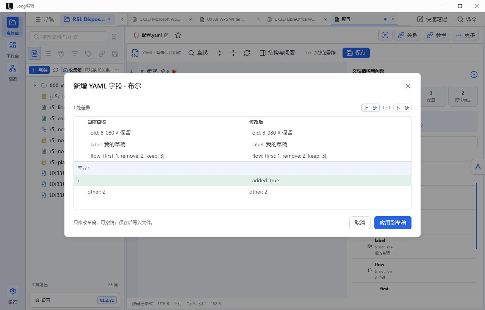

### v1.2.20 TOML 字段重命名

TOML“分区与问题”字段右键“重命名字段…”，预填名称，弹窗输入、差异预览后应用到草稿。支持根部和已有普通表内的单段普通／引号键，包括数组、内联表及日期值的外层字段名。只替换准确键范围，保留值、注释、日期、数字原文、BOM、换行与表归属；保留原有引号风格，必要时使用合法引号键，名称中的点保持单个字段。同级重名与表路径冲突局部提示并保留输入；点键、表头与数组表等提供源码定位。独立撤销、显式保存、失败重试和外部冲突副本继续保护未保存内容，保留全部功能、主题和正常动效，无新增常驻表单。

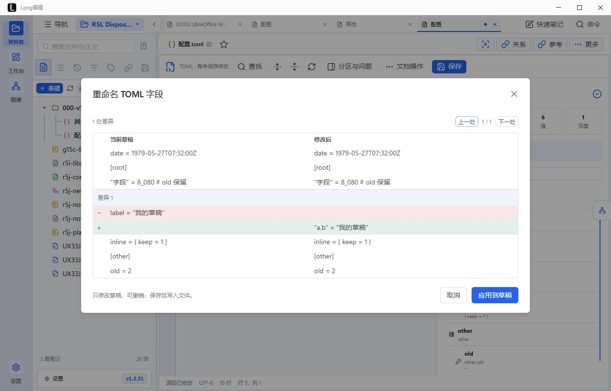

### v1.2.19 YAML 字段重命名

YAML 提纲字段右键“重命名字段…”，预填当前名称，弹窗输入、差异预览后应用到草稿。支持块式和流式映射中的普通字符串键，只修改准确的键原文，保留值、注释、锚点与别名绑定、数字原文、BOM 和换行；保留引号风格，true、null 或数字等名称保持字符串类型。连续改名接续最新路径及定位。同级重名、复杂键或归属不明确时局部提示，保留输入并提供源码定位。独立撤销、显式保存、失败重试和外部冲突副本继续保护未保存内容，保留全部功能、主题和正常动效。

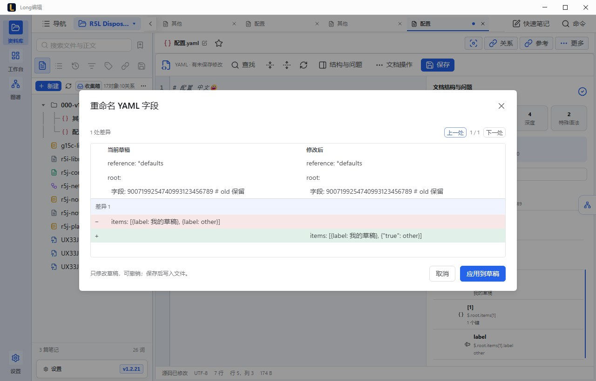

### v1.2.18 XML 元素创建与重命名

XML 元素提纲右键“添加子元素…”或“重命名元素…”，必要弹窗输入，预览后应用到草稿。新子元素支持空容器、自闭合容器、清晰的子元素布局及普通文字转义；重命名只修改当前元素开始/结束标签的本地名称，保留原前缀、属性、内部文字、注释、CDATA 和其他原文。应用后选中并定位元素，复杂内容局部提示、保留输入并提供源码定位。沿独立撤销、准确保存状态、保存失败重试和外部冲突副本保护未保存内容，不增加常驻表单，保留全部功能、主题和正常动效。

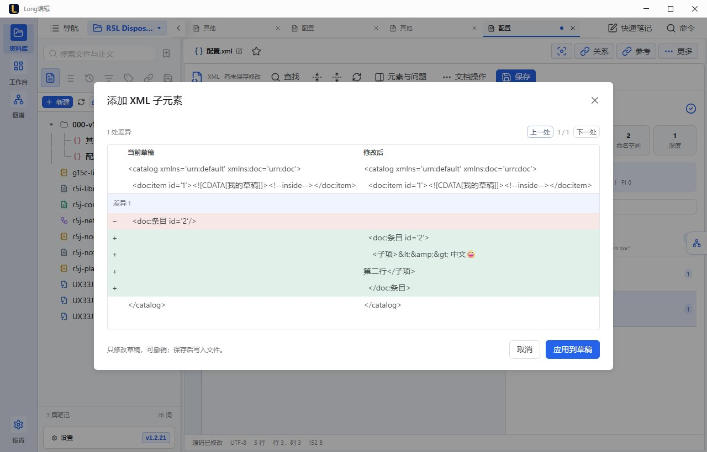

### v1.2.17 准确保存状态

JSON/JSONC、YAML、TOML、XML 和 SVG 源码视图在撤销、重做、手动恢复或结构化操作回到已保存原文后，正确更新现有状态栏、标签、保存按钮与关闭确认。基线来自真实读取或保存回执，精确比较源码及所属文件、签名与编码；不重新序列化文件，也不在每次输入时读盘。保存期间后续输入、文件切换、失败重试和冲突继续保护草稿，写入未完成时回到旧基线仍保护关闭；已检测到外部修改或无法确认基线时保守保留未保存状态。不增加页面或常驻表单，全部现有功能、主题和正常动效保留。

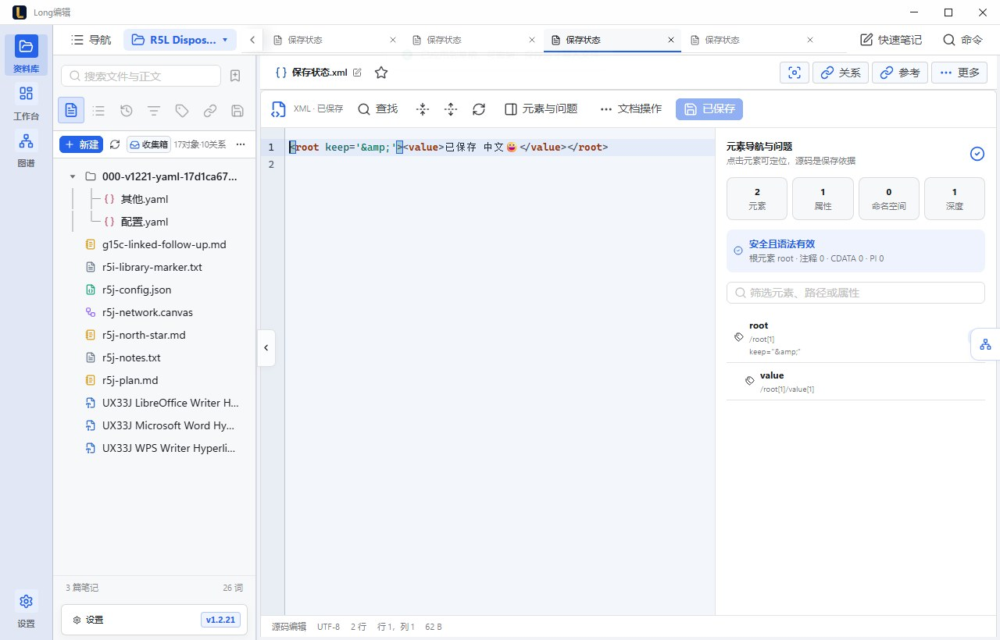

### v1.2.16 XML 属性新增与移除

XML 元素右键“修改属性…”，在已有弹窗新增普通属性或移除所选属性，无属性元素也可使用。名称和值局部输入与纠正，预览后应用到草稿，保留其他属性顺序、引号、缩进、BOM/换行及其他节点。命名空间声明与前缀属性的增删给出局部提示和源码定位；原有属性值编辑、独立撤销、显式保存、失败重试和冲突副本保留，不增加常驻表单。

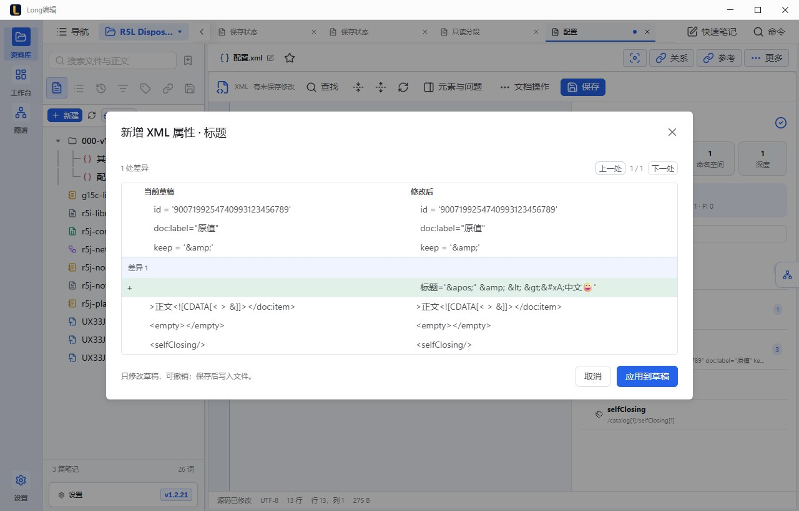

### v1.2.15 XML 元素删除

XML 的“元素与问题”提纲右键“删除元素…”，预览后删除完整子树及准确空白，保留相邻原文。支持首尾、唯一子元素、空元素、自闭合元素及连续删除；删除后定位到相邻元素或父元素，同名元素路径刷新。父级混合正文或外部注释归属不明时，局部提示并定位源码；沿已有独立撤销、草稿接续、显式保存、失败重试与冲突副本保护内容，不增加常驻表单。

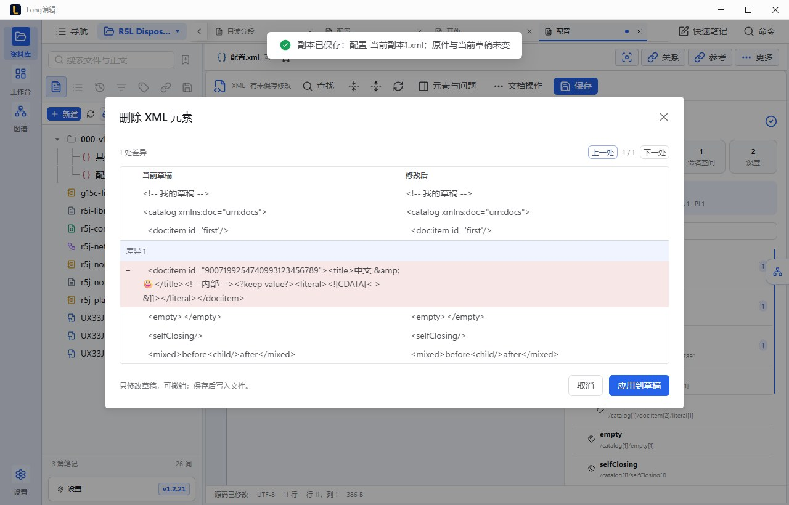

### v1.2.14 XML 同级元素排序

XML“元素与问题”提纲右键“上移 / 下移”，沿已有差异预览调整同一父级内相邻元素顺序；保留元素原文、内部属性、命名空间、文字、CDATA、注释和处理指令，移动后定位跟随原元素。首项和末项禁用对应方向；混合正文或外部注释归属不明确时局部提示并定位源码。未保存草稿、独立撤销、显式保存、失败重试与冲突副本沿原流程接续，不增加常驻表单。

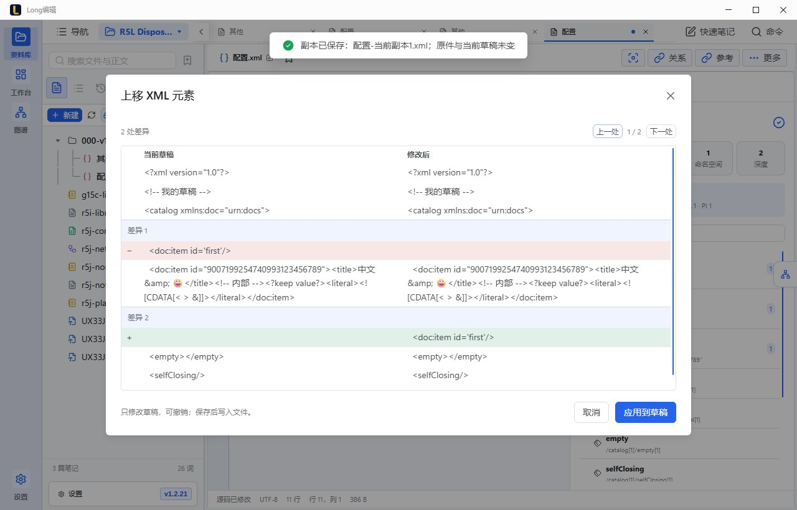

### v1.2.13 XML 元素复制

XML 的“元素与问题”提纲右键“复制元素”，预览后在原元素后插入完整副本；保留属性、命名空间、内部文字、CDATA、注释和换行缩进。支持同名元素、空元素、自闭合元素与连续复制，不自动修改业务标识符。父级混合正文或外部注释归属不明时，局部提示并定位源码；沿已有独立撤销、草稿接续、显式保存、失败重试与冲突副本保护内容，不增加常驻表单。

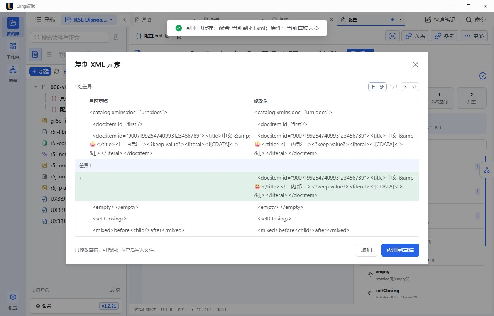

### v1.2.12 XML 文字编辑

打开 XML 的“元素与问题”，在结构提纲中右键元素选择“修改文字…”。弹窗预填可读原文，预览后只替换当前连续文字，保留其他节点、属性、注释和排版。支持普通文字、CDATA 及成对空元素，特殊符号自动转义，CDATA 结束符自动拆分并可继续编辑；复杂混合内容局部定位源码。沿已有独立撤销、显式保存、失败重试及冲突副本接续未保存内容，保留全部功能、风格和正常动效。

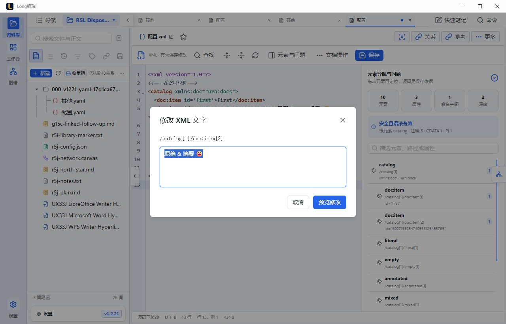

### v1.2.11 XML 属性编辑

XML 元素右键“修改属性…”选择已有属性并编辑可读值，特殊符号按原引号转义，保留其他属性、注释、排版与换行。支持前缀属性、同名元素、空值和多行；错误在弹窗内纠正，受限内容保留源码入口。沿现有差异预览、独立撤销、显式保存与冲突副本保护未保存内容，不增加常驻表单。同时修正 YAML 提纲的长数字、负数和科学计数原文显示。保留全部功能、风格及正常动效。

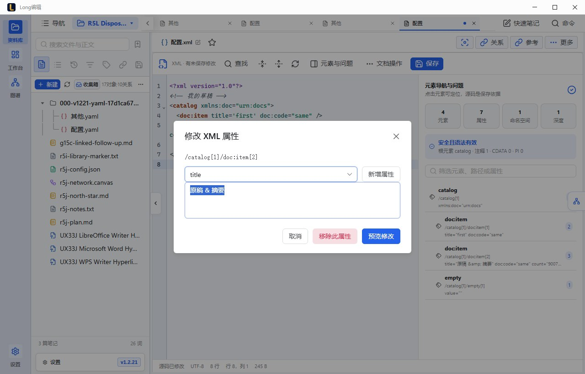

### v1.2.10 YAML 简单值编辑

YAML 节点右键“修改值…”编辑单行字符串、布尔、数字和 null，弹窗预选当前原文，错误原地纠正，保护字符串类型。准确处理中文和 emoji、嵌套同名字段、引号键及列表项，只替换当前字面量并保留尾注释、缩进和换行；沿现有差异预览、独立撤销、显式保存与冲突副本接续草稿。复杂语法保留源码入口，不增加常驻表单，保留全部功能、风格及正常动效。

### v1.2.9 TOML 配置值编辑

TOML 配置值右键“修改值…”编辑字符串、布尔或数字，弹窗预选当前原文，输入错误原地纠正。修复原文位置丢失，同名分区字段、带引号点号键与表数组准确定位。只替换当前值，保留注释、顺序、换行、长整数和转义；沿现有差异预览及独立撤销接续草稿，来源切换、保存失败与外部冲突继续保护内容。数组、内联表和日期时间保留源码入口，不增加常驻表单，保留全部既有功能、风格及动效。

### v1.2.8 字段与数组项复用

字段右键“复制为新字段…”、数组项右键“复制此项”，副本紧邻原内容。建议名称自动避开已有字段并选中，重名保留输入原地纠正。完整节点、长数字、转义和内部注释保持，一次复制可独立撤销，与移动和改值接续；源码和树形定位跟随副本。邻接注释归属不清就地说明，保存失败、外部冲突和来源变化继续保护草稿。保留全部原有功能、风格和正常动效，不增加常驻表单。

### v1.2.7 数组项位置调整

JSON/JSONC 数组项右键上移或下移，边界禁用，保留长数字、转义、内部注释和原有排版。沿现有差异预览应用到当前草稿，可一次撤销重做；源码焦点及树形选择跟随原记录。邻接注释归属不清时就地说明并保持内容，保存失败、外部冲突或来源变化继续保护草稿。节点菜单按小窗口可用空间展开并滚动，保留全部原有操作与风格。

### v1.2.6 表格列位置调整

右键列标题可向左或向右移动，标题、所有行值、类型、录入规则和各视图列宽保持对应，排序与看板、图表和仪表盘仍引用原字段。列移动、新增列均可一次撤销重做，与填充、行操作和其他未保存编辑交错使用；保存失败及冲突保留草稿。保留全部现有入口、风格和正常动效，不增加常驻操作区。

### v1.2.5 表格行插入与复制

右键行号可在原记录上方、下方插入空行，或复制当前草稿后只修改不同字段，每次操作都可一次撤销。排序时位置插入明确禁用，筛选隐藏新增空行时自动显示并定位。删除确认固定最初记录，等待期间的草稿和来源变化不会导致误删另一行。页面不增加常驻表单，原有入口、风格和正常动效保留。

### v1.2.4 表格选区填充

选中单元格后右键“填充选区…”，默认只填空白，也可替换选区。全部目标先校验，失败保留输入，成功一次撤销重做；排序、筛选后仍操作原选中行列。同一文件的行引用直接定位到当前草稿，保留未保存修改与历史。操作集中在右键与弹窗，不增加常驻表单。

### v1.2.3 批注批量整理

勾选批注后，在原有右键或“···”菜单统一改色或删除。菜单显示所选总数及筛选隐藏数，删除确认明确范围；一次撤销恢复整组批注、顺序和勾选，保留筛选。普通改色不增加确认，页面不增加常驻工具条，PDF 原文和阅读笔记保持原样。

### v1.2.2 批注撤销与保存保护

批注误操作可以从右键、每条批注菜单或搜索旁的“···”撤销重做。恢复后的批注沿原自动保存链落盘；保存失败可原地重试，其他窗口或外部程序修改过来源时保留当前评论供核对。切换文件清空旧历史，评论输入框保留文字撤销，阅读笔记正文不会被连带改写。

### v1.2.1 移动阅读接续

在右键、拖放与批量改名中继续原来的阅读和整理，命名现场、搜索定位及参考来源跟随成功项。当前阅读位置即时捕获，旧组件卸载不会重新写回过期路径；未保存正文不代存，复制保留源阅读记录。

### v1.2.0 界面与基础体验

减少重复标题与说明，按需打开属性和图谱工具，把空间留给正文、表格及画布。小窗口与六种风格统一适配，保留文件管理、保存保护、历史、搜索、关系和各格式既有能力。[完整窗口复查](docs/UI_Full_Window_Review_2026-10-22.md)。

### v1.1.37 PDF 批注接续

PDF 批注筛选、勾选、当前批注、列表分组和滚动位置自动接续；来源变化不套用旧选择，明确引用优先。评论保存失败时保留输入与页面。[使用方法](docs/Pdf_Annotation_Resume_User_Guide.md)。

### v1.1.36 上下文操作

命令窗口增加“资料 / 操作”切换；按当前文档显示附件、历史、来源核对、PDF 阅读笔记和录入检查，直接打开原有面板，保留原菜单与草稿。切换文档后拒绝旧结果，取消恢复同文档选区。[使用方法](docs/Context_Command_User_Guide.md)。

### v1.1.35 附件引用和草稿接续

附件“查看引用”自动纳入当前窗口的完整未保存 Markdown，同一路径以草稿为准；区分来源，变化后可刷新，打开复用草稿。[使用方法](docs/Attachment_Management_User_Guide.md)。

### v1.1.34 章节链接随项目接续

大纲右键复制库内章节链接，随资料库、移动改名和跨库复制接续，保留原文和草稿；查找替换后的单次撤销同时修复。[使用方法](docs/Portable_Chapter_Links_User_Guide.md)。

### v1.1.33 阅读成果随资料接续

文件右键复制到另一个库时，可带上 PDF 批注与阅读来源，保留原件和草稿；来源变化时只重新核对未完成项。[使用方法](docs/Copy_Reading_Outcomes_User_Guide.md)。

### v1.1.32 恢复后接续工作现场

备份时可选记录工作现场，恢复后按需接续文件与阅读位置；缺失目录可一次映射，当前有草稿则先记住现场。[使用方法](docs/Content_Restore_Continuity_User_Guide.md)。

### v1.1.31 XLSX 连续录入与检查

XLSX 单元格右键按需检查所选区域或筛选记录，定位并预览修正草稿。规则贯通输入、粘贴、清空和已有填充，保护其他草稿，可一次撤销。[详细说明](docs/RELEASE_NOTES_v1.1.31.md)。

### v1.1.30 Table 录入规则与纠错

列头右键设置录入规则，“数据操作”按需核对，先预览再修正草稿，保留隐藏行与未保存内容，可一次撤销。CSV 规则可随 Table 副本保留；XLSX 非法列表粘贴整体拒绝。[详细说明](docs/RELEASE_NOTES_v1.1.30.md)。

### v1.1.29 PDF 批注与阅读笔记接续

批注右键编辑和返回位置保持；阅读笔记从文档菜单按需预览更新，保留用户补写和未保存内容，可一次撤销与重做。[详细说明](docs/RELEASE_NOTES_v1.1.29.md)。

### v1.1.28 引用来源与关系核对

参考资料与关系菜单按需核对来源；失效文内来源链接可在草稿中修复、撤销与重做，保留未保存内容和代码中的示例。[详细说明](docs/RELEASE_NOTES_v1.1.28.md)。

### v1.1.27 标签整理与集合复用

文内标签从右键进入范围选择与影响预览；集合条件可导入、导出到其他资料库，修正失效目录和中心，保留同名集合与所有草稿。[详细说明](docs/RELEASE_NOTES_v1.1.27.md)。

### v1.1.26 文件菜单与结构化历史

资料库右键多级菜单正常展开，保留全部文件动作。结构化源码可从文档菜单比较保存历史，恢复局部、整篇或同类型副本；保护原稿，只改当前草稿，一次撤销，仍需显式保存。[详细说明](docs/RELEASE_NOTES_v1.1.26.md)。

### v1.1.25 查找替换

文档操作菜单或 Ctrl+H 打开查找替换，明确整篇文档或打开前的选区，逐项核对或预览后一次替换。支持大小写、整词、多行文字，改动只在当前草稿，可一次撤销，仍需保存。覆盖资料库与外部 Markdown 三模式、TXT，保留原 Ctrl+F。[使用方法](docs/Document_Find_Replace_User_Guide.md)。

### v1.1.24 长文组织

左侧大纲右键可复制章节链接、预览后移动整节、提高或降低标题层级。子标题、代码、表格与图片引用随整节移动；只改草稿、可一次撤销、仍需保存。引用和列表内标题保留定位与复制，结构修改只对可靠源码映射开放。[使用方法](docs/Markdown_Chapters_User_Guide.md)。

### v1.1.23 附件管理

附件目录、搜索与整理引用采用一致规则。“管理附件…”显示当前 Markdown 草稿引用及失效状态，修复路径仅应用到草稿，可撤销、仍需保存；库外来源防覆盖复制，原附件保留。[使用方法](docs/Attachment_Management_User_Guide.md) · [发布说明](docs/RELEASE_NOTES_v1.1.23.md)。

### v1.1.22 文件整理记录

文件栏右键“最近操作…”集中查询整理记录、查看位置和按项还原。原有批次撤销保留；后续编辑、同名冲突与草稿保护沿用现有文件事务。复制只查看，清除记录不会删除文件。[发布说明](docs/RELEASE_NOTES_v1.1.22.md)。

### v1.1.21 跨资料库复制

文件右键“复制到…”可以选择另一个资料库，自动预览目标和关联资源，保留源文件与未保存草稿；重名保留两份，未完成项可接着处理。正式安装包、使用范围和完整说明见 [发布说明](docs/RELEASE_NOTES_v1.1.21.md)。

### v1.1.20 结构化源码编辑

结构化编辑补齐保存归属、继续输入、读取失败和冲突副本保护，深化提纲右键、JSON Pointer 与可取消修改预览；完整回归、实际安装及独立同包检查通过，正式安装包和校验文件已发布。[使用方法](docs/Structured_Editing_User_Guide.md) · [发布说明](docs/RELEASE_NOTES_v1.1.20.md) · [发布记录](docs/V1_1_20_Unsigned_Community_Release_Audit_2026-10-19.md)。
