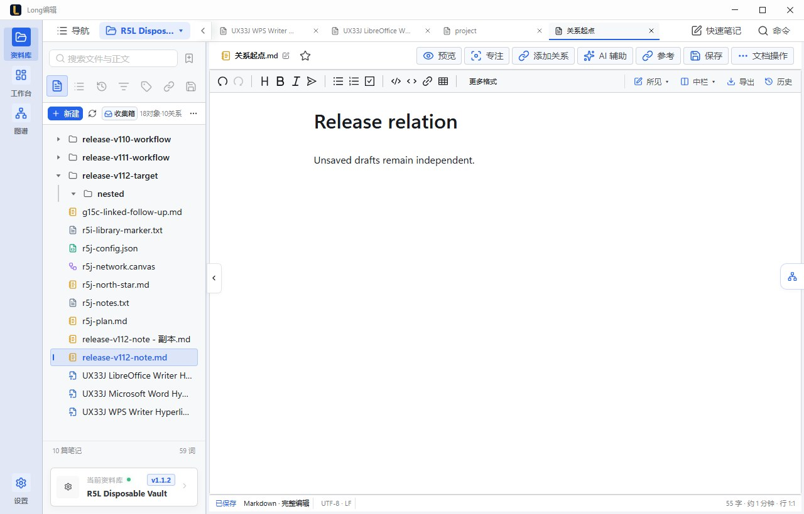
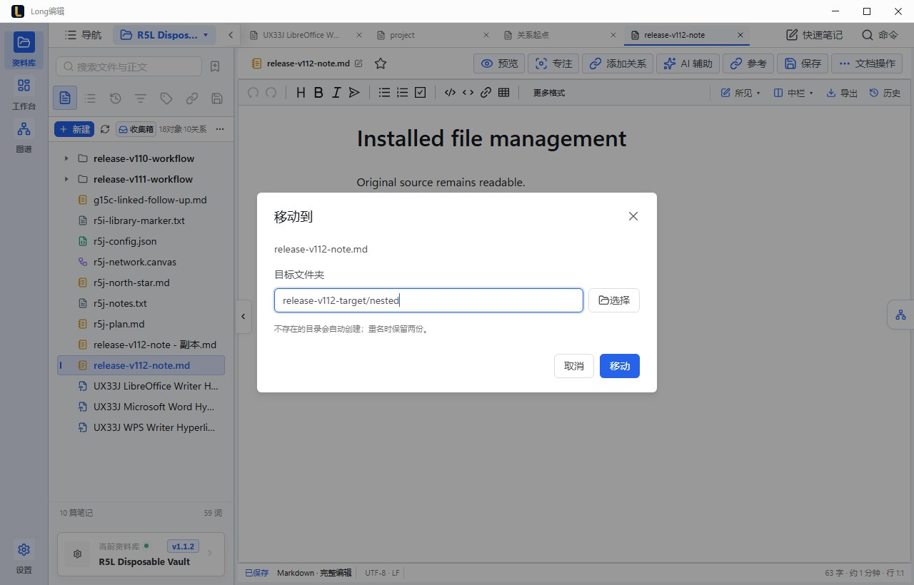
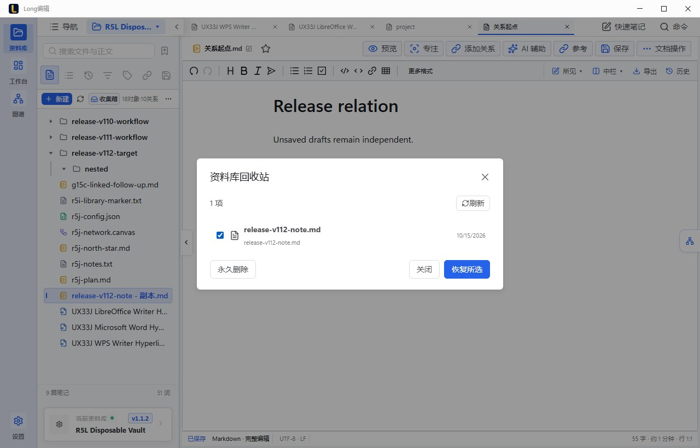

<p align="center">
  
</p>

<h1 align="center">Long编辑</h1>

正在准备 **v1.1.3 基础功能深化**：自定义模板、多文档固定与排序、标签/集合、关系维护和 TXT 历史。当前公开下载仍为 v1.1.2；新版安装包通过构建与安装检查后在 Release 发布。

<p align="center">
  <strong>让文件成为知识，让工作自然继续。</strong><br>
  本地优先的 Windows 知识工作台<br>
  从一份笔记，到一整个项目：把阅读、写作、资料整理与关系探索放在同一个工作空间。
</p>

<p align="center">
  
  
  
  <a href="https://www.gnu.org/licenses/agpl-3.0.html"></a>
</p>

<p align="center">
  <a href="#下载">下载</a> ·
  <a href="#快速开始">快速开始</a> ·
  <a href="#日常工作流">日常工作流</a> ·
  <a href="#真实界面">真实界面</a> ·
  <a href="#核心能力">核心能力</a> ·
  <a href="#格式能力">格式能力</a> ·
  <a href="#主题与交互">个性化</a> ·
  <a href="#开发与验证">开发与验证</a>
</p>

<p align="center">
  
</p>

<p align="center"><sub>真实安装版工作区：紧凑导航、稳定的多文档标签与主编辑区，把更多空间留给内容。</sub></p>

## 不只是打开文件，更是接续你的工作

文件可能分散在笔记、报告、配置、表格和图片里，思路却不应该被文件类型切碎。Long编辑以本地目录为资料库，在同一套导航里连接不同的阅读与编辑工作区：先找到资料，再理解内容，最后把自己的记录留在合适的位置。

<table>
  <tr>
    <td width="33%" valign="top"><h3>📚 一个资料库，多种内容</h3><p>文本、数据、Office、PDF、图形与媒体按类型进入对应工作区，不用把所有文件先转成笔记。</p></td>
    <td width="33%" valign="top"><h3>🔎 找到资料，边看边写</h3><p>搜索结果默认打开在主编辑区；需要对照时主动打开参考区，选文与来源可插入 Markdown。</p></td>
    <td width="33%" valign="top"><h3>🧭 看见知识之间的连接</h3><p>通过链接、反向链接、图谱、思维导图与 Canvas，把文件从列表变成可以探索的关系网络。</p></td>
  </tr>
  <tr>
    <td valign="top"><h3>📝 灵感落在合适的位置</h3><p>快速笔记直接选择资料库、保存位置与模板，不要求先收集、再额外归档。</p></td>
    <td valign="top"><h3>🗂️ 保存工作现场</h3><p>给一组打开的文档和视图命名，切换项目后再继续；智能集合让常用筛选随资料变化。</p></td>
    <td valign="top"><h3>🎨 把工作区调成喜欢的样子</h3><p>主题、控件质感、动效、字体与排版独立调整，文件列表也可以有自己的颜色和图标。</p></td>
  </tr>
</table>

### 适合怎样的工作？

| 你的任务 | 可以这样使用 |
| --- | --- |
| 学习、阅读与摘录 | 搜索课程资料，在侧边参考报告或 PDF 提取文字，把选文和出处整理到 Markdown 笔记 |
| 项目资料与会议记录 | 为项目建立资料库，用模板记录会议，保存工作现场，并用智能集合追踪相关文件 |
| 技术文档与配置整理 | 在同一资料库中阅读 Markdown，检查 JSON 结构，编辑 YAML/XML/TOML 和轻量代码源码 |
| 表格与报告审阅 | 打开 CSV、Table、XLSX、PDF 与 Office 工作区，按实际能力编辑或生成可靠副本 |
| 灵感、方案与知识组织 | 用 OPML、Canvas、Mermaid、Draw.io 表达思路，再通过知识图谱探索已有资料之间的联系 |

Long编辑不是完整的 Office 套件、IDE 或专业媒体编辑器；具体可编辑范围见下方[格式能力](#格式能力)。

## 下载

<p>
  <a href="https://github.com/Longyuyeee/Long_MarkDownReader/releases/tag/v1.1.2"></a>
  <a href="https://github.com/Longyuyeee/Long_MarkDownReader/releases/latest"></a>
</p>

当前公开稳定版为 **v1.1.2**，支持 Windows 10/11 x64。

| 安装方式 | 下载 | 适用场景 |
| --- | --- | --- |
| NSIS 安装程序 | [LongEdit_1.1.2_x64-setup.exe](https://github.com/Longyuyeee/Long_MarkDownReader/releases/download/v1.1.2/LongEdit_1.1.2_x64-setup.exe) | 推荐，大多数用户 |
| MSI 安装程序 | [LongEdit_1.1.2_x64_zh-CN.msi](https://github.com/Longyuyeee/Long_MarkDownReader/releases/download/v1.1.2/LongEdit_1.1.2_x64_zh-CN.msi) | 管理部署或 MSI 工作流 |
| 校验与说明 | [Release v1.1.2](https://github.com/Longyuyeee/Long_MarkDownReader/releases/tag/v1.1.2) | Release Notes 与 SHA-256 |

> 社区版暂未使用 Authenticode 商业证书，Windows 可能显示“未知发布者”或 SmartScreen 提示。请只从本仓库的 GitHub Release 下载，并使用同页 [`SHA256SUMS.txt`](https://github.com/Longyuyeee/Long_MarkDownReader/releases/download/v1.1.2/SHA256SUMS.txt) 核对文件；不需要关闭系统安全防护。

<details>
<summary>展开安装包 SHA-256 与本机核对方法</summary>

在 PowerShell 中进入下载目录，核对实际文件的哈希值：

```powershell
Get-FileHash -Algorithm SHA256 .\LongEdit_1.1.2_x64-setup.exe
```

```text
25b2652fecd4410747203724bef6ea73fdff69c2f2caff3078d1b1b17143d533  LongEdit_1.1.2_x64_zh-CN.msi
a978fdb11733a42c7d18afe864a903aaf17c74acdab16211d61cabeddf657856  LongEdit_1.1.2_x64-setup.exe
```

</details>

应用可每 24 小时检查更新，也可在设置中手动检查；自动更新始终需要确认，并校验安装包大小与 SHA-256。v1.0.4 及更早版本需先手动安装当前版本。

## 快速开始

1. **安装并启动**：普通用户优先选择上面的 NSIS 安装程序。
2. **选择资料库**：添加一个本地目录，或选择已有资料库；顶部资料库名称可展开切换列表。
3. **打开你的第一份资料**：从文件树选择文件，或在“搜索文件与正文”中查找；结果默认在主编辑区打开。
4. **创建自己的记录**：点击“快速笔记”，选择资料库、保存位置与模板，再记录内容。
5. **按需要打开参考**：搜索结果旁选择“在侧边参考”，对照阅读不会替换当前草稿。
6. **确认保存与接续**：可编辑草稿使用“保存”或 `Ctrl+S` 写入；在工作台保存命名工作现场，方便之后继续。

刚开始不必配置所有选项。先选资料库、打开文件、写一份笔记，等需要时再使用集合、图谱和个性化设置。

## 日常工作流

### ① 找资料 → 打开 → 对照 → 写自己的内容

搜索和参考是两种不同意图，界面明确区分：

| 你点击的操作 | 内容出现的位置 | 是否替换当前内容 |
| --- | --- | --- |
| 搜索结果的打开操作 | 主编辑区，进入对应格式工作区 | 切换到目标文档；未保存内容受保护 |
| “在侧边参考” | 独立的只读参考区 | 不替换当前草稿 |
| 将参考选文及来源插入 | 当前 Markdown 的插入位置 | 插入可撤销，仍需手动保存 |

打开自己的 Markdown 笔记并选定插入位置后，可将参考选文及来源直接插入。参考区在窄窗口自动改为上下布局，避免把正文挤得过窄。

参考展示磁盘上的部分文字；PDF 参考为提取文字，完整版面可在主编辑区打开。支持手动刷新和失效来源重新关联；阅读位置、搜索条件和参考资料身份按资料库记住，重启后重新读取内容，不保存参考选文，不自动跟踪全库重命名。

### ② 想到就记，保存时就选好位置

快速笔记可直接选择**资料库、保存位置和模板**。日常记录可以留在收集箱，也可以直接放入项目目录，不需要强制进行额外的归档操作。保存失败会保留内容，重试不会因为同一次保存操作而重复创建笔记。

收集箱从“新建笔记”开始使用，首次新建会自动准备文件夹。空目录与暂时无法访问会明确区分；路径失效时可重试或更换位置，继续使用其他区域。

### ③ 把常用筛选变成智能集合

智能集合是动态查找资料的视图，不是另一份文件副本。按目录、标签、时间、对象类型和关键词组合条件，源资料变化后重新查询，即可得到符合条件的内容。

例如：为项目相关资料建立集合，或把某个目录里带指定标签的笔记集中查看。文件依然留在原来的目录，不需要为了加入集合而搬家。

默认先看“我的集合”，也可以从最近修改、全部笔记或标签示例开始；需要新建或调整时再展开筛选条件。文内标签则用于按主题找笔记，点击标签即可查看相关笔记。

### ④ 保存现场，下次从这里继续

在工作台给当前工作现场命名，保留资料库内打开的文档标签、当前选中文档和支持的视图状态。切换任务后，再选择对应现场继续阅读与整理。

**工作现场不保存未保存的正文草稿，也不是文件备份。** 重要内容请先保存；恢复现场时，当前未保存的标签不会被悄悄丢弃。

### ⑤ 先看历史差异，再决定如何恢复

Markdown 历史提供差异预览，区分当前来源与历史版本的增删内容。可以恢复为独立副本，也可以在保护当前草稿后替换编辑区；替换之后仍需手动保存。

恢复前会核对当前文件与历史来源是否变化。发现来源过期时先拒绝执行，而不是用旧结果覆盖新内容。本版不把这一能力泛化为所有格式的历史恢复。

### ⑥ 给不同类型的资料建立关系

在文档工具栏“专注”旁点击 **添加关系**，选择另一份文件和关系类型，按需补充说明，保存后即可在图谱中看到联系。PDF、表格、图片和其他附件也能使用，不需要先写 Markdown 链接；图谱顶部及选中文件后也有同一入口。

关系页用“我提到的 / 提到我的”查看正文引用，图谱用于查看整个资料网络。手动关系关联当前资料库内的整份文件，单独保存于 `.longedit/file-relations.json`，原文保持不变；整体搬迁资料库时请保留此目录，应用内改名或移动会同步关系位置。

### ⑦ 整理文件，删错也能找回

在文件栏右键选择“移动到”“复制到”或“创建副本”；按住 Ctrl/Shift 多选后可一次处理多项。目录选择使用弹窗，输入新目录会自动创建，重名时保留两份。移动后，打开的文档、收藏、关系和显示样式继续跟随。

普通删除进入资料库回收站，可从文件栏空白处右键或“更多操作”打开回收站恢复；“撤销上次移动”可撤销本次应用会话最近一次成功移动。剪切、复制和粘贴使用应用内当前资料库的文件剪贴板。回收内容保存在资料库的 `.longedit/trash`，整体搬迁资料库时请一并保留。

## 真实界面

主图与下方图谱来自 **v1.1.2 真实安装版**。JSON、工作簿和外观截图保留历史安装验收场景，展示对应功能，不代表新版布局；测试库名称、示例文件中的版本文字也不代表当前软件版本。

### 文件整理与回收

<table>
  <tr><td width="50%"></td><td width="50%"></td></tr>
  <tr><td align="center"><sub>选择或输入目标目录</sub></td><td align="center"><sub>在回收站选择恢复</sub></td></tr>
</table>

### 专业编辑工作区

文件树保留完整扩展名并按类型使用不同图标；顶部标签支持多文档切换和横向滚轮导航。编辑器、状态栏与上下文工具共享一致的主题和保存状态。

<p align="center">
  
</p>

<p align="center"><sub>历史安装场景 · JSON 源码、解析状态与字段路径；新版采用开头所示的统一导航。</sub></p>

JSON、YAML、XML、TOML 与代码文件使用专业源码编辑体验。JSON 还提供虚拟化树形查看、结构诊断、字段路径定位和明确的安全编辑提示。

### 表格与工作簿

<p align="center">
  
</p>

<p align="center"><sub>历史安装场景 · XLSX 多工作表、公式栏与页面工具。</sub></p>

CSV、TSV 与开放 Table 提供网格、冻结前 N 列、看板、导入导出和显式转换；CSV/TSV 创建 Table 副本前会说明来源、候选目标、不覆盖策略与转换损失，完成后自动打开实际目标，源文件保持不变。XLSX 工作区提供多工作表、公式、样式、图表、筛选、页面设置、经典错误值和已有日期时间单元格的有界编辑。

### 知识图谱与思维导图

<p align="center">
  
</p>

<p align="center"><sub>v1.1.2 安装场景 · 关系网络与知识图谱治理面板；数据来自独立测试资料库。</sub></p>

知识图谱把文件、标题、链接与 Canvas 节点组织成可交互网络。支持稳定后自动全图适配、搜索、筛选、多种布局与主题、框选和拖动、缩放、适应当前选择、有界且尊重减少动效设置的选择反馈、可点击/拖动/键盘操作的语义缩略导航、右键操作、中心节点、视图保存以及 SVG/PNG 导出；密集中景会主动降低普通箭头和状态环噪声，近景仍保留方向语义。

### 设置、主题与资料库

<table>
  <tr>
    <td width="50%"></td>
    <td width="50%"></td>
  </tr>
  <tr>
    <td align="center"><sub>历史安装场景 · 主题、界面风格与动效节奏</sub></td>
    <td align="center"><sub>历史安装场景 · 多资料库管理与切换</sub></td>
  </tr>
</table>

设置按资料库、编辑与保存、外观、格式与文件、知识能力、系统与更新、隐私与诊断、AI 分类。主题不仅切换颜色，也统一编辑器、表格、画布、弹窗、选择器、光标和焦点状态。

## 核心能力

| 工作方向 | 已提供的体验 |
| --- | --- |
| 本地资料库 | 多资料库、文件树、全文搜索、标签、保存视图、历史、管理备份 |
| 专业编辑 | 多标签、撤销/重做、显式保存、外部修改冲突保护、语法诊断 |
| 知识组织 | 文内标签、智能集合、引用、反向链接、跨格式手动关系、知识图谱、思维导图、JSON Canvas、关系定位 |
| 表格数据 | CSV/TSV/Table 网格与看板，XLSX/ODS 工作区和有界高级对象支持 |
| 文档与演示 | PDF 阅读与页面工具，DOCX/PPTX 阅读、受控草稿和可靠副本 |
| 图形与媒体 | Mermaid、Draw.io、SVG、图片基础编辑器，以及支持逐帧、截图、位置记忆和同名字幕的流式视频播放器 |
| 外部打开 | 支持格式使用独立顶层窗口，不占用主资料库窗口或增加内部标签 |
| 个性化 | 核心主题、场景预设、外观组合、文件颜色与图标标记 |

所有可编辑格式都遵守同一条原则：修改先保留在草稿中，只有点击保存或按 `Ctrl+S` 才写回源文件。只读、可靠副本、显式转换和外部程序交接会在界面中明确说明。

### 阅读与写作：让内容处在中心

- Markdown 支持所见即所得、IR 与源码模式，常用格式工具、正文宽度、导出和历史靠近编辑区。
- 多文档标签与快速笔记、命令入口共享紧凑顶栏；点击切换不改变标签顺序。
- 当前文档名称可以点击改名，不必只从文件树寻找重命名操作。
- 专注模式减少周围导航干扰；需要参考时主动展开，不默认占用正文空间。
- 历史快照与正文保存分开：快照用于保留历史，不能代替对源文件的明确保存。

### 资料组织：从目录，到集合，再到关系

- 多个本地目录可以分别作为资料库，切换时保护未保存内容。
- 文件、目录、最近访问、大纲、标签、集合、关系与历史保留各自入口。
- 文件树通过缩进与层级引导表达父子关系；文件可使用独立图标、文字颜色和背景标记。
- 搜索、保存视图与智能集合用于找到内容；链接、反向链接与图谱用于理解联系。
- 点击“添加关系”即可关联库内任意类型文件；不改变该格式原有的阅读、编辑或只读范围。
- 路径暂不可用时可以重试；重新读取失败会保留当前未保存内容，不把空内容误当作读取成功。

### 结构与源码：为数据提供专用工具

- JSON/JSONC 支持源码与结构查看、字段路径定位、结构风险提示，以及有界的本地 JSON Schema 辅助。
- 大 JSON 渐进只读，使用分段导航和流式搜索，不强行构建全文树形或写回。
- YAML、XML、TOML 提供源码、结构导航与轻量诊断，不冒充完整 Schema 服务。
- 代码与配置文件提供语法高亮和轻量编辑工具，不执行程序、不提供编译或调试环境。
- `.env` 的敏感变量值默认遮罩，并排除全文索引与知识图谱；查看和编辑需逐文件明确确认。

### 表格、文档与演示：只开放已验证的编辑范围

- CSV/TSV/Table 支持网格、冻结列和看板；转换创建新副本并先披露损失，不直接覆盖来源。
- XLSX 提供工作表、公式、样式、图表、筛选及页面工具，复杂结构按能力限制写回。
- DOCX/PPTX 提供受控的基础对象、文字与样式编辑，并通过预览、冲突检查和输出复读保护保存。
- PDF 页面提取、合并、插入、重排和旋转生成副本；批注与 OCR 结果以独立附加文件保存。
- PDF 表单、文字水印、属性及永久脱敏仅开放已验证子集；永久脱敏使用图片型输出，会失去文字搜索与交互能力。

### 图形、导图与媒体：不同表达，统一入口

- 知识图谱侧重探索已有资料之间的关系；思维导图、Canvas、Mermaid 和 Draw.io 用于主动构建表达。
- OPML 可以在披露转换边界后生成独立 Canvas 投影，不与来源自动同步。
- SVG 提供源码与净化预览，限制危险协议和外部资源。
- 图片提供缩放、平移，以及支持格式的基础裁剪和调整；编辑结果另存为副本。
- 视频采用流式播放，支持逐帧、截图、位置记忆和同名字幕，不承担专业剪辑或转码。

### 可选 AI：按自己的服务配置

设置中可配置兼容 OpenAI API 格式的服务，包括本地 Ollama 回环地址；API Key 使用操作系统凭据库存储。AI 并非使用资料库的必要条件。

使用远程服务时，请把相关请求内容视为会发送到你配置的服务提供方，先确认隐私与费用；“本地优先”不代表远程 AI 请求也在本机完成。

## 格式能力

当前注册 **43 类格式、91 个扩展名**，映射到 11 套发布能力配置：30 类已验证、7 类有限能力、6 类依赖外部程序。

| 格式族 | 主要能力 | 明确边界 |
| --- | --- | --- |
| Markdown / TXT / LOG | 所见即所得或源码、搜索、撤销与显式保存 | LOG 大文件优先使用专业查看模式 |
| JSON / YAML / XML / TOML / 代码 | 按格式提供语法高亮、结构导航、轻量诊断和保存；JSON 提供字段路径与本地 Schema 辅助 | 大 JSON 渐进只读、分段导航和流式搜索；HTML 预览经过净化和 sandbox，不执行脚本；不是 IDE 或通用 Schema 服务 |
| CSV / TSV / Table | 网格、冻结列、看板、转换、导入导出 | 不承诺复杂 Excel 对象语义 |
| XLSX | 工作表、公式、样式、图表、筛选与有界类型编辑 | 仅正式注册 `.xlsx`；宏不执行，部分高级结构只读或保存可靠副本 |
| DOCX / PPTX | 阅读、受管草稿、经验证的基础对象与文字/样式编辑，以及可靠保存 | 不宣称完整等价 Microsoft Office；复杂对象与高级排版按边界处理 |
| PDF | 阅读、搜索、批注、OCR 附加文件、页面副本及有界表单/水印/脱敏 | 原文不覆盖；不是通用内容重排编辑器，永久脱敏图片副本会失去搜索与交互 |
| Mermaid / Draw.io / SVG | 查看、编辑、画布操作与安全保存 | 外部资源和危险协议会被阻断 |
| OPML / JSON Canvas | 思维导图、卡片与关系画布；OPML 可在完整披露后生成独立 Canvas 投影 | 修改需显式保存；投影副本不与源文件自动同步 |
| 图片 | PNG、JPEG、GIF、WebP、BMP、ICO、AVIF | 查看支持光标锚定滚轮缩放、拖拽平移和双击 100%/适应窗口；PNG/JPEG/WebP/BMP 可旋转、翻转、精确裁剪、缩放、调整亮度/对比度/饱和度、转换并另存副本；GIF/ICO/AVIF 与外部图片只读 |
| 视频 | MP4、WebM、OGV、M4V 及五种系统解码入口；资料库视频支持逐帧、PNG 截图、位置记忆和同名 VTT/SRT 字幕 | MOV/MKV/AVI/MPEG/MPG 取决于系统解码器；不提供嵌入字幕拆封、字幕编辑或转码 |
| ODS / ODP / 旧 Office / WPS | ODS 支持简单值和已有命名样式的可靠副本，ODP 支持简单正文页的可靠副本；旧 Office 转换，WPS 原生格式交给外部程序 | ODS 公式与自定义样式只读；ODP 复杂对象整页阻断，备注、版式、动画及外部打开只读；`.wps/.et/.dps` 不在软件内编辑 |

格式事实源位于 [`shared/file-formats.json`](shared/file-formats.json)，发布边界位于 [`shared/release-capability-matrix.json`](shared/release-capability-matrix.json)。

“43 类格式”是注册格式族数量，不是 43 种完全等价编辑器。“30 类已验证”也不意味着所有功能都可无损写回。软件按具体格式显示完整编辑、有限编辑、只读、可靠副本或外部依赖；格式能力页可查看实际支持范围。

## 设计原则

- **本地优先**：文档、索引和知识关系默认留在本机，不要求云端账号。
- **显式保存**：编辑不会在后台悄悄覆盖源文件，危险覆盖和格式降级需要确认。
- **能力诚实**：完整编辑、有限编辑、只读预览、可靠副本和外部依赖不会混为一谈。
- **恢复优先**：外部修改、路由错误和索引损坏提供比较、重载、隔离或重建路径。
- **用户控制**：默认应用、自动更新、外部程序接管和删除操作都由用户明确触发。
- **隐私可审计**：诊断和管理备份移除文档正文、完整路径、API Key、凭据与缓存正文。

### 保存、恢复与备份不是同一件事

| 机制 | 保存什么 | 不能替代什么 |
| --- | --- | --- |
| 正文保存 | 明确写入支持格式的文件内容 | 不能替代跨设备备份 |
| 历史快照 | 支持格式的历史内容，供比较与恢复 | 不能代替点击“保存” |
| 工作现场 | 资料库内文档身份、标签与支持的视图状态 | 不保存未保存的正文草稿 |
| 阅读与参考记忆 | 阅读位置、搜索条件和参考来源身份 | 不保存参考摘录正文，不保证自动跟踪所有改名 |
| 管理备份 | 脱敏设置与能力合同，恢复时重新映射本机资料库 | 不备份实际文档、API Key 或操作系统凭据 |

换电脑时，实际资料目录需要自行备份或同步；不要只带走管理备份，就以为所有文档已经一并迁移。

## 主题与交互

个性化不止是切换明暗。配色、界面质感、正文排版和文件标记可以分开调整，既能一键选择，也能继续 DIY。

| 调整层次 | 可选择的方向 |
| --- | --- |
| 核心与场景预设 | 专业浅色、专业深色、高对比；长文阅读、护眼研读、编码专注、创意图谱 |
| 配色与界面质感 | 19 个注册主题与外观组合；柔和、霓虹、玻璃、轻盈、极简、锐利等质感 |
| 文档显示 | 跟随风格、简洁、纸张、排版，按阅读习惯选择 |
| 字体与排版 | 正文字体与代码高亮主题；正文 12–28 px、行距 1.3–2.4、字距、段后间距、左对齐或两端对齐 |
| 文件列表 | 紧凑、舒适或宽松密度，平面或卡片行，彩色或单色图标 |
| 单个文件标记 | 独立图标、背景标记和文字颜色，保留主题下的选中辨识 |
| 动效与辨识 | 沉稳、利落、表现力或减少动效；高对比预设强化文字、焦点和边界 |

正文字体可选择无衬线、衬线、等宽、微软雅黑、宋体、楷体、仿宋、思源/Noto、Consolas，或填写自定义已安装字体名称。字体需要本机实际安装，缺失时自动回退，软件不会替你下载所有字体。

显示设置提供实时预览，**只改变阅读显示，不改写文档正文**。PDF 和 Office 继续保留原文档排版。主题库会合并视觉配置重复的组合，注册组合数不等于界面中完全不同的主题卡片数量。

紧凑工具栏和标签支持横向滚轮导航；左侧导航根据可用宽度在“图标 + 文字”和纯图标之间自适应。动效用于提示状态，不要求用户依靠动画才能理解操作。

## 常用操作与快捷键

| 快捷键 | 操作 |
| --- | --- |
| `Ctrl+S` | 保存当前草稿 |
| `Ctrl+P` | 打开命令面板 |
| `F11` | 切换专注模式 |
| `Ctrl+C` / `Ctrl+X` / `Ctrl+V` | 文件区域内复制 / 剪切 / 粘贴所选项目 |
| `F2` | 文件区域内重命名 |
| `Delete` / `Shift+Delete` | 文件区域内移到回收站 / 永久删除 |
| `Ctrl+Z` / `Ctrl+Shift+Z` | 支持的编辑器内撤销 / 重做，具体范围依工作区 |

打开外部文件、刷新目录、今日笔记、导出 HTML 和应用主题等操作可从命令面板选择。搜索、保存和格式工具也保留可见入口，不必先记住快捷键。

## 常见问题

<details>
<summary><strong>需要注册账号或把资料上传到云端吗？</strong></summary>

本地资料库不要求云端账号，文档、索引和知识关系默认在本机处理。检查更新和下载会访问 GitHub；配置并使用远程 AI 时，相关请求会访问你选择的服务。这些联网行为与本地文件工作区是不同边界。

</details>

<details>
<summary><strong>智能集合、资料库和工作现场有什么区别？</strong></summary>

资料库是实际文件所在的本地目录；智能集合是对这些资料的动态筛选；工作现场是打开哪些文档、当前看哪一份以及支持的视图状态。集合不会复制文件，现场也不保存未保存的正文。

</details>

<details>
<summary><strong>点击搜索结果，为什么没有自动打开在侧边？</strong></summary>

打开资料通常表示要阅读或编辑这份文件，所以默认进入主编辑区。需要边看边写时，明确选择“在侧边参考”；参考内容不会替换当前草稿。

</details>

<details>
<summary><strong>为什么有些格式只能只读或另存副本？</strong></summary>

复杂格式的可靠写回需要逐项验证。Long编辑优先保留源文件与已知结构，不把能预览误写成能完整编辑。PDF、图片和部分 Office 操作使用副本；旧 Office/WPS 原生格式可能依赖兼容外部程序，详见格式能力页。

</details>

<details>
<summary><strong>文件被其他软件修改了，或者目录暂时无法访问，怎么办？</strong></summary>

先保留当前草稿，再使用界面提供的重载、比较或重试入口。不要把重新读取当作自动保存；读取失败时，软件不会以空内容替换未保存草稿。遇到冲突可先保留副本，再决定采用哪份内容。

</details>

<details>
<summary><strong>怎样反馈问题，才能更容易复现？</strong></summary>

通过 [GitHub Issues](https://github.com/Longyuyeee/Long_MarkDownReader/issues) 描述你想完成的任务、实际点击步骤、预期结果与实际结果，并提供软件版本、Windows 版本及文件类型。截图和最小示例请先移除个人资料、路径、密钥与其他敏感内容。

</details>

## 开发与验证

<p>
  
  
  
  
</p>

技术栈为 Vue 3、TypeScript、Tauri 2 与 Rust。Markdown 使用 Vditor，专业源码编辑使用 CodeMirror。开发环境需要 Node.js 22、Rust stable、Windows WebView2 和 Tauri 2 所需的 Windows 构建工具。

### 基础功能深化路线

v1.1.2 已交付文件整理和侧栏精简；后续从自定义模板继续，再按多文档操作、标签/集合、关系维护、文本历史推进。入口继续按使用频率放在右键、新建菜单和按需弹窗中。已完成内容与后续范围见 [基础功能路线](docs/Foundation_Features_Upgrade_Plan_2026-10-14.md)。

### 从源码启动

```powershell
git clone https://github.com/Longyuyeee/Long_MarkDownReader.git
cd Long_MarkDownReader
npm ci
npm run tauri dev
```

### 检查与构建

| 目的 | 命令 |
| --- | --- |
| 前端类型检查与生产构建 | `npm run build` |
| 当前开发合同与回归审计 | `npm run check:current-development-audit` |
| Rust 功能与独立性能回归 | `npm run test:rust` |
| 生产依赖安全审计 | `npm run audit:prod` |

发布前完整质量检查与无签名社区安装包构建：

```powershell
npm run ci:patch-release
npm run build:ux39-unsigned
```

### 仓库结构

```text
src/                 Vue 3 前端、编辑器与知识工作区
src-tauri/           Rust/Tauri 桌面端、文件与格式命令
shared/              格式、能力、主题与发布事实合同
scripts/             自动化检查、证据采集与发布工具
docs/                当前审计、发布说明、开发交接与历史归档
design/brand/        品牌图标母版
releases/            仍受合同引用的历史产物与旧安装包归档
```

安装包由 Tauri 生成 MSI 与 NSIS。社区发布包含两个安装器与 `SHA256SUMS.txt`；受控更新不依赖旧 Tauri 私钥，也不发布 `latest.json` 或 `.sig`。

### 可追溯的开发与验收

能力说明由格式注册表和发布合同约束。发布流程区分源码检查、打包、真实安装运行、保存复开和公开附件核验；普通浏览器截图不能替代真实 Tauri 安装版验收。

| 需要了解的内容 | 文档入口 |
| --- | --- |
| 当前开发状态与换电脑接续 | [开发交接](docs/Development_Handoff.md) |
| 原始需求、阶段与收口边界 | [开发对齐与收口计划](docs/Development_Alignment_and_Closure_Plan_2026-08-02.md) |
| 产品路线与全界面改版方向 | [产品与 UI 计划](docs/V1_1_0_Product_and_UI_Plan_2026-10-11.md) |
| 当前公开版本的实际发布证据 | [社区版发布记录](docs/V1_1_2_Unsigned_Community_Release_Audit_2026-10-15.md) |
| 格式与写回能力事实 | [格式注册表](shared/file-formats.json) · [发布能力矩阵](shared/release-capability-matrix.json) |

欢迎围绕真实使用任务提出问题、补充最小复现或贡献改进。开发 UI 时先查看相关实际页面，保留现有能力；修改后验证草稿保护、保存复开与错误反馈，不能仅为了通过验收而降低要求。

## 许可证

项目采用 [GNU Affero General Public License v3.0](https://www.gnu.org/licenses/agpl-3.0.html)。使用、修改与分发请遵守许可证要求；第三方依赖和资源遵循各自许可证。

感谢 Vue、Tauri、Rust、Vditor、CodeMirror 及项目所使用的开源生态，也感谢持续提出真实使用反馈的用户。

## 更新摘要

| 版本 | 简要变化 | 完整说明 |
| --- | --- | --- |
| v1.1.2 | 文件右键整理、多选、复制与移动、撤销和回收恢复；侧栏精简 | [发布说明](docs/RELEASE_NOTES_v1.1.2.md) · [下载安装](https://github.com/Longyuyeee/Long_MarkDownReader/releases/tag/v1.1.2) |
| v1.1.1 | 收集箱、集合、标签与关系体验重排；跨格式添加关系；更平滑的标签切换 | [发布说明](docs/RELEASE_NOTES_v1.1.1.md) · [下载安装](https://github.com/Longyuyeee/Long_MarkDownReader/releases/tag/v1.1.1) |
| v1.1.0 | 全界面改版；工作会话、智能集合、Markdown 历史差异恢复；文件树、浮窗、专注模式和编辑器交互修复 | [发布说明](docs/RELEASE_NOTES_v1.1.0.md) · [下载安装](https://github.com/Longyuyeee/Long_MarkDownReader/releases/tag/v1.1.0) |

更多变更见 [GitHub Releases](https://github.com/Longyuyeee/Long_MarkDownReader/releases)；旧版过程记录见 [历史发布记录](docs/README_Release_History.md)。
