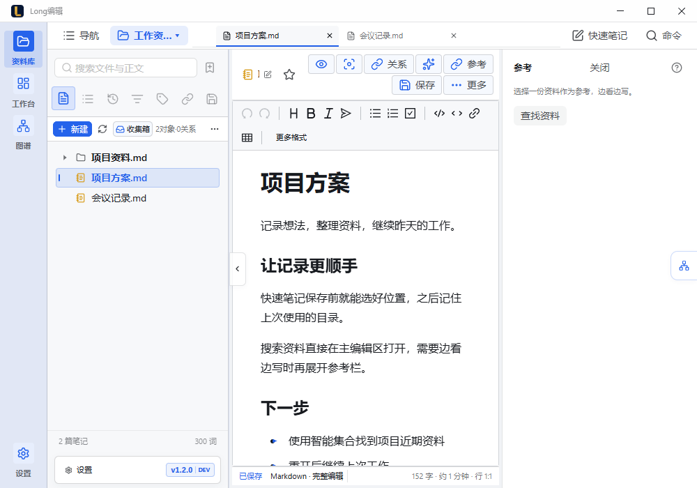
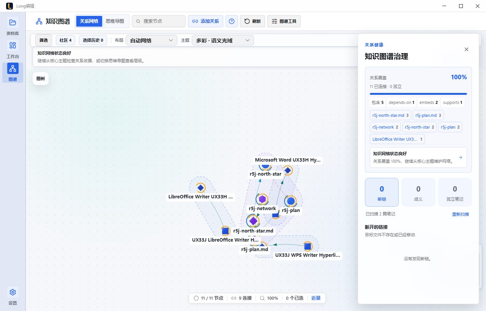
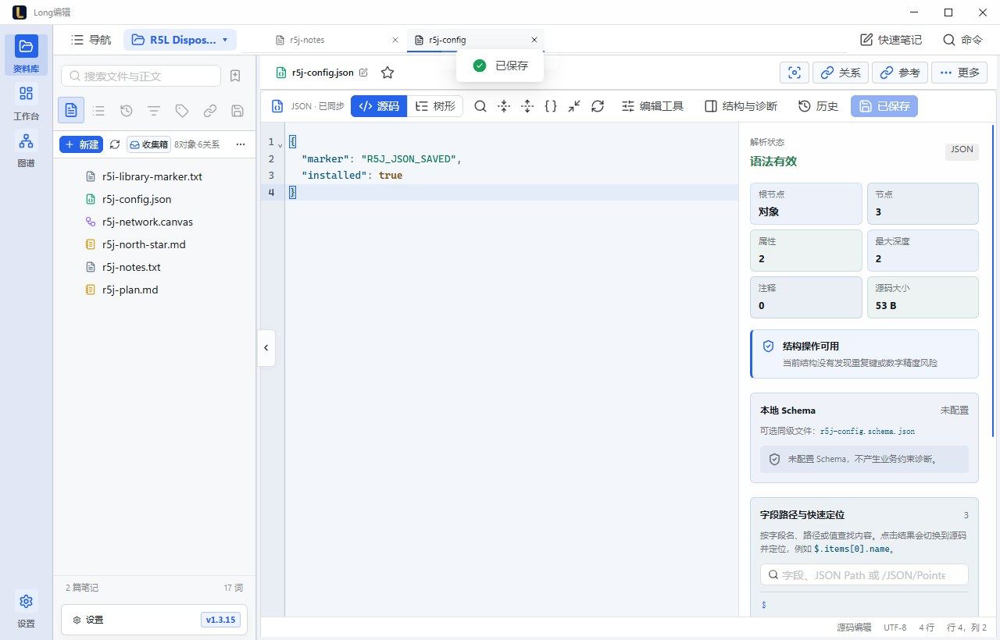
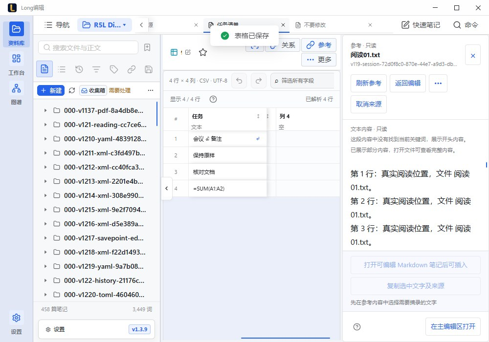
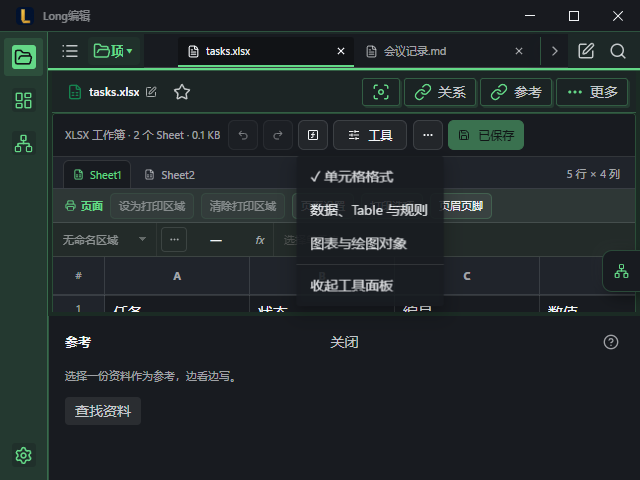
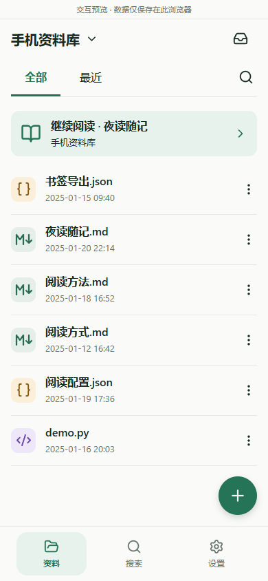
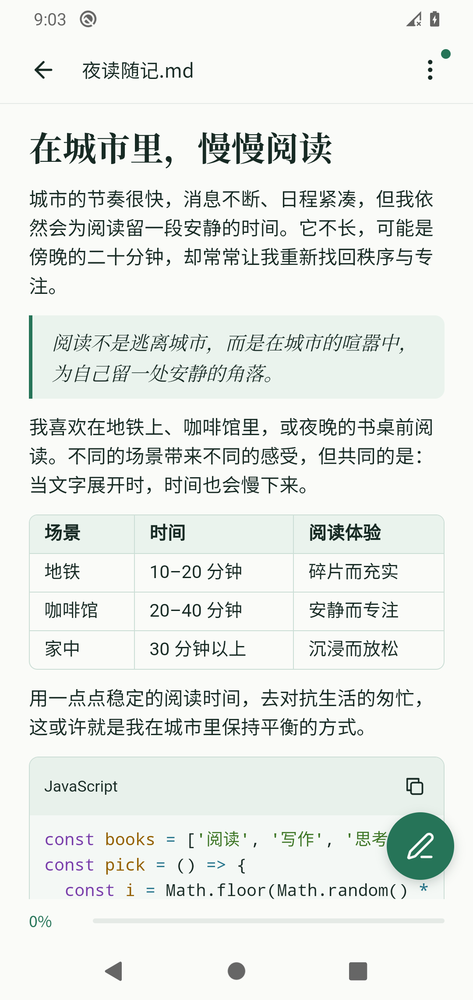
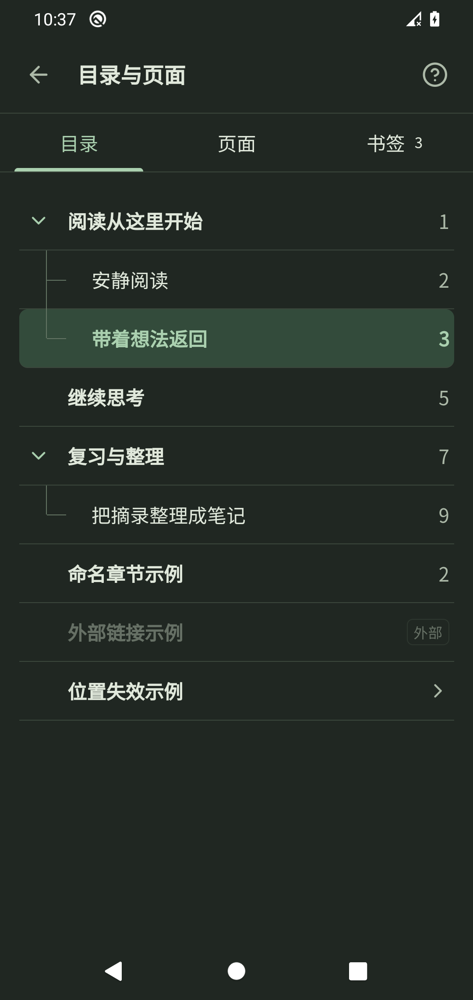

<p align="center">
  
</p>

<h1 align="center">Long编辑</h1>

<p align="center"><strong>用本地文件夹搭建你的知识库</strong></p>
<p align="center">写 Markdown、查资料、批注 PDF、编辑表格和配置文件，都在同一个工作区。</p>

<p align="center">
  <a href="https://github.com/Longyuyeee/Long_MarkDownReader/releases/latest"></a>
  <a href="#android-预览版"></a>
  
</p>

<p align="center">
  <a href="#下载"><strong>下载安装</strong></a> ·
  <a href="#知识库管理">知识库管理</a> ·
  <a href="#多格式支持">多格式支持</a> ·
  <a href="#界面与外观">界面与外观</a> ·
  <a href="#操作指南">操作指南</a>
</p>

<p align="center">
  <a href="docs/evidence/v120-reference-layout/library-1000-reference.png"></a><br>
  <sub>桌面工作区示例 · 资料库、Markdown 正文与按需展开的参考栏</sub>
</p>

## 知识库管理

把课程资料、项目文件或个人笔记所在的文件夹添加为资料库。文档保留原有目录和格式，资料库可在顶部随时切换。

- **整理文件**　在文件树用右键移动、批量重命名或回收文件，也可以把外部文件拖进资料库。用快速笔记把新想法存进收集箱或项目目录。
- **找回资料**　搜索文件名和正文，用标签按主题浏览，或把常用筛选保存为智能集合。给当前打开的一组文档保存「工作现场」，下次从工作台继续。
- **关联知识**　在笔记中引用文件与章节，也能给 PDF、表格、图片直接添加关系。用知识图谱查看关联，并从节点打开原资料。

<p align="center">
  <a href="docs/evidence/v1-3-15-candidate-lifecycle/installed-knowledge-guidance-graph.jpg"></a><br>
  <sub>知识图谱 · 浏览跨格式关联，检查断开的链接</sub>
</p>

## 多格式支持

桌面版注册了 **43 类格式、91 个扩展名**。从同一资料库打开文件，会进入适合该格式的编辑、阅读或预览工作区。

| 常用格式 | 可以做什么 |
| --- | --- |
| Markdown · TXT · LOG | Markdown 和 TXT 支持编辑与历史对照，LOG 提供日志查看。Markdown 可切换所见即所得、即时渲染与源码。 |
| JSON · YAML · XML · TOML | 查看语法和结构，定位字段并编辑。大 JSON 渐进只读，支持分段导航。 |
| CSV · TSV · Table | 编辑网格，筛选、冻结列、批量粘贴。Table 可按需要切换视图。 |
| XLSX | 在工作簿中切换工作表，编辑单元格与公式，使用筛选和样式。 |
| PDF | 查目录、搜索、批注，把摘录整理成带出处的 Markdown 笔记。 |
| DOCX · PPTX · ODS · ODP | 阅读及部分基础编辑。复杂内容按应用提示只读或另存副本。 |
| Canvas · OPML · Mermaid · Draw.io · SVG | 使用画布、思维导图或图形编辑器整理想法。 |
| 图片 · 视频 | 浏览图片、基础调整后另存，或播放视频并加载同名 VTT/SRT 字幕。 |

完整编辑、只读、另存副本与外部打开以文件工作区的提示为准。旧 Office/WPS 原生文件可能需要外部程序。[完整格式与保存能力](shared/release-capability-matrix.json)

<p align="center">
  <a href="docs/evidence/v1-3-15-candidate-lifecycle/installed-json-save-reopen.jpg"></a>
  <a href="docs/evidence/v1-3-9-candidate-lifecycle/installed-v1115-csv-reopened.jpg"></a><br>
  <sub>JSON 源码与结构诊断 · CSV 网格编辑与侧边参考</sub>
</p>

## 界面与外观

左侧找资料，顶部切换文档，中间专心处理内容。参考区按需打开，文件整理和低频动作放在右键或菜单中。长文阅读时可按 <kbd>F11</kbd> 进入专注模式。

在 **设置 → 外观** 可分别调整浅色／深色配色、控件质感与动效节奏。正文的字体、字号、行距和阅读宽度可单独调整，文件列表也支持密度、图标和颜色标记。

<p align="center">
  <a href="docs/evidence/v120-workbook-toolbar/neo-640-reference.png"></a><br>
  <sub>深色窄窗口 · 参考区随可用宽度调整位置</sub>
</p>

## 下载

### Windows 稳定版

当前公开稳定版为 **v1.3.15**，支持 Windows 10/11 x64。

| 安装方式 | 下载 |
| --- | --- |
| EXE · 推荐 | [LongEdit_1.3.15_x64-setup.exe](https://github.com/Longyuyeee/Long_MarkDownReader/releases/download/v1.3.15/LongEdit_1.3.15_x64-setup.exe) |
| MSI · 管理部署 | [LongEdit_1.3.15_x64_zh-CN.msi](https://github.com/Longyuyeee/Long_MarkDownReader/releases/download/v1.3.15/LongEdit_1.3.15_x64_zh-CN.msi) |
| 发布页与校验 | [Windows Release](https://github.com/Longyuyeee/Long_MarkDownReader/releases/tag/v1.3.15) · [SHA256SUMS.txt](https://github.com/Longyuyeee/Long_MarkDownReader/releases/download/v1.3.15/SHA256SUMS.txt) |

<details>
<summary>安装提示与校验方法</summary>

社区安装包未进行 Authenticode 签名，Windows 可能提示「未知发布者」。在下载目录运行 `Get-FileHash -Algorithm SHA256 .\LongEdit_1.3.15_x64-setup.exe`，对照发布页的 SHA-256 清单。自动更新会请求确认，并校验下载的安装包。

</details>

### Android 预览版

支持 **Android 10+ ARM64**，需要 Android System WebView 111 或更新版本。可打开手机本地资料库，读写 Markdown 和纯文本，浏览结构化文件，或给 PDF 添加批注。

[下载 Android APK](https://github.com/Longyuyeee/Long_MarkDownReader/releases/download/android-v0.1.0-beta.1/LongEdit-Android-arm64.apk) · [安装说明与校验值](https://github.com/Longyuyeee/Long_MarkDownReader/releases/tag/android-v0.1.0-beta.1)

<details>
<summary>查看手机界面与下载二维码</summary>

<p align="center">
  <a href="design/brand/android-preview/library.png"></a>
  <a href="design/brand/android-preview/markdown.png"></a>
  <a href="design/brand/android-preview/pdf-outline.png"></a><br>
  <sub>Android 交互预览 · 资料库、Markdown 阅读与 PDF 目录</sub>
</p>

<p align="center">
  <a href="https://github.com/Longyuyeee/Long_MarkDownReader/releases/tag/android-v0.1.0-beta.1"></a><br>
  <sub>用手机扫码打开 Android 发布页</sub>
</p>

</details>

## 操作指南

### 快速开始

1. **添加资料库**　在 Windows 启动 Long编辑，打开 **设置 → 资料库**，填入库名称，选择已有文件夹或输入新路径，点击 **添加库**，再点击 **切换**。
2. **打开资料**　在左侧文件树点击文档，或用 **搜索文件与正文** 找到它。顶部标签可切换已打开的文件。
3. **写下第一篇笔记**　点击顶部 **快速笔记**，选择资料库与保存位置，写完点击 **保存**。编辑已打开的文档时也可按 <kbd>Ctrl</kbd> + <kbd>S</kbd> 将草稿写入文件。

### 按任务查找

| 我想做什么 | 从哪里开始 |
| --- | --- |
| 边查资料边写 | 在搜索结果选择 **在侧边参考**。把参考里的选文和出处插入当前 Markdown。 |
| 给两份资料建立关系 | 在文档工具栏点 **关系**（宽窗口显示 **添加关系**），选另一份文件和关系类型，再去 **图谱** 查看。 |
| 保存常用搜索 | 在资料库侧栏打开 **智能集合**，按目录、标签或格式设置条件，保存为集合。 |
| 整理项目文件 | 在文件栏右键选择 **移动到**、**批量重命名** 或 **管理附件**。误删后可从文件栏菜单打开 **回收站**。 |
| 恢复上次的工作 | 打开 **工作台**，将当前打开的文档保存为 **工作现场**，下次按名称打开。 |
| 把 PDF 批注变成笔记 | 在 PDF 侧栏打开 **批注**，勾选条目后点 **整理为笔记**。[PDF 阅读笔记指南](docs/PDF_Reading_Notes_User_Guide.md) |
| 找回旧内容或迁移资料库 | 从文档菜单查看 **历史与差异**。迁移时在 **设置 → 隐私与诊断** 导出 **资料内容备份**。[备份与恢复指南](docs/Content_Backup_User_Guide.md) |

工作现场保存文档标签和视图状态。正文草稿通过保存写入文件，迁移资料使用内容备份。

<details>
<summary>快捷键与进阶指南</summary>

| 快捷键 | 操作 |
| --- | --- |
| <kbd>Ctrl</kbd> + <kbd>S</kbd> | 保存当前文档 |
| <kbd>Ctrl</kbd> + <kbd>P</kbd> | 打开命令面板 |
| <kbd>Ctrl</kbd> + <kbd>Shift</kbd> + <kbd>T</kbd> | 重新打开最近关闭的文档标签 |
| <kbd>F11</kbd> | 切换专注模式 |
| <kbd>F2</kbd> | 重命名文件栏中选中的项目 |

[写作与导出](docs/Writing_Delivery_User_Guide.md) ·
[附件管理](docs/Attachment_Management_User_Guide.md) ·
[查找与替换](docs/Document_Find_Replace_User_Guide.md) ·
[结构化文件编辑](docs/Structured_Editing_User_Guide.md) ·
[轻量表格](docs/Lightweight_Table_User_Guide.md) ·
[XLSX 工作簿](docs/Workbook_Editing_User_Guide.md)

</details>

## 最近更新

| Windows 稳定版 | 更新 |
| --- | --- |
| [v1.3.15](docs/RELEASE_NOTES_v1.3.15.md) | 在原文中更换单处文件链接的目标，支持草稿与撤销。 |
| [v1.3.14](docs/RELEASE_NOTES_v1.3.14.md) | 从文件链接返回来源，接续原来的草稿和位置。 |
| [v1.3.13](docs/RELEASE_NOTES_v1.3.13.md) | 返回后可前进到刚才的位置。 |
| [v1.3.12](docs/RELEASE_NOTES_v1.3.12.md) | 在结构提纲和源码位置之间往返。 |
| [v1.3.11](docs/RELEASE_NOTES_v1.3.11.md) | 查找后可返回编辑位置。 |

[全部发布](https://github.com/Longyuyeee/Long_MarkDownReader/releases) · [历史发布记录](docs/README_Release_History.md)

## 开发与反馈

项目使用 Vue 3、TypeScript、Tauri 2 与 Rust。Windows 开发需要 Node.js 22、Rust stable、WebView2 和 Visual Studio C++ 构建工具。

```powershell
git clone https://github.com/Longyuyeee/Long_MarkDownReader.git
cd Long_MarkDownReader
npm ci
npm run tauri dev
```

[开发指南](docs/Next_Development_Execution_Guide.md) · [问题反馈](https://github.com/Longyuyeee/Long_MarkDownReader/issues) · [AGPL-3.0 许可证](https://www.gnu.org/licenses/agpl-3.0.html)
