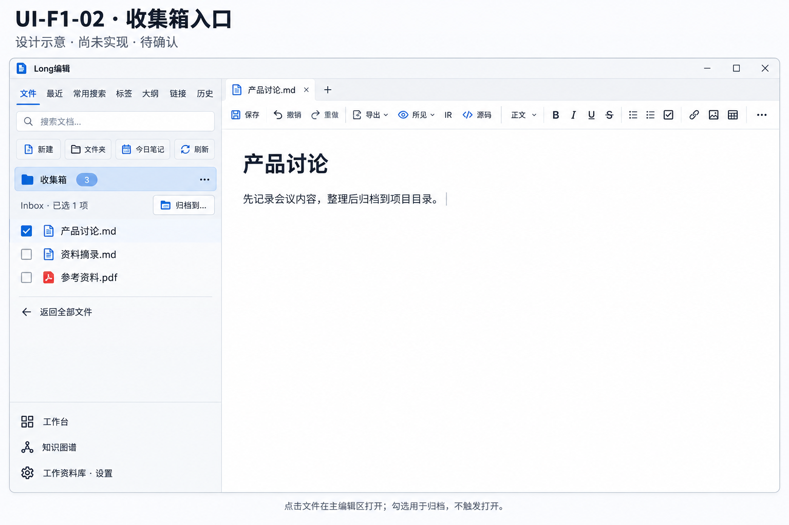
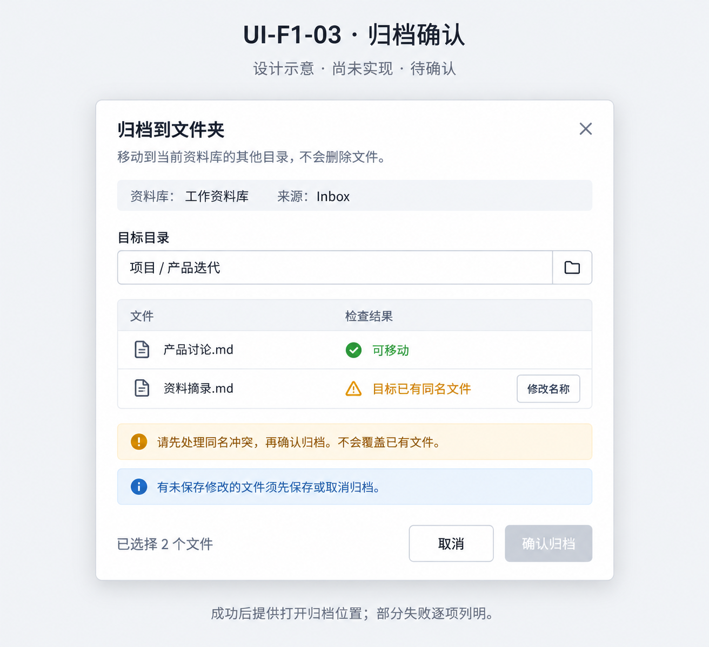

# F1 收集箱与归档：基线盘点及逐页提案

日期：2026-10-11。审计基线 `d57ede7f`。状态：**仅设计与代码审计，UI-F1-02 / UI-F1-03 均待用户确认，未实现**。不扩大为整个资料库外壳重构，不发版。

## 1. 观察与实际代码

已查看上一轮真实 [主编辑区截图](evidence/v110-quick-note-edges/main-opened-note.png)，对照当前 `src/views/LibraryMode.vue`：资料库有文件树、搜索及格式筛选、新建/模板、文件夹、今日笔记、刷新、七个侧栏页签、工作台/图谱与设置入口。Inbox 目前是普通目录，没有独立整理入口。不是本轮新跑出的功能验收。

`LibraryMode.vue` 的拖动逻辑调用 `move_items`，随后更新排序、刷新源/目标目录。`src-tauri/src/commands/files.rs` 中 `move_item` 校验库内路径、禁止移动根目录、遇同名报错；`move_items` 按顺序执行并在首个错误返回。因此不能直接把该命令包装成“批量全部成功/全部失败”的归档界面。

代码风险（未声称全部已运行复现）：

- 批量前几项可能已移动，后续冲突后前端只显示笼统错误；需要逐项结果，失败后根据磁盘重新核对，不能盲目全量重试。
- 移动的历史目录迁移失败被忽略；新归档不能承诺历史随文件完整迁移而不检查。
- 当前拖动片段只刷新目录，未在该片段看到完整的打开标签/草稿路径迁移；需追踪并回归，不把刷新文件树当完整闭环。
- Markdown 相对图片/附件链接、文件间链接可能受路径变化影响；当前 move_item 未进行这些重写。归档前须分析依赖；无法安全处理时阻止并解释，不静默破坏链接，也不擅自保存正文草稿。

## 2. UI-F1-02：资料库收集箱入口

方案：在文件侧栏已有工具栏下新增紧凑“收集箱”快捷入口，使用同一个侧栏显示待整理文件；主编辑区仍占主体，不新增第三列预览区。返回全部文件后恢复原有树视图。

- 点击文件名：通过既有主编辑区打开路径处理，不在侧栏编辑正文。
- 勾选：只选择归档对象，不触发打开；单选、多选均可进入“归档到…”。
- 目录默认 Inbox；“…”中提供设置收集目录（复用原生文件夹选择器，仅允许当前库内）和在文件树定位。收集目录配置须与快速笔记共享，不能与“上次保存目录”混为一谈。
- 第一批归档对象为文件；子目录保留浏览入口，不冒充整目录递归归档已受支持。首版不把目录里的全部内容误当可安全批量移动。
- 空目录、目录丢失、不可读、加载失败分别提示；失败不能显示“全部整理完成”。

| 现有功能 | 新位置/保留方式 | 回归要求 |
| --- | --- | --- |
| 文件/最近/常用搜索/标签/大纲/链接/历史 | 原侧栏页签全部保留 | 切换与键盘入口不减少 |
| 搜索、格式筛选、保存常用搜索 | 原搜索区保留 | 退出收集箱仍能恢复查询与结果 |
| 新建、模板、文件夹、每日笔记、刷新 | 原工具栏保留 | 不因新增入口隐藏原能力 |
| 文件树、右键操作、拖动与排序 | 全部文件视图保留 | 不以归档替代原操作；原行为单独回归 |
| 主区标签、编辑模式、格式工具、参考功能 | 保持原位置与功能，不属本次改版 | 文件打开与未保存正文保护不退化 |
| 工作台、图谱、设置 | 原位置保留 | 路由与切库仍可访问 |

图中为聚焦入口的示意，未完整展开的格式筛选/菜单不代表被删除；不把该图当作全外壳 UI 获批。

## 3. UI-F1-03：归档确认弹窗

归档即同一资料库内的显式移动，不是删除、压缩、云同步或修改原文件格式。

确认前显示来源、目标目录、逐项文件及冲突。已有同名项时默认阻止，用户可修改本次目标文件名；不覆盖原目标。存在未保存正文时阻止该项，回到编辑区自行保存或取消，不自动代存。

必须先整体预检再执行，但不承诺文件系统批量事务。执行过程中仍可能部分失败：保留逐项源路径/目标路径/结果，重新核对后只重试未完成项。成功后提供打开归档位置，能从新位置重新打开实际文件；不在未完成回滚机制前宣传“一键撤销”。部分失败结果界面的详细示意需补齐审批后实现，不把当前冲突态图当所有弹窗状态都已获批。

涉及的链接修复、附件移动和历史迁移须明确策略并通过故障验证，不接受“只移动文件名就验收完成”。

## 4. 确认后实施顺序

1. 先建立库级收集目录配置与入口，接通真实文件读取；保留快速笔记当前能力。
2. 建立归档预检和逐项结果合同，覆盖同名、越界、失效源、未保存草稿与关联依赖。
3. 经确认后接入归档弹窗；先单文件真实移动/复开，再批量及部分失败测试，审计后推送。
4. 补齐标签/历史/索引/链接一致性、目录配置切库隔离；未闭环项继续列账，不提前封板。

本轮使用内置 imagegen 生成设计图，提示词在 [生成记录](design/v1.1.0/UI-F1-02-03-prompts.md)。仅文档与图片变更，正式 UI 与移动后端未修改；不把代码审计当运行验收。
