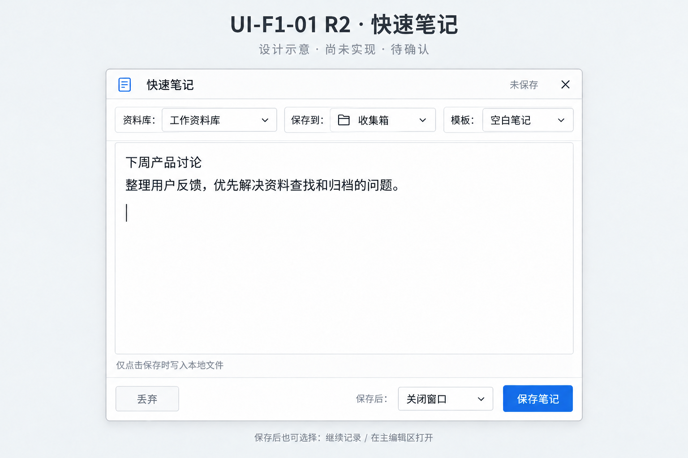

# v1.1.0 第一阶段：快速笔记基线与界面提案

日期：2026-10-11。代码基线：`c4732d99`。产品与运行版本仍为 1.0.26。

本文保留首次基线观察与设计过程。后续用户已明确批准 R2，正式实现进度见 [实施记录](V1_1_0_F1_QuickNote_Implementation_2026-10-11.md)；F1 尚未完成，未发布 1.1.0。总体需求以 [产品计划](V1_1_0_Product_and_UI_Plan_2026-10-11.md) 为准。

## 1. 代码审计

- `src/views/QuickNote.vue`：单个正文输入框、显式保存、丢弃、关闭、保存中禁用输入和重复提交、空输入警告、失败提示、保存成功后刷新资料库并关闭。
- `src-tauri/src/lib.rs` 的托盘 quick 入口：独立 400×300 窗口、置顶、无系统装饰；标题栏具有拖动区域。这些窗口能力不能因改版遗漏。
- 标题宣称“存入 Inbox”，但调用 `create_new_file` 未传 `targetDir`；`src-tauri/src/commands/files.rs` 默认使用资料库根目录。新设计必须明确真实目标，不能只换文案伪装收集箱完成。
- 保存先建空文件，再写正文。第二步失败可能遗留空文件，重试重新建文件的风险需要故障注入验证；当前是代码风险，不冒充已经复现的数据丢失。
- 正文写入成功后先清空输入，再发送刷新事件；刷新失败可能被统一提示为“保存失败”。需区分持久化成功与通知失败，不能鼓励用户重复保存。
- `store.isTempDirty` 与 `src/App.vue` 未保存状态/关闭保护联动；必须保留并实测独立窗口关闭、丢弃、取消确认。仅看到保护代码不等于窗口生命周期已通过。
- 后端已支持目标目录参数，优先复用受限路径校验；仍需审查原子写入、并发同名与重试幂等，不能单靠前端 loading 防重复。

## 2. UI-F1-01：仅快速笔记窗口

状态：**用户已明确确认“好的 就按这个方案来”；R2 获批，仅限快速笔记窗口**。下面是内置 imagegen 生成的历史设计稿，非运行截图；实施状态见独立记录。

R2 用户反馈落实：资料库、保存到、模板放在同一条紧凑工具栏，标签与当前值同行；取消独立模板行，把腾出的高度交给编辑区，不通过放大窗口制造空间收益。长名称省略但支持查看完整值与路径；仅在窄窗确实容纳不下时换行，不能遮挡输入或保存按钮。交互实现时仍须检验键盘访问、焦点和触控目标尺寸，不能靠无限缩小文字强塞一行。

[R1 原稿](design/v1.1.0/UI-F1-01-quick-note.png) 留存供对照；本次只修订设计资产与文档，不改正式界面。R2 生成提示词见 [记录](design/v1.1.0/UI-F1-01-r2-prompt.md)。

方向：以正文为主，明确“保存到哪里”和“保存后做什么”，保留显式本地保存。建议窗口约 560×460，尺寸仍须以实际布局验证；不能把画布像素直接当最终窗口尺寸。

| 现有功能/入口 | 新位置与行为 | 必须回归的用户场景 |
| --- | --- | --- |
| 托盘打开、置顶、拖动标题栏 | 保留原入口及原生窗口能力 | 工作中唤起、移动、再次唤起，不影响主编辑区 |
| 正文输入/自动聚焦 | 中央正文区，正文优先 | 中文输入、多行粘贴、长文滚动，不遮挡底部操作 |
| 立即存入文件库 | 右下“保存笔记” | 空内容不建文件；只有显式点击才写入 |
| 当前活跃资料库 | 可见的资料库与目标目录选择 | 库失效、目录不可写时保留输入；切库不串目标 |
| 丢弃、关闭 | 左下丢弃、右上关闭 | 有草稿时确认，取消后正文完整；保存中防误关闭 |
| 保存中保护 | 按钮忙碌态和输入保护 | 连点不重复、失败后可重试且不产生重复文件 |
| 保存后刷新并关闭 | 默认“保存后：关闭窗口” | 实际文件已落盘；通知失败不误报为正文保存失败 |
| 新增保存后动作 | 同一菜单选择继续记录/主编辑区打开 | 继续记录只清除已成功保存内容；打开到主区而非参考栏 |
| 新增模板复用 | 正文上方模板入口 | 复用既有模板；已有正文时不得无提示覆盖 |

示意图只展示正常浅色状态。深色、窄窗、缺失库、失败、保存中、未保存确认和菜单展开状态仍需补齐设计与实测，不视为已获批。资料库收集箱、归档弹窗等其他页面必须另出图、另确认。无既有专属快捷键在本轮被确认为已实现；新增快捷键必须避开中文输入和全局命令冲突。

## 3. 后续实施顺序与验收

1. 完成版本合同的跨小版本迁移审计：区分开发目标 1.1.0、运行/公开 1.0.26。当前机器合同 1.0.27 仍是待迁移的旧占位。
2. 用户确认 UI-F1-01 后，实现目标选择/记忆与可靠保存；先制定失败后重试、并发同名、磁盘成功但刷新失败的语义和测试，再接界面。
3. 补齐保存后继续/打开与模板保护，使用临时资料库按用户流程验收；不动真实资料库。
4. 收集箱和归档界面单独盘点、出图审批，再实现移动、同名保护、结果复开。
5. 每步审计、记录证据、提交推送；F1 闭环之后进入 F2。不得以单张示意图宣称全界面重构完成。

版本迁移已识别的热点：`check-development-version-identity.mjs` 下一补丁推算、`check-current-development-audit.mjs` / `lib/v121-updater-status.mjs` 的 1.0.27 条件，以及 `check-v1-community-release.mjs` 用补丁减一推导上一公开版本的逻辑。迁移需参数化测试覆盖 1.0.26 → 1.1.0，保留历史回执；本轮尚未修改这些规则。

## 4. 证据范围

基线脚本：`scripts/run-v110-quick-note-baseline.ps1`、`scripts/capture-v110-quick-note-baseline.mjs`。复用既有隔离原生调试构建/临时库/独立 WebView 配置，输出到 `docs/evidence/v110-quick-note-baseline/`，不覆盖 1.0.26 发布证据。

本轮观察限定为 QuickNote 路由的 400×300 渲染，不代表托盘创建、保存、关闭或 1.1.0 安装验收。设计图与真实基线证据分开存放。

实测结果：隔离调试构建成功，真实 WebView 已呈现旧输入框、关闭、丢弃及保存入口；截图中没有目标目录控件，正文与页脚在 400×300 下未重叠。见 [旧界面截图](evidence/v110-quick-note-baseline/quick-note-before.png) 与 [观察数据](evidence/v110-quick-note-baseline/observation.json)。视觉观察不替代保存落盘测试。

本轮验证记录：

- 初次执行脚本遇到动态脚本的 `$PSScriptRoot` 为空，修正为显式传递脚本目录；没有改动产品行为。
- 首次界面捕获因应用尚未初始化就切路由失败；补充等待临时库初始化后重跑成功，保留失败原因，不放宽页面出现条件。
- `cargo build --locked --manifest-path src-tauri/Cargo.toml` 成功；隔离基线脚本成功；脚本语法检查与 `git diff --check` 通过。
- 此提交无产品源码变更，未运行完整功能回归，也未宣称保存风险已修复。
