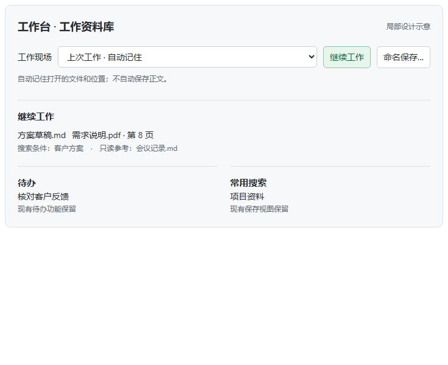

# UI-F2-01 工作台局部工作现场方案（待确认）

日期：2026-10-12。依据原 F2 需求与用户“不增加不必要步骤”的纠偏。当前代码 WorkspaceHome 有继续工作、待办和常用搜索；store 的标签恢复不是命名工作现场。以下为设计示意，未接正式页面，不计作功能完成。

## 交互原则

- 普通用户自动恢复上次工作，不要求先创建或命名工作区。
- 在现有工作台身份区增加一行“工作现场 / 继续工作 / 命名保存”，不占主编辑器空间；最近活动、待办、收藏、常用搜索、新建、打开及原导航全部保留。
- 命名保存是可选操作，只保存文件、搜索、参考与支持的阅读位置，不暗中保存正文。打开仍进入主编辑区。
- 切换时已有未保存文稿保留，不自动写盘或丢弃；遇缺失文件明确提示，不伪造内容。不同资料库隔离，配置删除不能删除实际文件。
- 首批在现有工作台完成入口；重命名/删除沿用上下文菜单，删除仅移除命名记录。具体未展示的新界面不能借本局部批准视为通过。

736/320px 已渲染查看，无横向溢出，命名/取消/继续的示意交互检查通过；不是生产功能验收。待用户确认后再修改正式界面。此审批点来自用户既定的“每界面修改前先看示意”要求，不取消 F3/F4 或全界面门禁。

## 接续实施

先建立每资料库隔离的版本化现场模型、旧状态迁移与持久化失败保护，再接工作台；随后验证重启、缺失文件、切库、草稿保留和失败重试。之后 F3 智能集合、F4 差异/副本恢复以及全界面和原生候选包验收。当前尚不具备封板条件。
