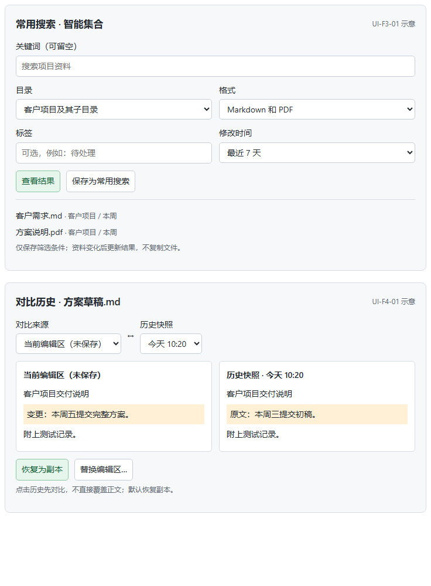
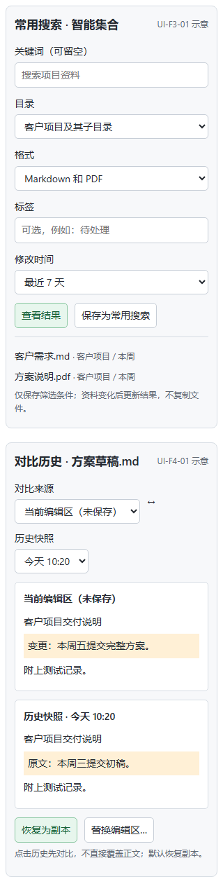

# UI-F3-01 / UI-F4-01 局部方案（已确认）

日期：2026-10-12。用户要求继续到封板再更新 README 和 Release，同时保留先看界面示意的约束。两处新界面合并提交确认，不将“继续开发”推定为对未展示设计的批准。

## UI-F3-01 智能集合

复用当前资料库搜索/常用搜索入口，筛选展开后可组合目录、格式、标签、修改时间；关键词可空。保存的是动态条件，不复制文件，不引入新的资料管理步骤。结果仍在主编辑区打开；支持修改已保存条件。窄侧栏按单列排布，不挤占编辑区永久空间。

代码审计：目前 `search_knowledge` 仅接受库路径和关键词；空关键词直接返回空结果。因此不能仅把条件加到前端、再从有上限的关键词结果中筛选，必须在后端候选范围和筛选层实现正确语义，并兼容已有保存搜索配置。

## UI-F4-01 历史差异恢复

沿用备份入口。点击历史先对比，不立即替换编辑区；对比来源可选当前草稿或磁盘。默认“恢复为副本”，唯一文件名、无覆盖并在主区打开。选择“替换编辑区”时明确确认，保护当前内容成功后再替换，不自动覆盖磁盘；文件、草稿或磁盘状态改变时重新核对。

## 示意与检查

以下为设计样例，不是真实搜索数据或已完成的生产界面。736/320px 渲染、无横向溢出及本地示意交互已检查；保持现有其他功能，不借局部批准移除原入口。

状态：用户在了解两个方向含义后回复“可以 那就增加”，已确认。依次实现 F3 后端/持久化/真实页面与变化刷新验收，F4 差异/无覆盖副本/草稿保护与复开验收，最后完成原生候选包及版本合同。未封板，不提前更新发布宣传或创建 Release。
