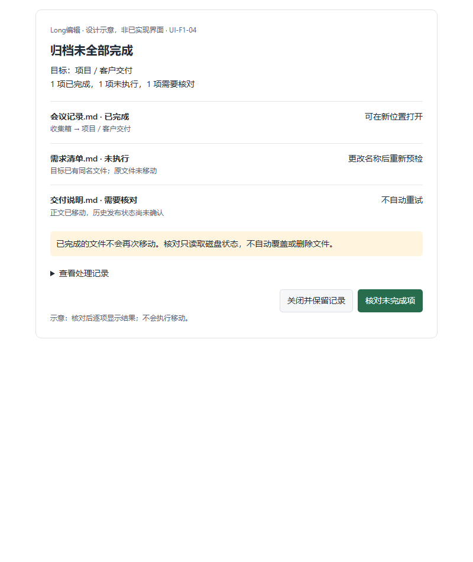

# 1.1.0 封板门禁与执行顺序

日期：2026-10-12。代码基线：4a5b5d42。目标：推进到封板，不擅自缩减已确认范围。结论：**尚不具备封板条件**。本文件为当前总接续点，历史逐步修复记录保留，但不能把测试数或提交数换算为产品完成比例。

## 本轮实际核查

后续实施更新：[新鲜窗口确认链路](V1_1_0_F1_Live_Window_Handshake_2026-10-12.md) 已接入预检回执与 App 原生事件监听；仍无执行期租约和用户归档闭环。以下门禁仍有效，不能将诊断 ready 视为执行许可。

- `package.json` 运行版本仍是 1.0.26，不提前升号。
- `src-tauri/src/commands/archive.rs` 仍仅暴露预检，`can_execute` 保持 false；这是正确的安全门禁，不应为上线直接改为 true。
- `src/components/InboxBrowser.vue` 有目录浏览、打开、刷新和目录设置，没有归档选择/执行/结果恢复闭环。
- `src/services/windowDrafts.ts` 已维护草稿活动与在途保存；不能由窗口缓存干净推断执行时全部窗口已确认。
- Workbook 绘图等近期改动补充了数据安全边界，不能替代 F1–F4 产品能力与全界面验收。
- `WorkspaceHome.vue` 已有最近活动、待办和保存视图；这些不是 F2 命名工作区恢复的完整验收证据。已有能力应复用而非重写；F2–F4 仍须按原计划逐条盘点，不将未审计内容武断计为完全缺失或已完成。

## 按优先级执行

| 顺序 | 必须交付 | 当前缺口/完成判据 |
| --- | --- | --- |
| 1 | F1 归档执行与恢复闭环 | 预检、实时窗口确认、执行重校验、无覆盖移动、依赖/历史/标签/索引/打开路径一致性、逐项结果与重启核对；失败不盲目全量重试；从真实入口完成归档并打开目标 |
| 2 | F2 项目工作区 | 复用现有标签/状态；命名保存切换、重启恢复、缺失文件、切库隔离、旧状态迁移与删除；不暗中保存或丢弃正文 |
| 3 | F3 智能集合 | 复用已有保存视图；目录/格式/标签/时间组合条件可查看修改，变化后刷新正确，过期请求不覆盖 |
| 4 | F4 历史差异恢复 | 草稿/磁盘/快照对比、副本无覆盖、替换保护、外部冲突、重新打开核验 |
| 5 | F5 决策和全界面改版 | 网页收集评估向用户反馈；逐页示意确认、功能位置对应表与回归，不拿一页批准代替全部页面批准 |
| 6 | 版本与候选包 | 审计 1.0.27 占位合同并迁移到 1.1.0；同提交构建 MSI/NSIS、安装升级回滚、公开附件回下载校验；最后才通知封板与发布 |

并行质量门禁：Workbook 剩余异步入口汇总与原生 XLSX 验收、跨窗口草稿确认、深浅主题/窄窗/键盘/输入法/减少动效和失败态。仅将可复现缺陷列为修复项，不无限扩展到未承诺的格式能力。既有完整 Office 等价编辑不在本版范围。

## 本轮验证（非封板证明）

- `cargo test --locked --manifest-path src-tauri/Cargo.toml commands::archive::tests -- --nocapture`：18 通过。
- `cargo test --locked --manifest-path src-tauri/Cargo.toml --lib archive --quiet`：89 通过，0 失败；这是名称含 archive 的测试筛选，含其他模块归档测试，不能称为 89 项用户流程验收；18 项包含在此筛选内，不相加。
- UI-F1-04 提案已在 800px、360px 渲染并检查截图，无横向溢出，示意交互通过。不是正式页面或真实归档结果。

## 审批点：UI-F1-04 归档部分失败与恢复

状态：**待用户确认，未实施正式 UI**。遵守最初每界面先示意再确认约束，“直接推进到封板”未明确取消此约束。

2026-10-12 更新：用户已明确回复“确认，按这个方向实现”。逐项结果组件和既有批准的预检入口已实施并查看真实页面，见 [实施边界](V1_1_0_F1_Plan_and_Archive_UI_2026-10-12.md)。此批准仅覆盖 UI-F1-04，不覆盖其他全局界面。

行为对应：

| 结果 | 呈现和后续行为 |
| --- | --- |
| 已完成 | 显示新路径，允许打开真实目标，不再次移动 |
| 未执行 | 说明阻塞原因；冲突处理后重新预检，不静默覆盖 |
| 需要核对 | 明确正文/历史的已知阶段，保留恢复材料，只读核对后再决定下一步 |
| 关闭 | 保留结果/恢复记录，后续可重新进入，不清理源或恢复材料 |

示意中的文件名与状态为样例，不是真实执行记录。首批不设置“一键全量重试”，不假装跨文件原子事务。功能位置沿用已批准归档确认流程的结果弹窗；关闭后的记录入口与更详细恢复操作如有新布局仍须单独示意审批。

下一步：确认此结果方向后继续执行协调和正式结果交互；不能因该图获批而视 F2/F3/F4 或全界面获批。封板前必须所有门禁有同版本证据，未获证据的项保持未完成。
