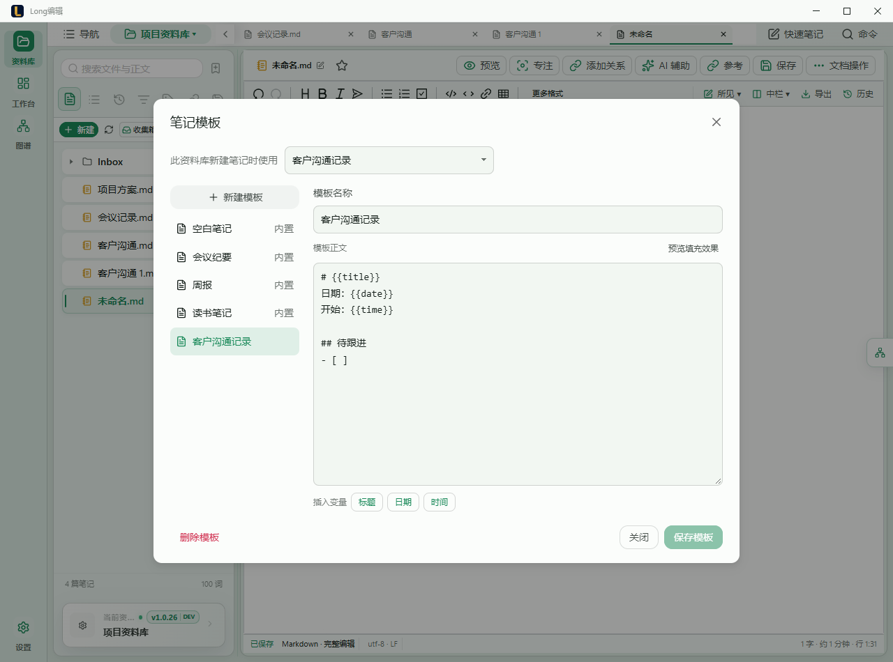
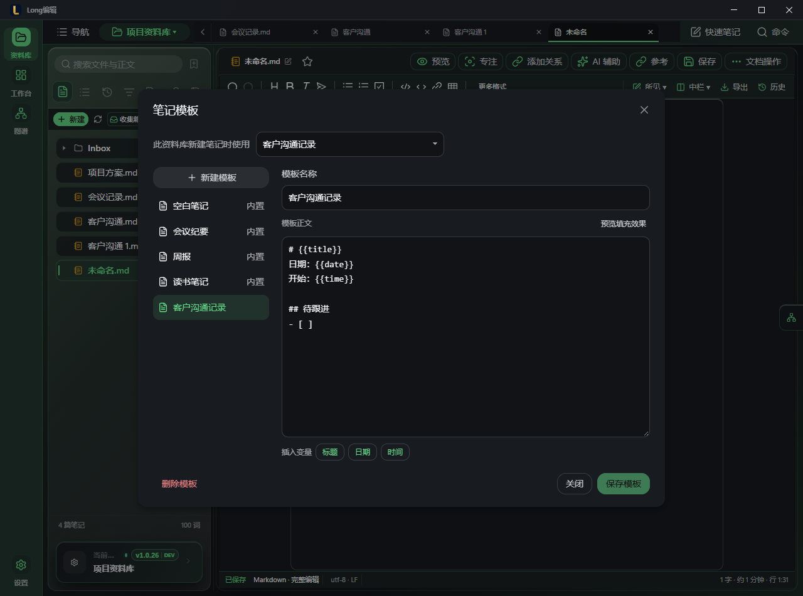

> 发布接续：本功能现已随 [v1.1.3](https://github.com/Longyuyeee/Long_MarkDownReader/releases/tag/v1.1.3) 正式发布，实际安装和附件结果见 [发布记录](V1_1_3_Unsigned_Community_Release_Audit_2026-10-15.md)。下方保留开发过程及验证范围。

# 自定义笔记模板

2026-10-15；开发分支 `codex/custom-note-templates`。公开版本仍为 1.1.2，下一目标 1.1.3。本批深化已确认的模板基础能力，不制作或发布新的安装包。

## 使用流程

- **重复使用笔记结构**：文件栏“新建 → 笔记模板”选择内置或自定义模板，在当前选定目录创建 Markdown 笔记。“空白笔记”始终可显式选择。
- **把现有内容存下来复用**：打开 Markdown 笔记，在“文档操作 → 保存为模板…”命名、修改结构后保存。取当前编辑器内容，包含未保存的修改，不要求先改写原文件。
- **维护模板**：“新建 → 笔记模板 → 管理模板…”打开弹窗。左侧选择，右侧编辑；支持新增、改名、删除、变量插入和填充预览。内置模板保留，可另存后修改。
- **减少重复选择**：弹窗顶部为当前资料库设置默认模板。新建菜单、目录右键新建 Markdown 和空白工作区的“创建新笔记”使用该默认；每日笔记和其他文件格式保持各自原有创建方式。
- **随手记录**：快速笔记共用相同模板；打开时使用当前资料库默认模板。切换模板前确认是否替换正文，取消时保留草稿。“继续记录”保存后准备下一份默认模板。主窗口模板更新会同步选项，不替换快速笔记正文。

## 数据与变量

自定义模板保存到应用本机配置，跨资料库共用；默认模板按资料库路径分别记忆，模板用稳定 ID 引用，改名后默认选择保持。最多 64 个自定义模板，名称 1–80 字、正文不超过 256 KiB，避免误把大型文档长期嵌入配置。

`{{title}}`、`{{date}}`、`{{time}}` 在使用时填充。日期/时间采用本机当前时间；资料库笔记标题采用最终文件名（不含扩展名），同名编号也会填入正文；快速笔记使用模板名称作为正文标题。模板预览展示填充后的文本，不执行用户内容。未知变量保持原样，替换结果不递归展开。

删除模板只删除模板及其默认引用，已创建的笔记保留。保存失败在弹窗内显示，输入与旧配置保持，可重试；关闭或切换尚未保存的模板会确认是否丢弃。模板编辑及保存参与现有窗口草稿保护。

管理备份延续不含正文的范围，不导出自定义模板正文；恢复管理配置时保留本机模板，旧机器路径的默认引用不迁移。设置页已说明这一点。模板跨设备导入/导出未在本批实施。

## 已完成验证

- [7 组实际页面流程、12 组六风格/宽窄弹窗布局](evidence/v113-note-templates/report.json)：当前草稿保存、变量预览、失败保留与重试、默认/显式/空白创建、重名标题、改名、快速笔记切换与保存、跨窗口更新不改草稿、删除后的默认回退及原笔记保留。页面使用真实 Vue 组件，原生 IPC 使用独立夹具。
- 原生新增 4 项测试通过：变量替换、旧配置兼容及配置序列化、重复名称与失效默认、真实临时目录中新建/重名/多级目录及目录范围。原配置 9 项、管理备份 5 项回归通过。配置读写仍走原有可靠写入；序列化测试不冒充真实安装器重启测试。
- `npm run build` 类型检查与生产构建通过；`npm run check:theme-contract` 与当前开发状态对齐检查通过。没有禁用正常动效；截图等待弹窗动画与通知自然结束。

## 接续

按 [基础功能路线](Foundation_Features_Upgrade_Plan_2026-10-14.md) 继续多文档操作，再到标签/集合、关系维护、常用文本历史；性能随每批持续改进。发布前再统一版本号与实际安装包检查，不在功能开发期间反复打包。

后续基础功能收尾已复核窄窗：760px 下侧栏按现有设计自动收起，点击“导航”展开后新建菜单和模板弹窗在六种风格下均可操作。此前“覆盖入口”的观察来自定位已收起侧栏，未确认产品叠层故障。多文档、标签/集合、关系维护、TXT 历史现也已实施，进入 [1.1.3 发布收尾](V1_1_3_Unsigned_Community_Release_Audit_2026-10-15.md)。
