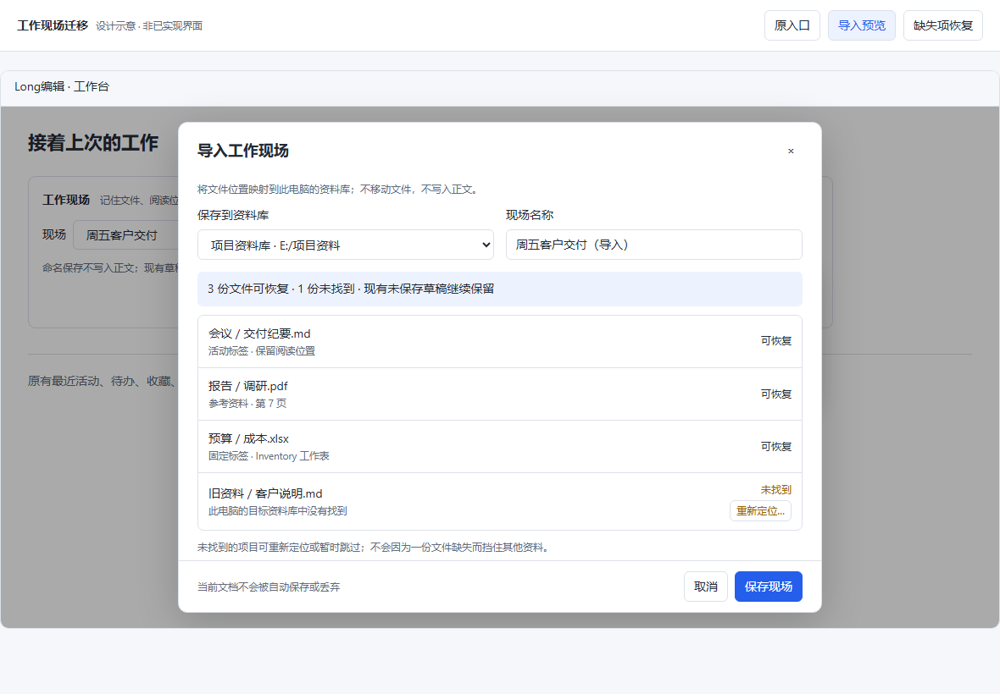

# v1.1.9 工作现场迁移与可靠恢复

## 需求、代码与当前边界

从已发布 **1.1.8 / main 952ba887** 接续。该提交完整 CI **39014294562 success**，976 项 Rust 功能通过、0 失败、5 既有忽略；上一版已完成公开回下载，不重复开发或重打旧包。本轮目标是按[十三版路线](Foundation_Deepening_Roadmap_1_1_8_to_1_1_20_2026-10-17.md)将 1.1.9 推进到封板发布，而非只完成本文件所述首批。

实际检查 `workSessions.ts`、`WorkSessionBar.vue`、store、搜索/视图/参考存储：原有命名/重命名/删除和 dirty 合并能力保留。缺口是本机 localStorage 绑定绝对根目录，没有导入/导出和真实文件预检；搜索选中键含原文摘要及绝对路径，不能直接复制进迁移包。专用编辑器也有局部草稿，恢复时不能只看文本 dirty 标记。

拉取历史标签时旧 v0.3.1—v0.3.4 本机与远端不同，Git 拒绝覆盖；保留这些标签，改用 `fetch --no-tags origin main` 安全同步。用户两份 `.misty_order.json` 未动。开发分支 `codex/v119-work-session-continuity`；当前运行时/公开仍 1.1.8，未封板或发布 1.1.9。

## 实施顺序与收口标准

1. 安全核心：版本化 `longedit-work-session` 元数据协议；库内相对路径，文件顺序/固定、阅读位置、活动文件及可选搜索/参考。白名单导出，剔除正文、草稿、搜索摘要、密钥、外部程序和旧绝对根路径。最多 128 文件、256 KiB，不静默截断。
2. 只读原生预检：目标须为已配置库，逐项返回可用/缺失/不可读/不支持；真实 canonical 边界拒绝库外目录别名、私有目录与敏感文件，不读取正文。只在主窗口允许新命令。
3. 原入口接入：管理现场增加导入/导出；导入到用户选定库并先预览。重名可改名，重复同源不产生多份记录；存储失败保留输入及原记录。重定位仅选择目标库内的真实可读文件。
4. 恢复按可用项接续，缺失项保留在命名记录以便后续修复；重新预检防过期。保留当前所有 dirty/专用编辑器模型及其活动标签，恢复其他干净文件与阅读位置，不代存、不写正文、不把现场当备份。
5. 实际 Vue 页面检查宽窄与六风格、失败/取消/过期/重复导入/存储不足；真实 Windows 安装态验证磁盘、重启、主窗口权限和已有全部历版功能。固定源码、MSI/NSIS、完整质量门及同包复核通过后封板，发布同字节并公开回下载。

## 界面示意与审批

[设计预览](design/v119-session-transfer.html)及 `evidence/v119-session-proposal/` 原图已经渲染并实看，1180/360px、三种状态、深色及示意交互通过；只证明方案可读，不是正式组件或原生验收。首次预览发现底部操作不可见、菜单层级压过弹窗，已在示意中修正；不将其写成产品缺陷已修。

已向用户展示导入预览并异步请求确认：原工作台保留，管理菜单导入/导出，弹窗列出可用与缺失项，允许重新定位/先恢复可用内容，底部动作固定可见。用户随后再次要求“每一次推进直接推进到封板……发布”；本轮沿已展示方向实施，不重复停在同一确认点，也不伪写为用户逐字批准每个细节。正式 `WorkSessionBar` 与 `WorkSessionTransferDialog` 已接入；以下早期核心验证不冒充新增 UI 或安装验证。

## 首批实际验证

- 新迁移模型、重复导入/存储失败/陈旧修复及原有兼容共 **21 项通过**。首次类型检查暴露项目目标不支持 `Array.at`，改用等价 `pop()`，未修改编译目标或删除检查；第二次类型检查通过。
- 原生核心初轮 **6 项通过**：新建不覆盖、UTF-8 BOM、坏结构/未知字段/超限、路径与设备名、真实文件分组、受配置库限制和重定位；实际 Windows 自有 junction 越界被拒绝，库外原文保持。初次新增未用 import 警告已移除；既有 `scan_visible` dead-code 警告保留。
- Windows 原生输入、完整正式页面、安装器与发布仍待执行，不能将单元测试和设计图冒充产品闭环。上述 21/6 是首轮数量，不作为最终批次数字。

## 安全补审与页面回归

1. 实际 `searchMatchKey` 的第八项是原文摘要。为真实 `useSearchReturn.remember` 增加检查，先得到 **3 通过/1 失败**；命名现场另得 **7 通过/1 失败**。现由自动与命名现场共用七项定位白名单，不再序列化摘要；旧 v1 读取只在内存解释、不静默覆写原记录，用户后续记住或命名时才写安全结构。实时结果仍重新读取，不改变正文或结果分页。复现日志原样保留。
2. 新预检模型初只校验标签路径，漏了独立参考文件身份。新增检查先得到 **6 通过/1 失败**，现对清单中全部 ready 项统一核对真实返回位置与请求身份，并拒绝额外/缺失/重复项。缺失记录仍保留，不能将另一文件当成原参考恢复。
3. 导入名称与记录标识又补先失败的 **5 通过/1 失败**：覆盖名称需有效且不超过 60 字符，标识不可空或冲突；校验在唯一一次存储写入前完成。重复同来源返回原记录，重名、陈旧修复、坏记录及配额失败不覆盖原字节。指纹只用于去重，不宣称来源签名。
4. 原生实现真实 canonical 边界与逻辑/真实类型一致检查，保留配置库路径拼写以兼容已有存储键；拒绝越界 junction、内部元数据别名、敏感路径、目录、超大及不支持文件。预检只读元数据/打开权限，不读取文档正文。导出只新建不覆盖，补拦 Windows ADS、DOS 设备名，导入仅接受普通文件和有界 UTF-8 元数据。主窗口标签检查接在四个 IPC 入口；随后真实 Debug Wry 复核已证明四条命令在快速笔记窗口全部拒绝（见下节），安装态仍须复验，不能用函数测试冒充 IPC 权限证明。
5. 纯模型/服务/旧现场/搜索返回补审 **31 项通过**（`core-closure.log`），再对照真实视图状态消费者补齐内部页面 ID 兼容后，最终 **32 项通过**（`core-final-audit.log`）。首轮 29 与后续 30/31 日志保留。真实 Vue App/LibraryMode/工作台回归通过：新增重启/摘要改变定位/旧记录读取与命名 **3 场景**；沿用上一版完整搜索页面 **9 场景 + 12 个六风格宽窄组合，0 页面异常**；原工作现场命名、配额、重启、草稿、重命名/删除取消及确认通过。实际原图已打开查看；未关闭正常动效，未改旧断言，历史截图目录未覆盖。
6. 对照 `DiagramStudio/TableView/WorkbookView/CanvasView/PptxReaderView/DrawioEditorView/PdfView/DocxReaderView/MindMapView/OdfContentReaderView` 的实际状态写入：内部页 ID 可带分隔符，不是磁盘路径。新增检查先 **7/1 失败**，修正“凡有 `/`、`:` 就拒绝”的过严规则；仍拒绝绝对盘符/UNC/POSIX 路径、外部 URL 与 `..`。没有改旧拒绝路径断言来换通过。

最终原生 **988 通过 / 0 失败 / 5 既有忽略 / 1 性能用例独立过滤**（`rust-functional-final-audit.log`），包含本模块 **12** 项；独立性能入口 **1 项通过**，4,457ms，在既定预算内（`rust-performance-final-audit.log`）。先前 986/987 是补审阶段数量，不是最终结果。只留下既有 `scan_visible` dead-code 警告；未启动本机原生 GUI 或安装产品。

最终完整 `npm run ci:patch-release` **退出 0**（`quality-gate-final-audit.log`），生产依赖 **0 漏洞**；包含生产构建/类型、既有能力及全部审计检查、Rust check。状态策略/需求入口已从旧“1.1.8 下一步”纠偏为本版核心开发，公开下载、固定标签和旧发布证据没有改动。`git diff --check` 通过；仅本批明确文件及已结束的证据入库，不纳入用户排序文件。该门通过只是安全核心检查点，不代表新版安装发布验收通过。

## 固定开发程序真实 IPC 与重启复核

安全核心产品 **6a3b1035** 已推送，PR **#58（Draft）**；其远端完整 CI **39016996509 success**，质量门和 **988 Rust/0 失败/5 既有忽略**与本地一致。未将未完成新版合入 main 或改下载。

为不让界面待确认阻断其余安全工作，单独 `codex/v119-native-session-audit` 固定产品 **6a3b10357bda9a2ee095fa07fe26cafd622a2ab0**，驱动 **3e426634f71e437a2d65ad3af575d1aa381a28e9**。只在一次性 GitHub-hosted Windows 构建隔离身份 Debug 开发程序，通过真实 WebView2/Wry 原生桥调用四个现场命令，**不替换 IPC 适配器、不直接桥 Rust 函数、不操作本机桌面**。

运行 **39017273250 success**：11 基线检查/25 实际调用、2 重启检查/4 调用通过。证明元数据导出排除正文/摘要/旧根，已有导出不覆盖，坏结构/超限拒绝，已配置新根部分恢复，越界/私有/目录别名拒绝，重定位只接受真实库内文件；四个命令在真正快速笔记窗口全部拒绝。真实 WebView 存储导入两次仅一份，重启同一程序仍能读到命名现场与导出文件，原文前后摘要一致。

两次程序 SHA-256 **3aafe9ced04a5209473ea4b5b66c7cbd8f99732e7153590d0f7ae0f0c827f201**，编译身份仍 **1.1.8**；不是候选安装器。GitHub 原始运行/步骤/控制台、未改写报告均在 [原生证据目录](evidence/v119-native-session/README.md)。收据另做 5 项驱动/证据正反校验，拒绝错误源码/驱动、丢检查、错程序、pending/failure 及冒充安装态。这里没有新 UI，不能把程序化 API/存储服务检查当成用户已能点击导入或正式恢复。

上述核心阶段浏览器检查使用真实生产 Vue 组件，但 IPC 是隔离模拟适配器，不是正式原生或安装态。截图中旧夹具注入的 v1.0.26/1.1.7 身份仅为夹具背景，不能作为当前运行时 1.1.8 或将来 1.1.9 的身份凭证。该阶段没有新导入 UI，设计图未算进上述通过项；正式 UI 实施见下一节。[核心证据索引](evidence/v119-work-session-core/README.md)。

## 正式交互与恢复保护

原管理入口接入导入/导出，保留命名、重命名、删除及键盘入口。导入先选配置库和名称、列出真实预检结果，只写命名元数据，不切库、不打开文件；同来源按原始输入指纹去重。导出默认不带搜索/参考，明确隐私和非正文备份边界，只新建文件。缺失项可重定位或继续可用部分，未修复项仍留原记录。

恢复先等现有保存结束，再核对库代次、记录快照和真实文件；核对期间文件变化需二次确认。保留 dirty 与已注册专用局部模型及活动标签，不代存。阅读/搜索/参考/标签元数据写入失败先回滚，原编辑器对象不替换；记录修复置于最后一次可失败写入。目标坏记录、取消、过期回复均保留原数据。

阅读位置采用最多 128 项惰性元数据队列，不扩大原 24 项正文/草稿缓存；40 项位置及重启已验证。旧本地现场超过 128 个文件仍按 128 一批预检并完整接续，只有新迁移文件限定 128；不可用项保留旧记录并提示，不静默删减原能力。

实际正式页面 **8 主场景 + 7 边界场景、12 宽窄/六风格组合、0 页面异常**，35 项模型/服务回归通过。实看深色截图发现背景与文字过渡不同步，改为统一表面而非屏蔽动效；最终深色及 360×540 原图已打开核对，底部动作可见。边界首轮夹具漏必填参考 query 被真实校验拒绝，修正夹具后重跑，未削弱产品校验。原现场浏览器回归通过。此处 IPC/文件选择仍为模拟，不能算安装态验收。[页面原图、报告和日志](evidence/v119-session-ui/README.md)。

## 剩余开发及发布门槛

- 正式 UI、异步预检/修复、草稿及保存保护已实现，浏览器回归通过；继续原生/安装态复验，不因单元或浏览器通过而跳过。
- 安装态验收包括超过 24 份视图现场，第一份为活动文件、稍后打开末尾文件；还需真实文件选择、主窗口权限、重启和磁盘不变。
- 安装驱动尚未开发：须新增当前版真实 IPC/磁盘/重启检查并继承全部历版；固定新源码和新 MSI/NSIS，再完整质量门、一次性远端安装及同包独立复核，通过才升公开事实并发布。不能复用 1.1.8 安装器声称支持 1.1.9。
- 未完成固定候选和安装复核前，不升公开事实、打标签、改 README 下载或创建 Release。还余十二个既定版本，全部完成后才需要新增基础能力深化规划。
