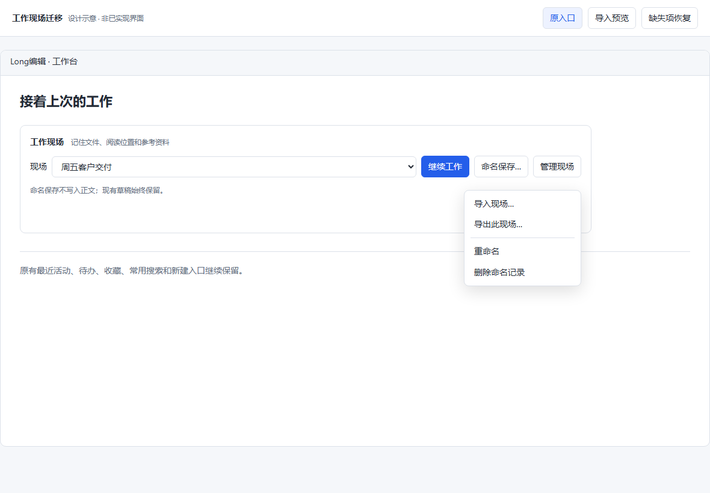
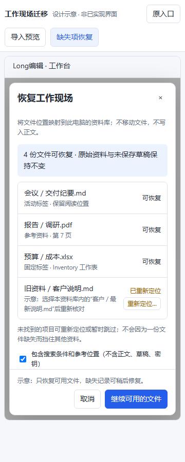

# v1.1.9 工作现场导入与恢复示意

保留工作台、命名保存、继续工作、重命名、删除及原有最近/待办/收藏入口。只在原“管理现场”菜单加入导入/导出，无新增常驻面板。未选择命名现场时仍可导入，导出/重命名/删除禁用。

导入文件先解析元数据，再选择已配置资料库和名称；显示可用、缺失及不可访问项。缺失文件可重新定位到该库内真实文件，也可先保存记录，之后恢复可用部分。导入只保存命名记录，不自动打开或代存当前正文；点击继续工作才进入主编辑区，现有草稿受保护。

正常恢复前也只读核对文件；有缺失项时沿用同一弹窗列明原因，允许修复或先继续可用内容。缺失记录不删除，能稍后再处理。弹窗内容独立滚动、底部动作固定；导出说明文件名/搜索词可能私人，现场不包含正文、不是内容备份。

以上图片保留为设计阶段原图，交互仅示例数据。原型检查 1180/360px、深色、缺失项重定位及确认反馈通过。示意展示和询问后，用户再次要求“每一次推进直接推进到封板……发布”；本轮沿已展示方案继续实施，不反复停在同一确认点，不将这条指令伪写为逐字批准弹窗细节。

正式组件现已接入原管理入口，实际生产 Vue 页面通过 8 个主场景、7 个边界场景、12 个宽窄/风格组合和 360×540 短窗口；不是仅有交互示意。原生及安装发布仍须独立验证，详见[开发审计](V1_1_9_Work_Session_Development_2026-10-17.md)和[页面证据](evidence/v119-session-ui/README.md)。
